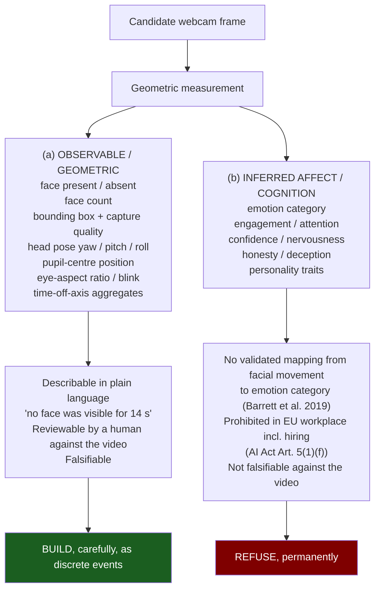
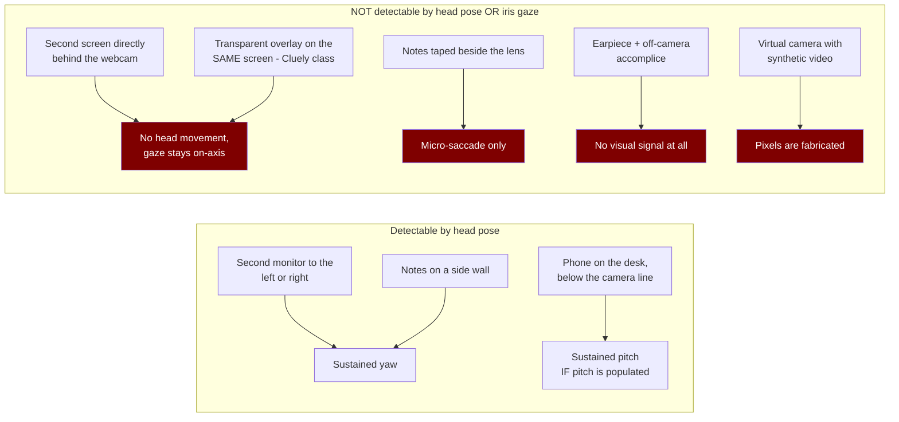

# Eye Tracking, Gaze and Facial Analysis in Secure Interview Mode — Research and Recommendation

**Prepared for:** the decision on whether and how KioMeet should add gaze / facial monitoring to secure interview mode.
**Type:** read-only external research plus an opinionated recommendation. No source file was modified; no git command was run.
**All sources checked:** 30 October 2026 unless a different date is stated inline.
**Builds on, and does not repeat:**
- `.agents/tasks/face-verification-design/external-research.md` (DPDP Act/Rules, GDPR Art. 9/22, BIPA/CUBI/RCW, NIST FRVT demographics, ISO/IEC 30107-3 PAD, virtual-camera injection, model licensing)
- `.agents/tasks/face-verification-design/codebase-recon.md` (authoritative file/symbol/line inventory)
- `docs/superpowers/specs/2026-10-27-interview-face-verification-design.md` (threat model §2, legal §7, architecture §8, failure modes and human override §13)

A consolidated **"Unverified / could not confirm"** list appears at §9. Content from sources was rephrased for compliance with licensing restrictions; every load-bearing claim carries an inline link.

---

## 0. Executive summary — the four findings that change the decision

**1. The EU AI Act makes emotion/affect inference in a hiring interview a *prohibited practice*, not a high-risk one — and it binds KioMeet as the provider, not just the customer.** Article 5(1)(f) prohibits "the placing on the market, the putting into service for this specific purpose, or the use of AI systems to infer emotions of a natural person in the areas of workplace and education institutions", with only medical/safety exceptions ([Article 5, Regulation (EU) 2024/1689](https://artificialintelligenceact.eu/article/5/)). The Commission's Guidelines on prohibited practices state that **hiring processes fall within the workplace context** for this prohibition, and the Dutch DPA reads it to reach recruitment and selection ([Future of Privacy Forum analysis of Art. 5(1)(f) and the Commission Guidelines](https://fpf.org/blog/red-lines-under-eu-)). Because the prohibition attaches to *placing on the market*, shipping an emotion/engagement/attention/confidence feature at all — even disabled by default — is the prohibited act for an EU-available product. The ban has applied since **2 February 2025** and carries the Act's top fine tier: up to **€35,000,000 or 7% of worldwide annual turnover** ([Article 99(3)](https://ai-act-service-desk.ec.europa.eu/en/ai-act/article-99)). **Consequence: everything in Part 2(b) is off the table permanently, not deferred.**

**2. The market has already run this experiment and retreated. Three independent retreats, all in the direction of less automation.** HireVue removed facial/visual analysis from its assessments (publicly announced January 2021), saying the visual component added little predictive value against the public concern it caused ([HireVue's own post](https://www.hirevue.com/blog/hiring/nonverbal-communication-in-interview-assessments); [SHRM](https://www.shrm.org/in/topics-tools/news/talent-acquisition/hirevue-discontinues-facial-analysis-screening)) — and still paid **$3.75M** to settle an Illinois BIPA class action over facial and voice biometrics collected through its video interview platform, class period 27 Jan 2017 – 25 Jun 2026 (*Deyerler v. HireVue*, No. 1:22-cv-01284, N.D. Ill.; [settlement notice](https://www.classaction.org/media/hirevue-long-notice.pdf)). ProctorU/Meazure Learning **stopped selling AI-only proctoring entirely in May 2021** and moved to human review of every session ([Meazure Learning announcement](https://www.meazurelearning.com/resources/proctoru-to-discontinue-exam-integrity-services-that-rely-exclusively-on-ai)). And the leading technical-interview platforms **do not do gaze tracking at all**: HackerRank's image analysis categories are exactly *multiple faces, secondary faces, no face, static face*, all routed to manual verification ([HackerRank support](https://support.hackerrank.com/articles/7825915809-impersonation-detection)); CodeSignal's Suspicion Score is built from paste events, similarity diffs and language switches — code telemetry, not faces ([CodeSignal KB](https://support.codesignal.com/hc/en-us/articles/16957476906135-Using-Suspicion-Score)); Karat uses trained human Interview Engineers who timestamp observed behaviour ([Karat](https://karat.com/detect-ai-use-technical-interviews/)). **Consequence: building gaze CV would make KioMeet more aggressive than HackerRank, CodeSignal and Karat, in the exact direction those vendors moved away from.**

**3. A vendor's own documentation says the quiet part out loud: face-based flags produce more false positives than true positives.** Respondus — which builds its own models and tests them across age, gender and skin tone — tells instructors in its product documentation that "there are more false positives than true positives" for flags relying on facial detection, and lists the causes: face turned away, cropping, caps, backlighting, low light, hands on face, certain glasses ([Respondus — How Review Priority is Determined](https://myfire.helpdocsite.com/respondus-lockdown-browser-editing-instructors/how-respondus-review-priority-is-determined-editing-instructors)). That is a structural base-rate result, not a model-quality one: when genuine cheating is rare, even an excellent detector yields mostly wrong flags (§6.3 works the arithmetic). **Consequence: no aggregate "integrity score". Discrete, timestamped, human-reviewable events only.**

**4. There is a narrow, defensible, cheap thing to build — and it is not gaze.** `VNFaceObservation` on macOS gives face count, bounding box, `roll`/`yaw`/`pitch` and `faceCaptureQuality` first-party, on-device, free, at the macOS 15.6 deployment floor; `VNFaceLandmarks2D` even exposes `leftPupil`/`rightPupil` regions (verified from Apple's documentation data endpoint, §5.1). But the highest-value signal by a wide margin is **face count ≥ 2** — "a second person was visible in frame" — because it is observable, nameable, non-inferential, and does not require any gaze model. Head-pose-off-axis is a defensible second. True iris gaze adds cost, a dependency, and false-positive surface while covering almost none of the residual threat, because a second screen placed *behind* the webcam defeats head pose and iris gaze identically, and an earpiece defeats both completely (§6.1). ARKit — the obvious route to eye transforms — **does not exist on macOS**: `ARFaceAnchor` lists iOS 11+ / iPadOS 11+ only (§5.2). **Consequence: Phase 1 is `face_absent` + `face_count` from `VNDetectFaceRectanglesRequest` alone. Gaze is Phase 3 and conditional on measurement.**

**Where the recommendation lands:** build a small, honest, on-device **presence and framing event recorder** — not a proctoring engine. Store events, never frames or landmarks. Produce no score. Never act automatically. Disclose fully and indicate persistently. Refuse, in writing and in code, to infer emotion, engagement, attention, confidence, honesty or personality. Full recommendation in Part 7; the decisions that need the user are in §7.9.

---

## 1. What commercial products actually do

Two notes on evidence quality before the tables. First, "what the vendor documents" and "what the vendor markets" diverge sharply and systematically: marketing pages assert emotion and eye-movement analysis far more often than support documentation describes it. Second, almost no vendor publishes an error rate; Respondus is the striking exception and is quoted accordingly.

### 1.1 Exam / education proctoring

| Vendor | Captured | Computed (documented) | Numeric score? | Decision | Disclosed to taker | Notes |
|---|---|---|---|---|---|---|
| **Proctorio** | Webcam video, screen, audio, device/network telemetry; room scan if enabled | "Face and gaze detection" algorithms, **only if the setting is enabled on that assessment**; per-frame characteristics delivered for every image regardless of setting | **Yes — "Suspicion Level"**, a percentage derived from the aggregation of frames deemed suspicious plus "abnormal behaviour"; per-metric severity weights are administrator-configurable and re-weighting **recomputes the score retroactively**; "Exam Metrics" compare one taker against the rest of the class | Vendor states it performs **no algorithmic decision-making** about whether integrity was breached; the administrator evaluates and decides | Varies by institution | Documented: [Proctorio FAQ](https://proctorio.com/faq), [Proctorio support FAQ](https://proctorio.com/support/hc/faq), [Proctorio — Where Machines Assist, Humans Decide](https://proctorio.com/blog/where-machines-assist-humans-decide); the score mechanics and configurable severity are documented by an institutional integrator ([MeasureUp](https://docs.measureup.com/how-to-understand-the-proctoring-report)) |
| **Respondus Monitor** | Webcam video, device/network telemetry, assessment interaction | **Facial detection** (not recognition for scoring) producing *Missing from Frame*, *Different person in Frame*, *Multiple persons in Frame*, *Partial Missing*; three sensitivity levels (Strict / Standard / Relaxed) where Strict fires when "both eyes of the test taker aren't visible" | **Yes — "Review Priority"** (Low/Medium/High) from a patent-pending process comparing the session against a system-wide baseline *and* against other takers of the same exam | Explicit in documentation: "Flags aren't cheating"; instructor reviews | Varies by institution | Most transparent vendor found. States plainly that facial-detection flags are "often incorrect" and that **false positives outnumber true positives**. Sources: [Review Priority](https://myfire.helpdocsite.com/respondus-lockdown-browser-editing-instructors/how-respondus-review-priority-is-determined-editing-instructors), [Sensitivity Levels](https://web.respondus.com/sensitivity-levels-in-respondus-monitor/), [Why We Do Our Own Machine Learning](https://go.respondus.com/Machine_Learning) |
| **Honorlock** | Webcam video, screen, audio; app detection on device | **Face detection, explicitly not recognition** — "does not identify the face, store any of the facial elements, or match the face to a database"; no-face / multiple-face triggers a human proctor; a human matches the ID to the taker | Not documented as a numeric score | AI flags → **human proctor intervenes**; human performs the ID match | Yes, via institution | [Honorlock — face detection vs face recognition](https://honorlock.com/blog/face-detection-vs-face-recognition-in-online-proctoring/); the non-storage and human-match description is from an institutional deployment page ([U. Wyoming](https://www.uwyo.edu/ctl/knowledge-base/honorlock-information.html)) — institutional restatement, not vendor primary. Honorlock now also sells **"Interview Integrity"** for hiring ([services page](https://honorlock.com/services/)) |
| **ProctorU / Meazure Learning** | Live human proctor + webcam/screen/audio | — | — | **Human review of every session.** Discontinued fully automated record-only AI-flagging services effective immediately in May 2021, migrating all partners off by the 2021/22 academic year | Yes | The single most decision-relevant vendor act in this space. [Meazure Learning announcement](https://www.meazurelearning.com/resources/proctoru-to-discontinue-exam-integrity-services-that-rely-exclusively-on-ai); corroborated by [Higher Ed Dive](https://www.highereddive.com/news/proctoru-scraps-fully-automated-remote-proctoring/600708/), [Campus Technology](https://campustechnology.com/articles/2021/05/24/proctoru-gets-rid-of-ai-only-proctoring.aspx), [Inside Higher Ed](https://www.insidehighered.com/news/2021/05/28/are-colleges-checking-ais-work-remote-exam-proctoring) (two staff now review footage so takers are not penalised for innocent actions, especially those with accommodations), and [EFF](https://www.eff.org/deeplinks/2021/06/long-overdue-reckoning-online-proctoring-companies-may-finally-be-here) |
| **ExamSoft / Examplify** | Webcam video, screen lockdown | Facial detection/comparison for ID and presence | Not publicly documented | Institution reviews | Varies | Independently reverse-engineered in a USENIX Security 2022 study which found that across four law-exam proctoring suites **all anti-cheating measures could be trivially bypassed**, and which tested Examplify's classifier for skin-tone disparity ([arXiv 2205.03009](https://arxiv.org/abs/2205.03009)). Subject of a 2020 US Senate inquiry over students of colour and students with disabilities being locked out or wrongly accused ([Blumenthal et al. letter, 3 Dec 2020](https://www.blumenthal.senate.gov/download/120320_-examsoft---letter-)) |
| **Mercer \| Mettl** (India) | Webcam, audio, screen, browser | Marketing describes detection of non-visibility of face, phone, talking, and "suspicious eye movement" | **Yes — "Candidate Credibility Index"**, framed as likelihood that a candidate resorted to unfair means | Reviewer-facing report | Varies | The Credibility Index is documented in the vendor KB ([Mettl support](https://support.mettl.com/portal/en/kb/articles/candidate-credibility-index-in-proctoring-reports-18-4-2023) — page returned a browser-gate when fetched; title and summary verified via search index). Claims such as "18 dynamic digressions with over 95% accuracy" trace to vendor marketing quoted in third-party decks ([institutional slide deck](https://www.dawsoncollege.qc.ca/ai/wp-content/uploads/sites/180/Garry-Chu-s-Slides-Used-during-2020-Ped-Day.pdf)) — **treat as marketing assertion, no methodology published** |
| **Talview (Proview)** (India) | Webcam, audio, screen, browser; optional 360° room scan | Candidate-facing documentation names "off-screen glances", "unusual eye movements", multiple faces, background voices, window changes, lighting changes — attributed to a patented "AI Proctoring Agent" | **Yes — "Proview Index"**, an indicator of integrity concern | AI flags → proctor or client review; "a flag does not automatically mean misconduct" | Yes, in candidate docs — but **candidates cannot see their own flags or event log** | [Talview — Why we use Proctoring and how it works](https://docs.talview.com/candidates/assessments/how-to/why-we-use-proctoring-and-how-it-works). The index definition page is behind an auth redirect; its existence and semantics are visible in the support index |
| **HirePro** (India) | Webcam, audio, video, image | Blog content claims algorithms work through "facial expressions, eye movement and pattern recognition", and that audio+video+image proctoring detects 98% of cheating | Not documented | Mix of live, recorded and automated | Varies | **No technical documentation found.** Every capability statement located is on marketing/blog pages ([features](https://hirepro.in/resources/blogs/ai-for-remote-proctoring-securing-the-future-of-assessments/), [98% claim](https://hirepro.in/resources/blogs/effectiveness-of-ai-and-traditional-proctoring-a-comparative-study), [facial expressions claim](https://hirepro.in/resources/blogs/common-myths-about-ai-based-remote-proctoring-system)). Classify as **marketing assertion, unverified** |

### 1.2 Technical-interview and AI-video-interview platforms

This is KioMeet's actual competitive set, and the pattern is the opposite of the exam-proctoring set.

| Vendor | Face/gaze signals | Integrity score | Decision | Notes |
|---|---|---|---|---|
| **HackerRank** | **No gaze tracking.** Image Proctoring captures webcam stills at intervals. Image Analysis flags exactly four categories: **Multiple faces** (≥2 in one frame), **Secondary faces** (≥2 unique faces at different times), **No face**, **Static face** (static image projection — i.e. spoof detection). Both features are **disabled by default** and require an explicit "Agree & Enable" confirmation | No face-derived score | Flagged images appear in the Summary Report "for manual verification"; up to five images per category | [HackerRank support — Image Proctoring and Image Analysis](https://support.hackerrank.com/articles/7825915809-impersonation-detection). Note how closely those four categories match the recommendation in Part 7 |
| **CodeSignal** | Proctored evaluations record camera, mic and full screen, plus a government photo ID; a **CodeSignal verification team reviews** that the streams ran and the ID is valid. No documented gaze or facial-behaviour computation | **Yes — "Suspicion Score"** per question (None → High) plus an "Integrity Flagged" consolidation — built from **paste events, similarity diffs, description copying, language switches, replay timing**. Code telemetry, not faces | Explicit: "Yes" does not mean the taker cheated; it marks a place to look. Documentation warns that innocent behaviours can look suspicious | [Suspicion Score](https://support.codesignal.com/hc/en-us/articles/16957476906135-Using-Suspicion-Score), [What is proctoring](https://support.codesignal.com/hc/en-us/articles/360039872174-What-is-proctoring-and-how-does-it-work). **The strongest existence proof that a credible integrity signal need not touch the face at all** |
| **Karat** | **Human observation.** Trained Interview Engineers are instructed to identify suspicious behaviour and "discreetly document and timestamp" it without disrupting the interview; publicly named behavioural signals include screen switching and instant fully-formed solutions | No documented automated score | Human-led | [Karat — detecting AI use in technical interviews](https://karat.com/detect-ai-use-technical-interviews/); the Interview Integrity help article is access-gated (403) and is cited via the search index. The *architecture* is the finding: the interviewer is the detector |
| **HireVue** | **Withdrawn.** Visual analysis removed from new assessment models (decision taken in 2020, announced January 2021). Current public position: the AI relies only on what the candidate says, with no video analysis and no other audio characteristics | Verbal/NLP scoring only | Human-reviewed with published algorithmic audit (ORCAA) | [HireVue — New Audit Results, Decision on Visual Analysis](https://www.hirevue.com/blog/hiring/nonverbal-communication-in-interview-assessments), [HireVue press release](https://www.hirevue.com/press-release/hirevue-leads-the-industry-with-commitment-to-transparent-and-ethical-use-of-ai-in-hiring), [Wired](https://www.wired.com/story/job-screening-service-halts-facial-analysis-applicants/), [Fortune](https://fortune.com/2021/01/19/hirevue-drops-facial-monitoring-amid-a-i-algorithm-audit) |
| **iMocha / Mettl / Talview / HirePro** | See §1.1 — the Indian-market vendors run one engine across exams and interviews, so their proctoring posture carries into hiring | Yes (indices) | Reviewer-facing | iMocha: no primary documentation of gaze computation was located during this research; recorded as not established (§9) |

### 1.3 The withdrawal history, verified

This history is the most useful single input to the decision, because it is the industry grading its own homework.

- **HireVue, January 2021 — facial-expression/visual analysis discontinued.** Reasons given by the company, in its own words and its CEO's: research indicated verbal and non-verbal behaviours were aligned so the non-verbal data added little to the predictive model, NLP had improved enough to carry the assessment, and the visual component had come to cost more in public concern than it contributed ([HireVue blog](https://www.hirevue.com/blog/hiring/nonverbal-communication-in-interview-assessments); [SHRM, quoting CEO Kevin Parker](https://www.shrm.org/in/topics-tools/news/talent-acquisition/hirevue-discontinues-facial-analysis-screening); [Staffing Industry Analysts](https://www.staffingindustry.com/news/global-daily-news/hirevue-announces-visual-analysis-no-longer-part-software-amid-natural)). External pressure is part of the record: EPIC filed an FTC complaint against HireVue in 2019 ([Wired](https://www.wired.com/story/job-screening-service-halts-facial-analysis-applicants/)), and the academic literature records the withdrawal as following sustained criticism including the concern that such models penalise atypical affect ([AI & Society, 2025](https://link.springer.com/article/10.1007/s00146-025-02309-7)). **Note carefully: withdrawing the feature did not extinguish the liability** — the BIPA class action covered a period running to June 2026 and settled for $3.75M.
- **ProctorU / Meazure Learning, May 2021 — AI-only proctoring discontinued.** Effective immediately, no more fully automated record-only services with AI flagging for downstream review; all such partners migrated to human-review proctoring ([announcement](https://www.meazurelearning.com/resources/proctoru-to-discontinue-exam-integrity-services-that-rely-exclusively-on-ai)). The company's own public argument was that AI was never an effective substitute for human monitoring ([Times Higher Education blog by ProctorU](https://www.timeshighereducation.com/blog/ai-only-proctoring-risky-and-doesnt-work-were-not-doing-it-any-more)).
- **Proctorio's positioning shift.** Proctorio's current public framing is that it records and detects without judging, and that it performs no algorithmic decision-making about integrity breaches ([FAQ](https://proctorio.com/faq); [blog](https://proctorio.com/blog/where-machines-assist-humans-decide)). It still ships a numeric Suspicion Level. That combination — a number that the vendor insists is not a verdict — is precisely the artefact §7.2 recommends against building.

---

## 2. The spine: observable signals versus inferred mental states

Everything that follows depends on holding this line. The two categories look similar in a feature list and are completely different in scientific validity, legal status and defensibility.



### 2.1 Category (a): observable and geometric

These are measurements of pixels and geometry. A human reviewer can look at the same video segment and agree or disagree:

| Signal | What it literally is | Defensibility |
|---|---|---|
| Face present / absent | Did the detector return ≥1 face rectangle | High. Directly checkable against the frame |
| **Face count ≥ 2** | Did the detector return ≥2 face rectangles for a sustained period | **Highest of any signal here.** Maps to a specific, nameable, non-inferential event; a reviewer sees the second person or does not |
| Bounding box area / position / `faceCaptureQuality` | Framing and image-quality floats | High, but these are *data-quality* signals, not conduct signals. Respondus folds data quality into Review Priority explicitly, which is honest and worth copying conceptually |
| Head pose `yaw` / `pitch` / `roll` | Rigid-body orientation of the head | Medium-high as a measurement. **Low as an inference about intent** — "turned 40° right for 6 s" is a fact; "was reading notes" is not |
| Pupil-centre offset within the eye region | 2D geometry | Medium as a measurement, **low in practice** on a webcam at interview distance without calibration (§5.3) |
| Eye-aspect ratio / blink / eyes-closed duration | Eyelid geometry | Measurable, but the use cases are drowsiness and liveness, not integrity. Recommend against collecting it: it has no integrity interpretation and reads to a candidate as medical surveillance |
| Time-off-axis aggregates | Sums of the above | Only as defensible as the underlying event, and aggregation is where honest measurement turns into an implied verdict (§7.2) |

Even here, the gap between measurement and meaning is where products go wrong. Respondus names the measurement (*Missing from Frame*) rather than the interpretation, then tells the instructor the flag is often incorrect. HackerRank names *No face* / *Multiple faces*. Neither claims to have detected cheating. That naming discipline is a product decision available to KioMeet for free, and it is most of the defensibility.

### 2.2 Category (b): inferred affective and cognitive states

**There is no defensible scientific basis for inferring emotion from facial movement, and the leading review in the field says so in terms.**

Barrett, Adolphs, Marsella, Martinez and Pollak, *Emotional Expressions Reconsidered: Challenges to Inferring Emotion From Human Facial Movements*, *Psychological Science in the Public Interest* 20(1), 1–68 (2019) surveyed the evidence for the "common view" that a person's emotional state can be read off their face, across the six most commonly used categories (anger, disgust, fear, happiness, sadness, surprise). Its findings, restated:

- People do sometimes produce the stereotyped configuration — smiling when happy, scowling when angry — at better than chance rates. That is the *only* part of the common view the evidence supports.
- **How people express each of those six categories varies substantially across cultures, across situations, and even across people within a single situation.**
- **The same configuration of facial movements variably expresses instances of more than one emotion category**, and a given configuration — a scowl, for example — frequently communicates something that is not an emotional state at all.
- The authors conclude there is an urgent need for research into how people actually move their faces in everyday contexts, and they direct that conclusion explicitly at consumers of emotion research — naming legal judgments, policy decisions, national security protocols, educational practices and commercial applications as domains currently relying on the unsupported assumption.

([Abstract, PubMed 31313636](https://pubmed.ncbi.nlm.nih.gov/31313636); [journal page](https://www.psychologicalscience.org/journals/pspi/1529100619832930/); [APS release](https://www.psychologicalscience.org/news/releases/emotion-expressions-pspi.html); a corrigendum was published at *Psychol Sci Public Interest* 20(3):165–166, which does not disturb these conclusions.)

The paper's own framing is the one to adopt: a system that maps facial configurations to emotion labels is not measuring emotion — it is measuring facial movement and then guessing.

The downstream literature has not rehabilitated the practice. Kate Crawford's *Nature* comment "Time to regulate AI that interprets human emotions" (2021) is formally indexed as a comment on the Barrett review ([Nature 592:167](https://pubmed.ncbi.nlm.nih.gov/33824522/)). The same critique has been extended to voice-based emotion inference as resting on tenuous assumptions about the science of emotion ([NYU Steinhardt, on Kang's work](https://steinhardt.nyu.edu/news/alexa-am-i-happy-how-ai-emotion-recognition-falls-short)). And — decisively for this decision — the EU legislature adopted the critique as the stated basis for a statutory ban: **Recital 44** of the AI Act records "serious concerns about the scientific basis" of emotion-inference systems, naming **limited reliability, lack of specificity and limited generalisability**, and noting that expression of emotion varies considerably across cultures, situations and within a single individual ([Recital 44](https://www.euaiact.com/recital/44)).

**Deception and honesty inference is worse, not better.** Two settled results in the deception literature:

- Human lie-detection accuracy across more than 200 experiments averages **54%** against a 50% chance baseline — a ~4-point edge, with an accuracy ceiling around 67% ([Bond & DePaulo 2006, as summarised in the peer-reviewed literature](https://www.mdpi.com/2076-3417/13/16/9188); [Levine, *Current Opinion in Psychology*](https://timothy-levine.squarespace.com/s/Levine-2015-COPSY-New-Improved.pdf)).
- The reason is not that observers use the cues badly; it is that **the valid behavioural cues are weak to absent**. The lens-model meta-analysis of human lie judgments found both proposed explanations in play — reliance on invalid cues *and* a genuine scarcity of valid ones ([Hartwig & Bond, *Why Do Lie-Catchers Fail?*](https://www.researchgate.net/publication/51251661_Why_Do_Lie-Catchers_Fail_A_Lens_Model_Meta-Analysis_of_Human_Lie_Judgments)).

A model trained to predict deception from faces is therefore trained against a signal the field has been unable to establish exists at usable strength. Note too that the AI Act treats polygraphs "or similar tools" as high-risk in law-enforcement and migration contexts (Annex III 6(b), 7(a)) — the legislature's view of the technique is visible in where it placed it.

**Also in category (b), and often missed:** "engagement", "attention" and "focus" are affective/cognitive inferences even when they are computed from gaze geometry. "Looked off-axis for 40% of the session" is category (a). "Was 60% engaged" is category (b) wearing a geometry costume. The AI Act Guidelines note that attitude and emotion are treated as equivalent for the purposes of the prohibition, specifically to prevent circumvention by renaming ([FPF analysis](https://fpf.org/blog/red-lines-under-eu-)). Renaming will not work.

One useful boundary from the Act's own recitals: **physical states such as pain and fatigue are not "emotions"**, and the mere detection of readily apparent expressions, gestures or movements (a frown, a smile, a head movement, a raised voice) is outside the definition **unless used to identify or infer emotions** (Recital 18, as analysed by [FPF](https://fpf.org/blog/red-lines-under-eu-)). That is exactly the gap KioMeet should occupy: measure the movement, never infer the state.

**Plain answer to the question asked:** category (b) has no defensible scientific basis, and in the EU workplace — including hiring — it is prohibited outright. Do not build it, do not stub it, do not leave a disabled toggle for it.

---

## 3. Legal landscape specific to gaze and facial analysis in hiring

This part covers only what the prior memo does **not**. General DPDP/GDPR/BIPA/CUBI obligations, NIST demographics and PAD standards are in `external-research.md` §§7–11 and are not restated.

### 3.1 EU AI Act Article 5(1)(f) — emotion inference in the workplace is a prohibited practice

**The scope, quoted precisely.** Article 5(1) prohibits, among other practices:

> "…the placing on the market, the putting into service for this specific purpose, or the use of AI systems to infer emotions of a natural person in the areas of workplace and education institutions, except where the use of the AI system is intended to be put in place or into the market for medical or safety reasons"

(Art. 5(1)(f), Regulation (EU) 2024/1689; text verified at [artificialintelligenceact.eu/article/5](https://artificialintelligenceact.eu/article/5/), which records the Article as in force from 2 February 2025 per Art. 113(a).)

**Does a hiring interview count as "workplace"? Yes.** The European Commission's Guidelines on prohibited AI practices interpret the workplace context broadly, covering any physical or virtual space where work is performed, and **state specifically that hiring processes fall within the workplace context for the purpose of this prohibition**. Education institutions are read equally broadly, explicitly including admissions procedures. Recital 44 extends the prohibition to systems used in situations *related to* the workplace and education, and the Dutch DPA reads that to include home working environments, online/distance learning, and emotion recognition applied to recruitment and selection. ([FPF, *Red Lines under the EU AI Act* blog 6, analysing Art. 5(1)(f) and the Commission Guidelines](https://fpf.org/blog/red-lines-under-eu-).) Two further practitioner sources reach the same reading: emotion recognition in recruitment is first a legality question and disclosure does not cure it ([Warden AI](https://www.warden-ai.com/resources/eu-ai-act-article-50-recruitment-transparency-rules)), and for many scenarios the threshold question is not how to disclose but whether the system can be deployed at all ([Stibbe](https://www.stibbe.com/publications-and-insights/feeling-watched-transparency-obligations-for-emotion-recognition-and)).

**The cumulative conditions, and the boundaries that narrow them.** The prohibition bites only when all of these hold: the act is placing on the market, putting into service for this purpose, or use; the system is used specifically to infer emotions; the setting is the workplace or an education/training institution; and the medical/safety exception does not apply. Narrowing points:

- It covers **inference of emotions**, not "emotion recognition systems" generally. The Art. 3(39) definition also reaches *intentions*, but neither Art. 5(1)(f) nor Recital 44 mentions them — so inference of intentions sits in a genuinely unresolved zone, and the Dutch DPA reads the prohibition to cover both identification and inference of emotions and intentions.
- It is limited to inferences **based on biometric data**, defined in Art. 3(34) as personal data resulting from specific technical processing relating to physical, physiological or behavioural characteristics, such as facial images. The AI Act definition **omits the GDPR's "which allow or confirm the unique identification" limb**, so it is broader than the GDPR one; the Commission Guidelines give the AI Act definition precedence for Art. 5(1)(f), while Recital 14 pulls toward reading it in light of the GDPR. Unresolved, and it matters: a landmark mesh that cannot identify anyone is plausibly "biometric data" for AI Act purposes while plausibly not being Art. 9 GDPR special-category data.
- The **medical/safety exception is narrow**. The Guidelines limit it to what is strictly necessary and proportionate, read therapeutic use as applying to CE-marked medical devices, confine safety to protecting life and health, and **explicitly exclude general well-being monitoring such as stress or burnout detection, and exclude property protection and fraud prevention**. Interview integrity is fraud prevention. The exception does not reach this feature.

(All of the above from [FPF's analysis of the Guidelines](https://fpf.org/blog/red-lines-under-eu-); see also [Wolters Kluwer's workplace-law analysis](https://legalblogs.wolterskluwer.com/global-workplace-law-and-policy/the-prohibition-of-ai-emotion-recognition-technologies-in-the-workplace-under-the-ai-act/).)

**Penalties.** Non-compliance with Article 5 attracts administrative fines of up to **€35,000,000 or, for an undertaking, 7% of total worldwide annual turnover for the preceding financial year, whichever is higher** ([Art. 99(3), EC AI Act Service Desk](https://ai-act-service-desk.ec.europa.eu/en/ai-act/article-99)). Unlike the high-risk regime there is no conformity-assessment route: a practice is either prohibited or it is not ([NHIMG](https://nhimg.org/eu-ai-act-prohibited-practices-guide)).

**Why this binds KioMeet, not only its customers.** The prohibited acts include *placing on the market* and *putting into service for this specific purpose*. KioMeet would be the **provider**; the hiring company the **deployer**. A provider that ships an emotion-inference capability into the Union market commits the prohibited act independently of whether any customer enables it. Shipping it behind a feature flag is not a mitigation. **This is a hard blocker, in force now, at the Act's highest penalty tier.** The only safe posture is not to build the capability at all.

### 3.2 EU AI Act Annex III — high-risk classification, and whether this feature lands there

Annex III, verified text ([Annex III, Regulation (EU) 2024/1689](https://www.euaiact.com/annex/3)):

- **4(a) Employment:** "AI systems intended to be used for the recruitment or selection of natural persons, in particular to place targeted job advertisements, to analyse and filter job applications, and to evaluate candidates."
- **3(d) Education:** "AI systems intended to be used for monitoring and detecting prohibited behaviour of students during tests…" — the proctoring limb proper. It bites if KioMeet is ever used for examinations in the EU.
- **1(c) Biometrics:** emotion recognition systems *not* caught by the Art. 5 prohibition are high-risk.
- **1(a) carve-out, relevant to the on-hold identity feature:** remote biometric identification is high-risk, but this "shall not include AI systems intended to be used for biometric verification the sole purpose of which is to confirm that a specific natural person is the person he or she claims to be."

**Obligations triggered by high-risk classification** (Chapter III): a risk-management system, data governance, technical documentation, **automatic logging over the system's lifetime**, transparency and instructions for use, **human oversight designed in**, accuracy/robustness/cybersecurity requirements, a quality-management system, conformity assessment and CE marking, EU-database registration, post-market monitoring and serious-incident reporting. For a three-person team this is a programme, not a checklist.

**Timing.** The Digital Omnibus on AI, **Regulation (EU) 2026/1744**, published 24 July 2026 and in force from 27 July 2026, moved standalone Annex III high-risk obligations from 2 August 2026 to **2 December 2027** (Annex I product-embedded systems to 2 August 2028); systems placed on the market before that date are caught only if substantially modified afterwards ([Orrick](https://www.orrick.com/en/Insights/2026/07/EU-AI-Act-Update-Digital-Omnibus-Finalizes-8-Compliance-Changes); [Cloud Security Alliance research note](https://labs.cloudsecurityalliance.org/wp-content/uploads/2026/08/CSA_research_note_eu_ai_act_high_risk_deadline_omnibus_20260801-csa-styled.pdf); [EC Apply AI Alliance community note](https://futurium.ec.europa.eu/en/apply-ai-alliance/community-content/omnibus-wasnt-only-delay-and-operators-most-affected-are-ones-told-they-had-more-time)). **The Article 5 prohibitions were not deferred**, and the Omnibus added two further prohibited practices. Article 50 transparency obligations took effect **2 August 2026** and were likewise not deferred ([Cooley](https://www.cooley.com/news/insight/2026/2026-08-03-eu-ai-act-transparency-obligations-take-effect-2-august-2026); [Usercentrics](https://usercentrics.com/knowledge-hub/eu-ai-act-high-risk-delay-article-50-transparency-consent/)).

**Is a presence/framing event recorder "high-risk"?** Genuinely arguable, and the arguable-ness is itself a design input. Article 6(3) provides a derogation where an Annex III system "does not pose a significant risk of harm… including by not materially influencing the outcome of decision making", available where the system performs a narrow procedural task, improves the result of a previously completed human activity, detects deviations from prior decision patterns without replacing human assessment, or performs a preparatory task. **But: "an AI system referred to in Annex III shall always be considered to be high-risk where the AI system performs profiling of natural persons"**, and a provider claiming the derogation must document the assessment before placing the system on the market and register under Art. 49(2) ([Art. 6, as amended by Reg. (EU) 2026/1744](https://www.euaiact.com/article/6)).

Read against the two candidate designs:

| Design | Art. 6(3) derogation plausible? | Why |
|---|---|---|
| Discrete, timestamped presence/framing **events** surfaced to a human who already observed the session, producing no score and gating nothing | **Plausibly yes** — a preparatory task improving a completed human activity, not materially influencing the outcome | The interviewer is the decision-maker and has independent first-hand observation. No candidate-level inference is produced |
| An aggregate **integrity/suspicion score** per candidate, comparable across candidates | **Plausibly no** | A per-person behavioural score used to compare candidates looks like profiling, and profiling removes the derogation unconditionally |

That asymmetry is one of the strongest arguments against building a score (§7.2). **This classification question needs counsel before any EU availability; this memo does not settle it.**

**Article 50(3)** separately requires deployers of emotion-recognition and biometric-categorisation systems to inform the natural persons exposed, whether used in real time or ex-post ([McCann FitzGerald on the Commission's Art. 50 guidelines](https://www.mccannfitzgerald.com/knowledge/data-privacy-and-cyber-risk/ai-transparency-european-commissions-guidelines-on-article-50-part-2-deployer-obligations)). Moot if the feature contains neither — which is the recommendation.

### 3.3 Illinois Artificial Intelligence Video Interview Act (820 ILCS 42)

Directly on point for AI analysis of interview video. Obligations, before asking an applicant to submit a video interview, for positions based in Illinois where the employer uses an AI analysis of applicant-submitted videos:

1. **§5(1) Notice** — notify each applicant **before the interview** that AI may be used to analyse their video interview and consider their fitness for the position.
2. **§5(2) Explanation** — provide information before the interview **explaining how the AI works and what general types of characteristics it uses to evaluate applicants**.
3. **§5(3) Consent** — obtain the applicant's consent to the use of AI to evaluate the interview; **without consent, AI may not be used to evaluate the applicant**.
4. **§10 Sharing limited** — the employer may not share applicant videos except with persons whose expertise or technology is necessary to evaluate the applicant's fitness for the position.
5. **§15 Destruction on request** — on an applicant's request, the employer must, **within 30 days of receiving the request**, delete the applicant's interviews and instruct any other person who received copies to delete them too, **including all electronically generated backup copies**.
6. **§20 Demographic reporting** (added by PA 102-0047, 2021) — an employer that **relies solely** on an AI analysis of a video interview to decide whether an applicant proceeds to an in-person interview must collect and report the race and ethnicity of applicants who were and were not advanced, and of those hired.

([Public Act 101-0260 text, ilga.gov](https://ilga.gov/Legislation/PublicActs/PrinterFriendly/101-0260); [820 ILCS 42 codification, Justia](https://law.justia.com/codes/illinois/chapter-820/act-820-ilcs-42/); §5 and §10 wording cross-checked at [ilga.gov ILCS](https://my.ilga.gov/Legislation/ILCS/Articles?ActID=4015&Chapter=EMPLOYMENT&ChapterID=68&MajorTopic=BUSINESS%20AND%20EMPLOYMENT&Print=True); §20 at [PA 102-0047](https://ilga.gov/Legislation/PublicActs/PrinterFriendly/102-0047); practitioner summary at [BCLP](https://www.bclplaw.com/print/v2/content/1520090/reminder-for-illinois-and-other-employers-restrictions-apply-when-using-artificial-intelligence-analysis-during-the-hiring-process.pdf).)

**Two design consequences.** First, §5(2) is an *architecture requirement disguised as a notice requirement*: an employer cannot explain how the AI works and what characteristics it uses unless KioMeet documents exactly that — which a short, enumerable list of geometric event types satisfies easily and an opaque weighted score does not. Second, §15's 30-day deletion-on-request, reaching backups and downstream recipients, is far cheaper to honour when the stored artefact is a handful of event rows rather than video or frames. **Both point the same way as §7.5.**

Scope caveat, stated honestly: AIVIA is framed around applicant-submitted (asynchronous) video interviews. A live two-way interview is arguably outside the literal text. Treat the obligations as the design floor regardless — the delta in cost is near zero and the delta in defensibility is large.

**Also Illinois, and broader:** HB 3773 amended the Illinois Human Rights Act effective **1 January 2026**, making it a civil rights violation to use AI in covered employment decisions in a discriminatory way, **and to use AI for covered employment purposes without notifying the affected individual** — independently of whether a discriminatory effect occurs ([Fisher Phillips](https://www.fisherphillips.com/print/v2/content/36909/illinois-employers-using-ai-workplace-purposes-need-provide-notice-quick-takeaways-things-to-prepare.pdf); [Greenberg Traurig](https://www.gtlaw.com/-/media/files/insights/alerts/2024/09/gt-alert_illinois-enacts-requirements-for-ai-use-in-employment-decisions.pdf); [Washington Legal Foundation](https://www.wlf.org/wp-content/uploads/2026/08/082526CunninghamWitt_LB.pdf)). "Covered employment decision" is drafted broadly — recruitment, hiring, promotion, discipline, discharge and terms of employment ([SGR](https://www.sgrlaw.com/newsroom/publications/illinois-proposes-detailed-notice-rules-for-employers-using-ai-in-employment-decisions-reflecting-a-broader-state-trend)). The Illinois Department of Human Rights withdrew its draft notice rules in June 2026, so the mechanics remain unsettled while the duty is live ([Secure Privacy](https://secureprivacy.ai/blog/illinois-ai-law-2026-guide)).

### 3.4 Maryland HB 1202 — Md. Code, Labor & Empl. § 3-717

The operative prohibition: **an employer may not use a facial recognition service for the purpose of creating a facial template during an applicant's interview for employment unless the applicant consents by signing a specified waiver.** The statute defines a "facial recognition service" as technology that **analyses facial features and is used for recognition *or persistent tracking* of individuals in still or video images**, and a "facial template" as the machine-interpretable pattern of facial features extracted from one or more images of an individual by a facial recognition service. The waiver must carry specified contents, including the applicant's name, the interview date, and statements that the applicant consents and has read the waiver.

([HB 1202 enrolled text, Ch. 446](http://mgaleg.maryland.gov/2020rs/Chapters_noln/CH_446_hb1202t.pdf); [Third Reader](https://mgaleg.maryland.gov/2020RS/bills/hb/hb1202t.pdf); [§3-717 codification, Justia](https://law.justia.com/codes/maryland/labor-and-employment/title-3/subtitle-7/section-3-717/); [fiscal and policy note](http://mgaleg.maryland.gov/2020RS/fnotes/bil_0002/hb1202.pdf); scope — protections run to applicants, not to current employees or later stages of the relationship ([National Law Review](https://natlawreview.com/article/facial-recognition-and-ai-hiring-reminder-maryland-employers)).)

**Why this is sharper than it looks for a gaze feature.** The definition reaches technology used for **persistent tracking**, not only recognition — and continuous face tracking through an interview is persistent tracking. Exposure then turns on whether the feature "creates a facial template", i.e. extracts a machine-interpretable pattern of facial features. A **face bounding box plus a yaw/pitch/roll triple is a weak candidate** for a "pattern of facial features". A **478-point landmark mesh held in memory is a much stronger candidate**, even if discarded immediately. That is a concrete, non-hypothetical reason to prefer Phase 1's rectangle-only detector over a landmark mesh, and to bring Maryland into the consent copy if landmarks are ever introduced.

### 3.5 NYC Local Law 144 of 2021 — automated employment decision tools

Prohibits employers and employment agencies from using an AEDT in New York City unless (i) a **bias audit by an independent auditor** was conducted within one year prior to use, (ii) a **summary of the audit results is publicly available**, and (iii) **notice is provided to candidates and employees at least 10 business days before the tool is used**, including the job qualifications and characteristics the tool will assess.

([Local Law 144 text, NYC Legistar](https://legistar.council.nyc.gov/View.ashx?GUID=F99584B7-57C8-469E-9637-46A0E780690E&ID=10399761&M=F); [DCWP final rule](https://rules.cityofnewyork.us/wp-content/uploads/2023/04/DCWP-NOA-for-Use-of-Automated-Employment-Decisionmaking-Tools-2.pdf); [DCWP AEDT FAQ](https://www.nyc.gov/assets/dca/downloads/pdf/about/DCWP-AEDT-FAQ.pdf); the 10-business-day point is recorded in DCWP's revised stakeholder slides ([on.nyc.gov/3zHlSva](https://on.nyc.gov/3zHlSva)); effective 1 January 2023 ([Littler](https://www.littler.com/da/node/591496)).)

**The hinge is whether the output "substantially assists or replaces discretionary decision making".** A per-candidate integrity score that a hiring team weighs when deciding whether to advance someone is a strong candidate for substantially assisting. A timestamped list of "no face visible, 00:14:02–00:14:19" entries shown to an interviewer who watched the session live is a much weaker one. **The score/no-score choice again moves KioMeet across a regulatory boundary**, and an annual independent bias audit is a recurring cost a three-person team should not take on voluntarily.

### 3.6 India — DPDP, and an interaction the prior memo did not reach

The prior memo established the central facts: the DPDP Act 2023 has **no sensitive or biometric category**, no Art. 22 equivalent and no "profiling" concept; the Rules were notified 13 November 2025 (G.S.R. 846(E)) with the operating obligations — notice, security, retention, breach — commencing **13 May 2027**; penalties reach ₹250 crore for security failures and ₹200 crore for breach-notification failures. Three additions specific to *continuous monitoring*:

**(a) The SPDI Rules 2011 are still live, and they *do* classify biometric information as sensitive.** Section 43A of the IT Act 2000 and the Information Technology (Reasonable Security Practices and Procedures and Sensitive Personal Data or Information) Rules, 2011 — which list biometric information among sensitive personal data and impose written-consent, purpose-limitation and reasonable-security-practice duties — **remain part of the applicable framework until the DPDP Act's consequential amendment omitting §43A commences**. MeitY confirmed in a July 2025 Lok Sabha answer that §43A read with the SPDI Rules continues to apply until the DPDP Act comes into force ([MeitY answer to Q.1649, 30 July 2025](https://sansad.in/getFile/loksabhaquestions/annex/185/AU1649_oHDiWm.pdf?source=pqals)); practitioner analyses agree the SPDI Rules become redundant only once §43A is omitted ([Legal 500](https://www.legal500.com/intelligence/india/privacy/what-happens-to-existing-spdi-rules-after-full-dpdp-enforcement); [Clyde & Co](https://www.clydeco.com/en/insights/2025/12/decrypting-india-s-data-protection-regime-principl); [Linklaters](https://www.linklaters.com/en/insights/data-protected/data-protected---india)). **Carry this forward as a correction: between now and full DPDP commencement, a stored biometric artefact in India sits under a regime that treats it as sensitive, even though DPDP itself will not.** The clean answer is to store no biometric artefact at all (§7.5).

**(b) The §7(i) employment legitimate use probably does not cover candidates.** DPDP §7(i) permits processing without consent "for the purposes of employment or those related to safeguarding the employer from loss or liability, such as prevention of corporate espionage, maintenance of confidentiality of trade secrets, intellectual property, classified information or provision of any service or benefit sought by a data principal **who is an employee**" ([DLA Piper, quoting the provision](https://knowledge.dlapiper.com/dlapiperknowledge/globalemploymentlatestdevelopments/india-key-employer-obligations-under-indias-new-data-protection-regime); see also [Chambers](https://chambers.com/articles/navigating-the-legitimate-use-exemption-for-employee-data-under-the-digital-personal-data-protection)). Practitioner commentary identifies exactly this gap — the extent to which the provision reaches candidates who have not yet become employees is an open question ([Legal 500 on pre-employment screening under the DPDP Act](https://www.legal500.com/intelligence/india/privacy/employee-background-verification-and-pre-employment-screening-under-the-dpdp-act)). **For a candidate, assume consent is the only available ground** — which the recommendation already does.

**(c) No India-specific employment or IT rule on candidate monitoring was found, and that is the honest answer.** India has no equivalent of the EU AI Act, no AEDT statute and no workplace-surveillance statute; academic commentary notes the framework lacks comprehensive provisions specifically addressing employee monitoring and workplace privacy ([workplace surveillance paper](https://3fdef50c-add3-4615-a675-a91741bcb5c0.usrfiles.com/ugd/3fdef5_17d423f483424ae5a8348c8a14091f67.pdf)). The constitutional backdrop is *K.S. Puttaswamy v. Union of India* (2017) 10 SCC 1 and its legality / legitimate-purpose / necessity / proportionality test, but that binds state action. **Flagged plainly: nothing in current Indian law prohibits what is being considered. That is a reason for caution, not comfort** — the primary customer base is enterprise hiring teams whose own EU and US exposure becomes KioMeet's problem the moment they buy, and India's own regime tightens on 13 May 2027.

### 3.7 Documented enforcement, litigation and regulatory action

| Matter | Jurisdiction / date | Outcome | Why it matters here |
|---|---|---|---|
| ***Ogletree v. Cleveland State University*** | N.D. Ohio, 22 August 2022 | A pre-exam room scan held an **unreasonable search under the Fourth Amendment**; the court found the student's privacy interest in his home outweighed the university's interest in scanning it | Reported as the first US ruling that the Fourth Amendment protects students from unreasonable video searches of their homes before a remote test. **Binds state actors only** — KioMeet's customers are private employers, so it is not directly applicable, but it is the clearest judicial statement that remote-monitoring intrusion into the home is legally cognisable, and a direct reason not to build a room scan. ([Opinion and Order](https://news.justia.com/wp-content/uploads/2022/08/Ogletree-v.-Cleveland-State-University-Opinion-and-Order.pdf); [NPR](https://www.npr.org/2022/08/25/1119337956/test-proctoring-room-scans-unconstitutional-cleveland-state-university); [EFF](https://www.eff.org/deeplinks/2022/08/federal-judge-invasive-online-proctoring-room-scans-are-also-unconstitutional); [U. Cincinnati Law Review blog](https://uclawreview.org/2023/01/04/unconstitutional-room-scans-the-fourth-amendment-in-the-digital-age/); [Ballard Spahr](https://www.ballardspahr.com/Insights/Alerts-and-Articles/2022/08/Federal-District-Court-Finds-Public-University-Cannot-Require-Room-Scan-During-Tests)) |
| **Thuringian Higher Regional Court — University of Erfurt / Wiseflow** | Germany, **November 2025** | **Processing of biometric data during proctoring held unlawful under Art. 9 GDPR.** Consent was held not effectively given because the students had **no real alternative** to proctored online exams; the "substantial public interest" basis was found absent | Resolves an item the prior memo flagged as unverified. Brought by Gesellschaft für Freiheitsrechte with a student and the independent student-body association; the Erfurt Regional Court had dismissed in November 2024 on damages grounds without deciding lawfulness. The software processed biometric data for facial recognition and transmitted it to AWS. GFF frames the ruling as a signal against disproportionate surveillance **including in the workplace**. ([GFF case page, English](https://freiheitsrechte.org/en/themen/freiheit-im-digitalen-zeitalter/proctoring)) **The most important European data point here: the consent route for proctoring biometrics failed precisely on "no real alternative", which is why §7.4 insists on a genuine, costless opt-out.** |
| **Higher Administrative Court of North Rhine-Westphalia — FernUniversität Hagen** | Germany, 4 March 2021 | Emergency application against recording and storing exam video **dismissed**, on a weighing of consequences; the court's own press release stated that lawfulness could not be clarified in summary proceedings, and it expressed doubts about whether the deletion rules were specific enough | Reported for balance: not every European challenge succeeds, and this one did not reach the merits. ([GFF case page](https://freiheitsrechte.org/en/themen/freiheit-im-digitalen-zeitalter/proctoring)) |
| **Amsterdam court — University of Amsterdam** | Netherlands, 11 June 2020 | Held that, in the limited circumstances presented, the remote-proctoring processing **was not unlawful** | Also for balance. ([ATP summary](https://www.testpublishers.org/amsterdam-court-case); [AKD analysis, Dutch](https://www.akd.eu/nl/insights/gebruik-van-online-proctoring-voor-bestrijding-van-examenfraude-niet-in-strijd-met-privacyrecht)) |
| **Dutch DPA (Autoriteit Persoonsgegevens)** | Netherlands, January 2024 | Investigation and published recommendations on personal-data processing in remote online education, prompted by a large volume of indications and questions received | Supervisory attention is sustained, not historical. ([AP recommendations](https://www.autoriteitpersoonsgegevens.nl/en/current/recommendations-on-privacy-during-remote-online-education)) |
| ***Pocornie v. Vrije Universiteit Amsterdam*** (Proctorio) | Netherlands Institute for Human Rights, Dec 2022 → Oct 2023 | **December 2022 interim:** the student established sufficient facts for a **suspicion of discrimination**, the institute noting it is generally known that face-detection algorithms perform worse on people with darker skin, which shifted the burden to the university. **October 2023 final: complaint not upheld** — VU demonstrated she did not experience more login problems than other students, with an unstable connection and glasses advanced as explanations | Both halves must travel together. The first is why a vendor cannot wave the bias concern away; the second is why an individual claim is hard to prove. ([NL Times, Dec 2022](https://nltimes.nl/2022/12/09/anti-cheating-webcam-software-may-discriminated-based-skin-color); [NL Times, Oct 2023](https://nltimes.nl/2023/10/17/anti-cheating-software-biased-vu-students-skin-color-ruling); [NOS, Dutch](https://nos.nl/artikel/2494441-klacht-over-discriminerende-antispieksoftware-niet-gegrond-oordeelt-college); [AIAAIC record](https://www.aiaaic.org/aiaaic-repository/ai-algorithmic-and-automation-incidents/proctorio-fails-to-recognise-black-student); [Proctorio's response](https://proctorio.com/blog/response-to-rtl-news); [Times Higher Education](https://www.timeshighereducation.com/news/universitys-use-online-proctor-exams-not-discriminatory)) |
| ***Deyerler v. HireVue, Inc.*** | Cook County, then N.D. Ill. No. 1:22-cv-01284 | **$3,750,000 BIPA settlement.** Class: individuals who, while in Illinois, completed a HireVue video interview involving a model that may have collected their voice and facial biometrics, **27 Jan 2017 – 25 Jun 2026**. The complaint alleged HireVue used an algorithm to collect and analyse facial geometry during a video interview and to assess cognitive ability, personality traits, emotional intelligence and social aptitude | **The directly analogous case.** A video-interview vendor paid for collecting facial biometrics without BIPA notice and written release — and the class period ran years past the 2021 withdrawal of visual analysis. ([Settlement long notice](https://www.classaction.org/media/hirevue-long-notice.pdf); [settlement agreement](https://www.classaction.org/media/hirevue-settlement.pdf); [original complaint](https://www.classaction.org/media/deyerler-v-hirevue-inc.pdf); [federal docket document](https://www.govinfo.gov/content/pkg/USCOURTS-ilnd-1_22-cv-01284/pdf/USCOURTS-ilnd-1_22-cv-01284-0.pdf); [settlement site](https://videointerviewbipasettlement.com/)) |
| **NCS Pearson BIPA settlement** | Illinois | **$18,224,000** to settle claims over palm-scan and facial-comparison technology used in exam administration, including online proctoring, without the required written disclosures or valid written consent | Exposure scales with volume, and *proctoring specifically* has produced a large BIPA settlement. ([Settlement summary](https://www.claimdepot.com/settlements/bipa-test-settlement)) |
| ***Martell v. X Corp.*** | N.D. Ill., 13 June 2024 | Held that **"biometric identifiers" under BIPA must actually identify individuals**; hashes that did not identify photo subjects were not biometric identifiers (2024 WL 3011353, at *4) | The most useful case for the recommended architecture: geometry computed for measurement, never used for identification, and discarded, has a real argument for falling outside BIPA. **But it is one district-court decision against a contrary line** — *Rivera v. Google* and the Clearview litigation treat face-geometry scans derived from images as covered, and BIPA's statutory exclusion of "photographs" has not saved defendants who extracted geometry from them. ([Covington on Martell](https://www.insideprivacy.com/privacy-and-data-security/illinois-federal-court-dismisses-bipa-suit-against-x-holding-biometric-identifiers-must-identify-individuals/); contrary line: [Rivera v. Google coverage](https://newmedialaw.proskauer.com/2017/03/02/court-refuses-to-dismiss-biometric-privacy-action-over-facial-recognition-technology-used-by-google-photos/), [Clearview docket](https://www.govinfo.gov/content/pkg/USCOURTS-ilnd-1_21-cv-00135/pdf/USCOURTS-ilnd-1_21-cv-00135-2.pdf)) **A counsel question, not a settled defence.** |
| **Hungarian DPA — Budapest Bank** | Hungary, 2022 | Found AI emotion recognition applied to employees and consumers breached GDPR principles and obligations; ordered the bank to stop analysing emotions in voice analysis. The DPA treated the voice-derived data as **ordinary** personal data attracting heightened scrutiny, not Art. 9 special-category data | Pre-dates the AI Act and reaches the same place by GDPR reasoning, citing the vulnerable position of employees arising from subordination. ([FPF analysis](https://fpf.org/blog/red-lines-under-eu-)) |
| **US Senate inquiry — ExamSoft** | US, 3 December 2020 | Senators wrote to ExamSoft citing reports that students, particularly students of colour and students with disabilities, had faced issues, been locked out of tests, or been wrongly accused of cheating | Political and reputational risk is part of the risk. ([Letter](https://www.blumenthal.senate.gov/download/120320_-examsoft---letter-)) |

Other instruments pointing the same way, noted without full analysis: Colorado's AI Act, Texas's TRAIGA and California's FEHA automated-decision-system regulations all touch AI in employment, and the US state-law trend through 2025–2026 is toward notice duties and discrimination liability for employment AI ([SGR overview](https://www.sgrlaw.com/newsroom/publications/illinois-proposes-detailed-notice-rules-for-employers-using-ai-in-employment-decisions-reflecting-a-broader-state-trend)). None of them makes a geometric event recorder unlawful. All of them make an opaque candidate score more expensive.

---

## 4. Documented harms, bias and accessibility

### 4.1 Face detection and darker skin tones

The prior memo established the identity-*matching* side (NISTIR 8280: false-positive differentials often varying by factors of 10 to beyond 100 across demographics; false negatives worse on low-quality imagery; InsightFace's own published ~20-point spread across demographic subsets). The **proctoring-specific** evidence is separate and worth citing on its own because the failure mode is different: not a wrong match, but **the detector failing to find a face at all** — which in a proctoring product means being flagged or locked out.

- **Peer-reviewed and quantified.** Yoder-Himes, Asif, Kinney, Brandt, Cecil, Himes, Cashon, Hopp and Ross, "Racial, skin tone, and sex disparities in automated proctoring software", *Frontiers in Education*, published 20 September 2022, DOI [10.3389/feduc.2022.881449](https://doi.org/10.3389/feduc.2022.881449). As published: a **significant increase in the likelihood that students with darker skin tones and Black students would be marked as more in need of instructor review** for potential cheating; no significant male/female difference in aggregate, **but on intersectional analysis, women with the darkest skin tones were far more likely to be flagged** than darker-skinned men or lighter-skinned men and women ([publisher page](https://www.frontiersin.org/articles/10.3389/feduc.2022.881449)). The intersectional pattern reproduces Gender Shades' central methodological point: a system can look acceptable on race-marginal and sex-marginal breakdowns and fail badly at an intersection.
- **Independent technical analysis of the market leader in legal exams.** "Watching the Watchers: bias and vulnerability in remote proctoring software" reverse-engineered four proctoring suites used in US law-school and attorney licensing exams and evaluated Examplify's classifier alongside current face classifiers to determine whether certain skin tones are more readily flagged ([arXiv 2205.03009](https://arxiv.org/abs/2205.03009)).
- **Incident record.** The AI Incident Database entry for Proctorio records reports that facial detection performed significantly worse for Black students, failing to recognise them over half the time in the reported instances, and that several universities including the University of Illinois Urbana-Champaign discontinued use ([MIT AI Risk Repository, incident 138](https://airisk.mit.edu/ai-incidents/138-alleged-issues-with-proctorio-s-remote-testing-ai)). Press reporting: [Motherboard/Vice](https://www.vice.com/en/article/proctorio-is-using-racist-algorithms-to-detect-faces/), [The Verge on Proctorio](https://www.theverge.com/2021/4/8/22374386/proctorio-racial-bias-issues-opencv-facial-detection-schools-tests-remote-learning), [The Verge on ExamSoft](https://on.theverge.com/2021/1/5/22215727/examsoft-online-exams-testing-facial-recognition-report). The "face not found" lockout pattern is recorded in sector guidance ([BCcampus](https://bccampus.ca/2024/10/16/beyond-surveillance-the-case-against-ai-proctoring-ai-detection/)) and in EFF's survey of proctoring signals, which specifically names gaze monitoring and eye tracking that claims to determine whether a student is focusing on the screen ([EFF](https://www.eff.org/deeplinks/2022/08/federal-judge-invasive-online-proctoring-room-scans-are-also-unconstitutional)).
- **The counter-case, reported honestly.** Proctorio disputes that its software performs worse on darker skin and argues lighting dependence applies to all users regardless of skin colour ([Proctorio response](https://proctorio.com/blog/response-to-rtl-news)); the Pocornie complaint was ultimately not upheld (§3.7). Respondus publishes that each new model is tested across age, gender and skin-tone groupings plus hairstyles, glasses and head coverings, using data from real online testing environments rather than general-purpose datasets ([Respondus](https://go.respondus.com/Machine_Learning)), and reports measured improvement: 92 false-positive errors (0.2%) across roughly 45,000 videos in 2022, down to 18 (0.04%, or 12 controlling for poor lighting) on the same videos by 2025 ([Respondus algorithm-fairness whitepaper, 13 June 2025](https://web.respondus.com/algorithm-fairness-whitepaper/) — PDF; figures read via the search index because the PDF could not be fetched directly; methodology not independently verified).
- **The honest synthesis.** The failure mode is real, measurable and unevenly distributed; the best-engineered vendors have materially reduced it; and lighting and camera quality are large confounders that correlate with resources rather than with skin tone alone. All three are true. What follows for KioMeet is not "the technology is useless" but a data-model rule: **a detection failure must never be recorded as a candidate behaviour**. If no face is found, the honest event is `image_quality_insufficient`, not `candidate_absent` — and that distinction has to live in the schema, not only in the UI copy.

### 4.2 Disability and neurodivergence

This is the harm KioMeet is least likely to notice in testing and most likely to cause.

The Center for Democracy & Technology states the mechanism most clearly: because disability can affect how people move, how they look, how they communicate, how they process information and how they cope with anxiety, proctoring software places disabled test-takers at **higher risk of being flagged as suspicious — and of being outed as disabled** in the process ([CDT, *How Automated Test Proctoring Software Discriminates Against Disabled Students*](https://cdt.org/insights/how-automated-test-proctoring-software-discriminates-against-disabled-students/)). The second clause is the one product teams miss: a flag that a candidate can only clear by explaining a tic, a stim, a medical device or an eye condition has **compelled a disability disclosure** as the price of contesting it.

Supporting evidence:

- A 2025 study of student perspectives on online proctoring records that the technologies used have been shown to unfairly flag students with disabilities, and that meaningful consent is often unavailable ([arXiv 2511.10826](https://arxiv.org/html/2511.10826v1)).
- Sector accessibility guidance names three mechanisms specifically: room-scan requirements, biometric systems that flag facial differences, and **eye tracking that penalises neurological variation** ([Integrity Advocate](https://www.integrityadvocate.com/resources/online-proctoring-and-accessibility)).
- Advocacy analysis records that these programs flag test-takers for looking away from their screens or making other movements deemed suspicious, and that this is specifically dangerous for people with disabilities ([Surveillance Technology Oversight Project](https://www.stopspying.org/opeds/2022/8/4/the-daily-beast-how-tech-treats-students-with-disabilities-like-criminals-nzs7e)).
- Institutional documentation concedes the mechanism in operational terms: a known-issues page notes that leaving the seat to stretch, take a break, **use a medical device** or use the restroom can produce a "face not clearly visible" notification ([UW–Madison accessibility KB](https://kb.wisc.edu/accessibility/page.php?id=113392)).
- The AI & Society literature records the HireVue withdrawal as following criticism that such models systematically penalise individuals with atypical affect, failing to account for the diversity of human expression ([Springer, 2025](https://link.springer.com/article/10.1007/s00146-025-02309-7)).
- ProctorU's own stated reason for adding two human reviewers per session was to avoid penalising test-takers for innocent actions, **naming accommodations as particularly important** ([Inside Higher Ed](https://www.insidehighered.com/news/2021/05/28/are-colleges-checking-ais-work-remote-exam-proctoring)).

Concretely, for a gaze-based "suspicion" signal, all of the following are *normal* and all produce the flag: looking away or up to think (near-universal, and culturally variable); using a screen reader or magnifier, which decouples gaze from visual focus entirely; nystagmus and other involuntary eye movements; strabismus, which breaks any binocular-symmetry assumption; blindness or low vision, where gaze direction carries no information about attention at all; tics and stim behaviours; ADHD-typical motor restlessness; autistic gaze patterns, where sustained direct gaze may be aversive; conditions affecting fixation; neck or spinal conditions limiting head position; a prosthetic eye; and heavy glasses, a hijab or a turban changing landmark geometry.

**Design consequence, as a rule:** any signal whose false-positive population is "people who think with their eyes up, people who use assistive technology, and people whose bodies move involuntarily" must not be aggregated into a per-candidate number, must not be surfaced unless the candidate was told in advance exactly what is measured, and must never be the thing a candidate has to disclose a disability to rebut. That is where §7.1's rule comes from (no gaze signal in the minimum viable phase) and §7.4's (an accommodation path available without stating a reason).

### 4.3 Environmental and socioeconomic confounds — and why these dominate for the Indian market

Respondus documents the confounders in its own instructor-facing material: a face turned away, heavy cropping by the frame edge, baseball caps, backlighting, very low lighting, hands on the face and certain glasses all reduce facial detection rates. Its guidance to students is to avoid dark rooms, avoid sitting with a window behind them, place a laptop on a firm surface rather than their lap, not take the exam lying down, and choose a distraction-free environment because other people entering the frame may trigger flags. It also records that **poor upload speed causes the system to lower the webcam frame rate automatically**, and that internet interruptions generate their own flagged events ([Respondus — How Review Priority is Determined](https://myfire.helpdocsite.com/respondus-lockdown-browser-editing-instructors/how-respondus-review-priority-is-determined-editing-instructors)).

Read that list as a description of *who gets flagged*: candidates without a private, well-lit room, a desk, and a stable connection. For a product whose candidates will be predominantly Indian — frequently interviewing from shared family rooms, hostels, cafés or co-working spaces, on entry-level laptops with low-end webcams, over mobile-hotspot or shared-broadband links — **this is the dominant false-positive source, larger than skin tone and larger than disability combined, simply because it affects more people.**

`face_count ≥ 2` is the sharpest instance of both the problem and the right handling. A family member crossing the frame in a one-room home is, to the detector, indistinguishable from an accomplice. The event is still worth recording: "a second face was visible from 00:21:40 for 6 s" is a true statement, and the interviewer — who was on the call — very likely already knows why. What must not happen is that the event becomes a number, the number becomes a comparison across candidates, and a candidate loses an interview for living in a small house.

### 4.4 Published false-positive rates

Very little is published. What exists:

| Source | Figure | Caveats |
|---|---|---|
| **Respondus product documentation** | Qualitative but unambiguous: for flags relying on facial detection, **"there are more false positives than true positives"**, and such flags "are often incorrect" | Vendor's own instructor-facing documentation; no number attached. The most candid published statement located from any vendor ([source](https://myfire.helpdocsite.com/respondus-lockdown-browser-editing-instructors/how-respondus-review-priority-is-determined-editing-instructors)) |
| **Respondus algorithm-fairness whitepaper (13 June 2025)** | 2022: **92 false-positive errors (0.2%)** across ~45,000 videos. 2025: **18 false-positive events (0.04%)** on the same videos; **12** controlling for poor lighting | Vendor self-report; "false positive" defined narrowly (e.g. a taker flagged as missing who was in fact visible); methodology not independently audited; PDF not directly fetchable ([whitepaper](https://web.respondus.com/algorithm-fairness-whitepaper/)) |
| **HackerRank marketing** | "93% accuracy in detecting unauthorized AI usage and code copying" | Marketing page, no methodology — and it describes **code** detection, not face or gaze ([source](https://www.hackerrank.com/writing/hackerrank-proctoring-vs-competitors-ai-skills-evaluation-security)) |
| **Mercer \| Mettl marketing** | "18 dynamic digressions with over 95% accuracy", trained on 2.8M proctored assessments | Marketing claim quoted in a third-party institutional deck; no methodology, no definition of "accuracy", no error breakdown. **Not verified** |
| **HirePro marketing** | audio + video + image proctoring "helps detect 98 per cent of cheating", so AI proctoring "misses only a minimal 2 per cent" | Blog claim; no methodology, no base rate, no denominator. **Not verified** ([source](https://hirepro.in/resources/blogs/effectiveness-of-ai-and-traditional-proctoring-a-comparative-study)) |

The pattern is itself the finding. The two vendors publishing numbers with any methodology publish **false-positive** numbers. The vendors publishing **detection** numbers publish them on marketing pages with no methodology. **Any claim of the form "detects N% of cheating" is unfalsifiable until the base rate and the false-positive rate accompany it** — which is §6.3's argument, and the reason §7.10 forbids KioMeet from making such a claim.

Note the apparent tension in the Respondus material, because resolving it is instructive: the 0.04% figure is a per-video rate for one narrow flag class after model improvement, while "more false positives than true positives" is a statement about the *ratio among flags*. Both are true at once precisely because the number of genuine positives is tiny. **The vendor's own documentation is therefore a worked demonstration of the base-rate problem in §6.3.**

---

## 5. Technical options implementable in this stack

Constraints: macOS 15.6 deployment floor, Objective-C/Swift client, Node/Express backend, PostgreSQL + Redis, **no paid cloud ML, no model training**, must be lightweight, must not degrade a live WebRTC call that is already encoding/decoding video and screen-sharing. Only category (a) signals are in scope.

### 5.1 Apple Vision — what it actually offers for landmarks and head pose

The prior memo established the negative (no face-recognition API). Here is the positive, verified the same way — by reading Apple's documentation data endpoint (`developer.apple.com/tutorials/data/documentation/...json`) on 2026-10-30:

**`VNFaceObservation`** carries `landmarks`, `roll`, `yaw`, `pitch`, `faceCaptureQuality`, and a bounding box; macOS 10.13+ ([Apple docs](https://developer.apple.com/documentation/vision/vnfaceobservation)). For this feature that is the whole shopping list except gaze.

**`VNDetectFaceRectanglesRequest`** (macOS 10.13+) returns face bounding boxes; revisions 1–3 ([Apple docs](https://developer.apple.com/documentation/vision/vndetectfacerectanglesrequest)). **This single request delivers both of the Phase-1 signals** — face present/absent and face count — and does not touch landmarks at all. It is the cheapest and legally safest thing in this entire document.

**`VNDetectFaceLandmarksRequest`** (macOS 10.13+) locates facial features; it can accept pre-computed `VNFaceObservation`s via `inputFaceObservations`, and a `constellation` property selects the landmark set ([Apple docs](https://developer.apple.com/documentation/vision/vndetectfacelandmarksrequest)). The constellation options are exactly two: **`constellation65Points` and `constellation76Points`** (plus `constellationNotDefined`), verified from [`VNRequestFaceLandmarksConstellation`](https://developer.apple.com/documentation/vision/vnrequestfacelandmarksconstellation).

**The finding the prior memo did not reach: Vision does expose pupils.** `VNFaceLandmarks2D` (macOS 10.13+, iOS 11+, visionOS 1+) exposes thirteen landmark regions, enumerated verbatim from Apple's documentation data: `allPoints`, `faceContour`, `leftEye`, `rightEye`, `leftEyebrow`, `rightEyebrow`, `nose`, `noseCrest`, `medianLine`, `outerLips`, `innerLips`, **`leftPupil`** ("the region containing the point where the left pupil is located") and **`rightPupil`** ([Apple docs](https://developer.apple.com/documentation/vision/vnfacelandmarks2d)). Each pupil region is a single point. Combined with the `leftEye`/`rightEye` outlines, that is in principle enough for a crude pupil-offset-within-eye-box estimate — no third-party model required.

**Three caveats that decide whether that is usable:**

1. **Apple publishes no accuracy figure, no stability guarantee and no intended-use statement for pupil landmarks.** The silence is the same silence the prior memo documented for feature prints. A single pupil *point* at interview distance on a 720p webcam is a handful of pixels; its precision is unmeasured and unmeasurable from the documentation.
2. **`pitch` availability remains unconfirmed on the target OS generations.** The prior memo flagged this and it still stands: contiguous pitch/yaw/roll metrics were introduced in the iOS 15 / macOS 12 era ([WWDC21 session 10040](https://developer.apple.com/videos/play/wwdc2021/10040/)) and developers report `pitch` missing with landmarks revision 3 ([Stack Overflow 77363872](https://stackoverflow.com/questions/77363872/getting-continuous-head-pose-information-from-vision-framework) — secondary). **Phase 2 must gate on `yaw` and `roll` only unless `pitch` is empirically confirmed on macOS 15.6, 26 and 27.** This matters because looking *down* at a phone is a pitch change, so a yaw-only detector is blind to the single most likely physical cheat.
3. **The client has zero Vision usage today.** Verified by grep across `inter/`: no `import Vision`, no `VNDetect*`, no `VNFaceObservation`, no `CIDetector`. This is greenfield but dependency-free — Vision is a system framework available at the deployment floor.

### 5.2 ARKit on macOS — it does not exist

Worth stating flatly because ARKit's `ARFaceAnchor` is the obvious route to eye transforms (`leftEyeTransform`, `rightEyeTransform`, `lookAtPoint`) and 52 blend shapes, and that route is closed.

Verified from Apple's documentation data endpoint on 2026-10-30:

| Symbol | Platform availability |
|---|---|
| **ARKit** (framework) | iOS 11.0+, iPadOS 11.0+, visionOS 1.0+ — **no macOS** |
| **`ARFaceAnchor`** | iOS 11.0+, iPadOS 11.0+ — **no macOS, not even visionOS** |

([ARKit framework](https://developer.apple.com/documentation/arkit); [`ARFaceAnchor`](https://developer.apple.com/documentation/arkit/arfaceanchor), abstract: "An anchor for a unique face that is visible in the front-facing camera.")

Even on iOS, face tracking requires either a TrueDepth camera or an A12 Bionic or later chip ([Unity's ARKit Face Tracking requirements](https://docs.unity3d.com/Packages/com.unity.xr.arkit-face-tracking@4.2/manual/index.html), restating Apple's requirement). **Conclusion: ARKit face tracking, blend shapes and eye transforms are unavailable to KioMeet on any Mac, with or without TrueDepth. The TrueDepth question does not arise because the framework is not on the platform.**

### 5.3 MediaPipe Face Landmarker and Iris — the most likely third-party path, with real friction

**Licence: clean.** The MediaPipe repository is **Apache License 2.0** (verified by fetching `google-ai-edge/mediapipe/master/LICENSE` on 2026-10-30). The **MediaPipe Face Mesh V2 model card states "LICENSED UNDER Apache License, Version 2.0"**, and documents the model as a MobileNetV2-like CNN taking a cropped face with 25% margin resized to 256×256, outputting **478 3D landmarks** flattened into a 1D tensor plus a face-presence flag with a default 0.5 threshold ([Model Card — MediaPipe Face Mesh V2](https://storage.googleapis.com/mediapipe-assets/Model%20Card%20MediaPipe%20Face%20Mesh%20V2.pdf)). **This is the one gaze-adjacent asset in this document whose licence is unambiguously commercial-safe** — in sharp contrast to §5.4.

**What it provides.** The Face Landmarker bundle contains three models: BlazeFace short-range detection (192×192), FaceMesh-V2 (256×256) producing 478 landmarks — **the 468-point mesh plus 10 iris points** — and a blendshape model producing 52 coefficients, plus an optional facial transformation matrix. Configuration includes `num_faces`, `min_face_detection_confidence`, `min_face_presence_confidence`, `min_tracking_confidence`, and running modes IMAGE / VIDEO / LIVE_STREAM ([Google — Face landmark detection guide](https://developers.google.com/edge/mediapipe/solutions/vision/face_landmarker)).

**Two things to notice before treating this as the answer:**

- **Google's own caveat on iris: it is not gaze.** The MediaPipe Iris announcement states plainly that iris tracking **"does not infer the location at which people are looking, nor does it provide any form of identity recognition"** ([Google Research blog — MediaPipe Iris](https://research.google/blog/mediapipe-iris-real-time-iris-tracking-depth-estimation/)). What it does provide is accurate iris, pupil and eye-contour landmarks from a single RGB camera, and a metric subject-to-camera distance with relative error under 10% without a depth sensor; the underlying paper describes a tiny network predicting 2D pupil positions on top of the face mesh ([arXiv 2006.11341](https://arxiv.org/html/2006.11341v1)). **So adopting MediaPipe does not buy gaze. It buys the geometry from which you would have to derive gaze yourself, uncalibrated, and the resulting on-screen/off-screen classifier would be entirely KioMeet's unvalidated invention.**
- **The blendshapes are a trap.** 52 ARKit-style blendshape coefficients are exactly the raw material for an emotion classifier, and `output_face_blendshapes` defaults to `False`. **Leave it false, permanently, and say so in a code comment** — both because of §3.1 and because their presence in a build invites a future contributor to "just add a confidence score".

**Platform friction: there is no native macOS/Swift path.** The official implementation guides for Face Landmarker are **Android, Python and Web** ([task guide](https://developers.google.com/edge/mediapipe/solutions/vision/face_landmarker)). MediaPipe does publish iOS guides for some tasks, but no first-party macOS target exists for this one. Realistic routes, in rough order of effort:

| Route | Shape | Assessment |
|---|---|---|
| Build MediaPipe C++ for macOS arm64 and bridge via Objective-C++ | Bazel build, graph configuration, a new native dependency in the Xcode project | Heaviest. Bazel-in-Xcode is a long-lived maintenance tax for a three-person team |
| Run only the **landmark model** as ONNX / Core ML through ONNX Runtime's Core ML EP | Use an Apache-2.0 ONNX export of FaceMesh-V2; use Vision's `VNDetectFaceRectanglesRequest` as the face detector instead of BlazeFace, so only one model ships | **The pragmatic route if gaze is ever built.** Apache-2.0-throughout ONNX exports of the MediaPipe face chain are published ([example, Apache-2.0 declared end to end](https://huggingface.co/Heliosoph/mediapipe-face-onnx); [another 478-landmark ONNX export](https://huggingface.co/senty-au/face_landmarks_detector-ONNX)) — **but third-party re-hosting means the licence chain must be re-verified at adoption time against the Google model card, not taken from a model-hub README** |
| Python sidecar process | `mediapipe` pip package, IPC from the app | Rejected: shipping a Python runtime inside a notarised, capture-protected macOS app is a packaging and security problem, and the project has no precedent for it |
| Server-side | Stream frames to Node, analyse there | Rejected on privacy, bandwidth and cost — see §5.6 |

**Honest conclusion for §5.3:** MediaPipe is the right answer to "what would we use if we built gaze", and the answer to "should we build gaze" is still probably no (§6.1, §7.1).

### 5.4 Open-source gaze models — licences, verified, and the trap is the same as InsightFace

Licences fetched directly from source on 2026-10-30.

| Project | Code licence | Pretrained weights | Commercially usable? |
|---|---|---|---|
| **MediaPipe Face Landmarker / Iris** | **Apache 2.0** (repo `LICENSE` fetched) | **Apache 2.0** per the Face Mesh V2 model card | **Yes** — the only unambiguous yes in this table |
| **OpenFace** (`TadasBaltrusaitis/OpenFace`) | **Non-commercial research only.** A licence agreement between the licensee's academic institution or non-profit and **Carnegie Mellon University**, granting a personal, non-exclusive, non-transferable licence **for noncommercial research purposes**, without sublicensing rights | Same agreement | **No.** The project maintainer confirms commercial use requires contacting CMU for a commercial licence ([issue #113](https://github.com/TadasBaltrusaitis/OpenFace/issues/113)). ([Licence text](https://github.com/TadasBaltrusaitis/OpenFace/blob/master/OpenFace-license.txt)) **The widely-held belief is correct. Disqualified — same trap as InsightFace** |
| **L2CS-Net** (`Ahmednull/L2CS-Net`) | **MIT** (`LICENSE` fetched) | **Contaminated.** The published model reports state-of-the-art 3.92° on MPIIGaze and 10.41° on Gaze360 ([arXiv 2203.03339](https://arxiv.org/abs/2203.03339)) — and **Gaze360 is "for non-commercial research use only"** ([Gaze360 dataset README](https://github.com/erkil1452/gaze360/blob/master/dataset/README.md); [repo](https://github.com/Erkil1452/gaze360)) while **MPIIGaze data "is only to be used for non-commercial scientific purposes"** ([MPI-INF dataset page](https://www.mpi-inf.mpg.de/departments/computer-vision-and-machine-learning/research/gaze-based-human-computer-interaction/appearance-based-gaze-estimation-in-the-wild)) | **Code yes, weights no.** Exactly the InsightFace pattern: permissive code, restricted weights. Training your own is excluded by the user's constraints |
| **ETH-XGaze** (`xucong-zhang/ETH-XGaze`) | No `LICENSE` file in the repo (404 on fetch) | **Dataset is CC BY-NC-SA 4.0 with additional conditions and terms** ([ETH Zurich AIT project page](https://ait.ethz.ch/xgaze)); a model-hub card for ETH-XGaze-trained weights records that the ETH agreement restricts the dataset to non-commercial research, prohibits training models on it for commercial use, and prohibits redistributing the dataset and the authors' models ([hysts/ptgaze-eth-xgaze-resnet18](https://huggingface.co/hysts/ptgaze-eth-xgaze-resnet18)) | **No** |
| **GazeML / ptgaze-family MPIIGaze weights** | Varies by repo | Trained on MPIIGaze → non-commercial scientific use. A model-hub card notes the dataset licence binds the recipient and does not automatically extend to users of the weights, **but that the legal status of weights trained on restrictively-licensed datasets is unsettled** and commercial users must assess the risk themselves ([hysts/ptgaze-mpiigaze-resnet-preact](https://huggingface.co/hysts/ptgaze-mpiigaze-resnet-preact)) | **No — do not rely on the unsettled-status argument for a commercial ship** |
| **YuNet** (OpenCV Zoo face detection) | **MIT** (`LICENSE` fetched) | MIT | **Yes** — a usable commercial face detector if Vision's is ever insufficient, which it should not be |

**The decisive point.** Every published, benchmarked, state-of-the-art gaze estimator located during this research is trained on a non-commercial research dataset. The one commercially clean asset — MediaPipe — is explicitly *not* a gaze estimator and says so. **There is no commercially licensed, accuracy-published, off-the-shelf gaze model available to this project.** Any gaze feature KioMeet ships would be geometry KioMeet invented, with no published accuracy, no benchmark and no calibration. That is the single strongest technical argument for not shipping gaze, and it is independent of the legal and base-rate arguments.

### 5.5 Head pose alone as a proxy — and the honest assessment of what it buys

Head pose is dramatically easier: it is a free property of `VNFaceObservation`, requires no model, no licence, no new dependency, and is robust to the pixel-level noise that destroys pupil precision. The question is whether it is sufficient for the realistic threat.



**Assessment.** Head pose catches the *careless* second-screen user and nothing else. Iris gaze would add, at most, the ability to detect eye movement toward a surface that is near-axis but not on-axis — and it would add that at the cost of a new dependency, no licensed model with published accuracy, a far larger false-positive surface (§4.2), and a much stronger argument that KioMeet is "creating a facial template" under Maryland §3-717 and processing biometric data under the AI Act's broader Art. 3(34) definition. **Head pose is strictly the better trade, and `face_count` is better than both.** For the specific threat named in the brief — "a candidate repeatedly looking at a second screen or a phone" — head pose with `pitch` confirmed is adequate, head pose without `pitch` is half-adequate, and neither helps at all once the second surface moves behind the webcam, which takes the candidate about ten seconds to arrange.

### 5.6 Where inference should run — and why this answer differs from the face-verification decision

The face-verification spec put the match **server-side** because an on-device verdict is a client assertion a patched client can forge, and the verdict gates a LiveKit token (§3.2, §3.3 of that spec). **The correct answer here is the opposite, and the reason is that the trust models genuinely differ.**

| Property | Face verification (identity gate) | Gaze / presence monitoring (evidence) |
|---|---|---|
| What the output does | **Grants access.** The verdict precedes JWT minting | **Grants nothing.** It is a note for a human who was present |
| What a patched client gains by lying | Entry for a proxy candidate — total defeat of the control | Suppression of its own events. The candidate could achieve the same by covering the camera, **which the interviewer on the call can see** |
| Server-authority requirement | Absolute. Server must see pixels | Not applicable to the measurement; applies to **enablement, consent record, event store and retention** |
| Privacy cost of server-side | Accepted once per session, for three frames | **Unacceptable**: continuous frame streaming for the whole session |

**Reject server-side per-frame analysis, explicitly.** At 1 fps of 640×480 JPEG at roughly 40 KB a frame, a 45-minute interview is ~2,700 frames and ~108 MB per candidate uploaded *in addition to* the LiveKit media path. At 2 fps it doubles. That is bandwidth the candidate pays for on a phone hotspot, compute the backend does not have, and — decisively — it **manufactures the centralised biometric-processing pipeline that §7.5 exists to avoid**. It would convert a feature with a strong "nothing identity-bearing leaves the device" story into one with a server-side store of candidate face imagery, moving KioMeet from the *Martell* side of the BIPA argument to the *Rivera* side, and from "arguably not Art. 9 data" to "obviously processing facial images at scale".

**The split that preserves server authority where it matters:**

```
CLIENT (authoritative only for producing events)
  own AVCaptureVideoDataOutput on the existing shared session
  (the InterLiveKitCameraSource.swift isolation pattern: add/remove only
   its own output, never touch session inputs, never start/stopRunning)
  sample 1 frame every 500 ms while cameraState == .active
  VNDetectFaceRectanglesRequest -> faceCount, bbox, yaw/roll
  hysteresis state machine -> discrete events
  batch POST events every ~15 s (and on session end) over HTTPS
  NEVER transmits: frames, crops, landmarks, templates, embeddings

SERVER (authoritative for everything that matters)
  decides whether monitoring is enabled at all (tier + room settings)
  holds the consent record and its timestamp
  owns the event store, the retention clock and the sweeper
  records monitoring_expected vs events_received, so a client that
    stops reporting is itself visible as a gap rather than as silence
  writes audit_events rows via auth.auditLog (the single existing writer)
```

The "visible gap" property is what replaces trust in the client: a session where the server expected reporting and received none is a recorded fact the interviewer can see, and it is indistinguishable from the candidate covering the camera — which is the honest state of knowledge.

**Sampling rate.** 2 Hz. Events here are measured in seconds, not frames: a 3-second hysteresis threshold needs roughly 6 samples, which is plenty of evidence and 15× less work than a 30 fps pipeline. Hysteresis: open an event after the condition holds for ≥ 3 consecutive seconds, close it after ≥ 1 second of the condition clearing, and **discard any event shorter than the open threshold entirely** so transient detector noise never reaches the store. Skip all work while `cameraState` is `.muted` or `.muting` — the existing `InterCameraNetworkState` machine already exposes this, and `InterLiveKitCameraSource` already demonstrates the frame-drop pattern.

### 5.7 Resource cost — structural reasoning, and an honest admission

**No authoritative, current, Apple-Silicon-specific latency or power benchmark was found for `VNDetectFaceRectanglesRequest` or for MediaPipe Face Landmarker on macOS.** Recorded as unverified (§9) rather than estimated into a number that would look like a measurement. What can be said structurally:

- The cost scales with **sample rate × model size**, and 2 Hz rectangle detection on a downscaled frame is a tiny fraction of the work the app is already doing. The call is simultaneously encoding camera video, encoding a screen-share stream, and decoding the remote participant — all at 24–30 fps. One 2 Hz request on a 640×480 crop is a rounding error against that.
- `VNDetectFaceRectanglesRequest` is first-party and benefits from Apple Silicon acceleration ([WWDC22 session 10024](https://developer.apple.com/videos/play/wwdc2022/10024/)); a 478-landmark mesh through ONNX Runtime's Core ML EP is a different order of cost, and the EP's supported-operator tables are finite and per-format, so unsupported ops silently fall back to CPU and remove the ANE benefit (documented in the prior memo §2.3 from [ONNX Runtime CoreML EP docs](https://onnxruntime.ai/docs/execution-providers/CoreML-ExecutionProvider.html)).
- The real risks are not average CPU but **thermal and battery** on a fanless MacBook Air during a 45-minute call, and **frame-pipeline contention** — a third `AVCaptureVideoDataOutput` on a session that already has a preview layer, the LiveKit output, and optionally the recording output. `output.videoSettings` is already pinned to `kCVPixelFormatType_32BGRA` precisely to stop format renegotiation disturbing other outputs, so a new consumer must pin the same format.
- **Required measurement before Phase 1 ships** (exit criterion, not a nice-to-have): process CPU %, package power, and the LiveKit publisher's sent-frame rate and encode-time percentiles, with monitoring off versus on, on the lowest-spec supported Mac, over a 45-minute two-client call with screen-share active. **Exit gate: no measurable regression in published frame rate and no thermal throttling attributable to the feature. If the feature degrades the call it is monitoring, it fails, regardless of how good the signal is.**

---

## 6. The adversarial view — does this actually work?

### 6.1 What a motivated cheater does

Ordered by effort. Everything from row 3 down is both cheap and currently popular.

| Attack | Effort | Caught by head pose? | Caught by iris gaze? | Caught by anything KioMeet could build? |
|---|---|---|---|---|
| Second monitor beside the laptop | Trivial | **Yes**, sustained yaw | Yes | Yes |
| Phone flat on the desk | Trivial | **Only if `pitch` is populated** (§5.1 caveat 2) | Partly | Partly |
| **Move the second screen behind/above the webcam** | **Trivial — about ten seconds** | **No** | **No** — gaze is on-axis | No |
| Notes taped around the lens bezel | Trivial | **No** | No — micro-saccades only, far below webcam resolution | No |
| **Transparent on-screen overlay (the Cluely class)** | **A download** | **No** | **No** — the candidate looks at their own screen, which is where they are supposed to look | **No.** Window-level capture restriction does not help: the overlay is on the candidate's machine, not in the shared window |
| **Earpiece + off-camera accomplice** | Trivial | **No** | **No** | **No. Nothing visual detects this.** The brief is right: gaze monitoring cannot detect it at all |
| Second person positioned off-camera but in the room | Trivial | No | No | Only if they cross the frame — which is what `face_count` catches, by luck rather than by design |
| **Virtual camera feeding synthetic/deepfake video** | Moderate, commoditised | Vacuously "no" — the pixels are fabricated, so every geometric signal is whatever the attacker chooses | Same | **No.** The prior memo and design spec §2.2/§2.3 establish this is undetectable on macOS: camera extensions are fully AVFoundation-compatible and `transportType`/`model` are writable by the extension author, so a virtual camera can declare itself a built-in FaceTime HD camera. ISO/IEC 30107-3 does not even reach injection |

The overlay class deserves specific attention because it is the current mainstream attack in exactly KioMeet's market. These tools render a floating answer panel using low-level graphics APIs (Metal on macOS) specifically so that screen-share capture does not see it, and vendors market this undetectability as a paid tier ([FinalRound review describing Metal/DirectX-level rendering and the paid undetectability tier](https://finalroundai.com/blog/cluely-review-pros-cons); [Hyring overview](https://hyring.com/blog/what-is-cluely/); [Fabric HQ, describing the teleprompter behaviour on Zoom/Teams](https://fabrichq.ai/blogs/how-to-detect-cluely-in-interviews)). Honorlock — a proctoring vendor — publishes a page on blocking this class and notes that a large number of imitators appeared immediately ([Honorlock](https://honorlock.com/blog/what-is-cluely-how-to-block-it/)). **Against an on-screen overlay, gaze monitoring is not merely weak: it is actively counterproductive, because the cheating candidate's gaze stays correctly on their own screen while the honest candidate who looks up to think gets flagged.** Talview makes the same observation in its own marketing: invisible overlays and chatbots on a second device slip past proctoring that watches only eye movement and tab switching ([Talview](https://www.talview.com/blog/best-ai-proctoring-tools-for-ai-cheating-detection)).

Independent confirmation that the whole category is softer than it markets: the USENIX Security 2022 reverse-engineering study of four proctoring suites used in US law and licensing exams found that, **despite promises of high security, all of their anti-cheating measures could be trivially bypassed**, and that the suites posed significant user security risks of their own ([arXiv 2205.03009](https://arxiv.org/abs/2205.03009)).

### 6.2 So what fraction of realistic cheating does this catch?

Stated as honestly as the evidence allows, with the reasoning shown rather than a fabricated percentage.

Partition the realistic cheating population in a *live, human-attended, technical interview* — not an unattended exam, which is a different threat model:

| Method | Share of realistic cheating (judgement, not measurement) | Caught by the recommended feature |
|---|---|---|
| On-screen AI overlay / second-device chatbot | **The largest and fastest-growing share** | No |
| Earpiece or off-camera coach | Substantial | No, unless they cross the frame |
| Second person physically present and visible | Small | **Yes — `face_count`** |
| Proxy sitting the interview entirely | Small | Not by this feature (that is the on-hold identity feature) |
| Careless second monitor off to one side | Small, and shrinking as the overlay tools improve | **Partly — head pose** |
| Virtual camera / deepfake | Small today, growing | No |

**The honest conclusion: this feature catches a minority of realistic cheating, and the minority it catches is the part a human interviewer watching the video would very likely notice anyway.** Its genuine value is therefore *not* detection rate. It is three narrower things:

1. **An evidence trail.** A timestamped, append-only record that a dispute can be adjudicated against, which is exactly the value the face-verification spec claims for its own audit trail (§2.1 of that spec, "a durable evidence trail for the interviewer's own judgement").
2. **Attention direction.** Pointing an interviewer at 00:21:40 of a recording is a real time saving over watching 45 minutes — the same value CodeSignal and Respondus both claim for their flags, and both are careful to claim nothing more.
3. **Deterrence through disclosure.** A candidate told at the start that face presence is recorded is less likely to invite a visible accomplice. Note this value comes entirely from *telling* them, not from the detection quality — which is a further argument for §7.4's prominent disclosure and against secrecy.

**What it must never be sold as:** cheating detection. The gap between "catches a visible second person" and "catches cheating" is the gap that produces the lawsuits in §3.7.

### 6.3 The base-rate problem, worked explicitly

This is the arithmetic that decides the score question, so here it is in full. All numbers are illustrative; the point is the shape, which is robust to the inputs.

Take a cohort of **1,000 interviews**. Let `p` be the prevalence of the specific cheating a gaze/off-axis detector could in principle catch — not all cheating, just the visible-off-axis kind. From §6.2 that is a small slice of a small slice. Take `p = 5%`, which is generous.

Let the detector have a per-session **true-positive rate (TPR) of 30%** — it catches the careless subset of that 5% — and vary the per-session **false-positive rate (FPR)**, meaning the probability that an honest candidate triggers at least one sustained off-axis event in a 45-minute interview.

| Per-session FPR | Honest candidates flagged | Cheaters caught | **Flags that are wrong** |
|---|---|---|---|
| 50% (an untuned detector: nearly everyone looks away to think) | 475 | 15 | **96.9%** |
| 20% | 190 | 15 | **92.7%** |
| 10% | 95 | 15 | **86.4%** |
| 5% | 47.5 | 15 | **76.0%** |
| **1.6%** | 15 | 15 | **50.0%** — a coin flip, and this is the *best* case |
| 0.5% | 4.75 | 15 | 24.0% |

Reading the table: **to reach even a coin flip, the detector must raise a false sustained-off-axis event in fewer than 2 honest interviews in 100.** Against §4.2 and §4.3 — thinking with the eyes up, assistive technology, involuntary movement, bad lighting, cropped framing, shared rooms — a sub-2% per-session false-positive rate for a gaze signal is not a plausible target. It is not achievable by tuning; it is achievable only by setting thresholds so high that the TPR collapses too.

Three things follow, and they are the backbone of Part 7:

- **Lower prevalence makes it worse, and prevalence here is low.** At `p = 2%`, a 5% FPR gives 49 false flags against 6 true ones — 89% wrong.
- **Aggregation does not rescue it.** Summing several weak signals into a score raises the apparent confidence without raising the PPV, because the false positives are *correlated*: bad lighting, a cropped frame, a small room and a candidate who looks away to think co-occur in the same person. A score built from correlated weak signals is a confident wrong answer.
- **A human reviewing the clip is not bound by this arithmetic**, because they see information the detector never had — the question being asked, the candidate's explanation, whether the person crossing the frame was carrying laundry. **The human's PPV can be far better than the detector's. That is the entire argument for events-plus-human over scores.**

This is not a theoretical objection. It is the mechanism behind the sentence Respondus prints in its own instructor documentation — that facial-detection flags produce more false positives than true positives (§4.4) — and behind ProctorU's decision to put humans back in every session (§1.3).

---

## 7. Recommendation for KioMeet

**The one-line version: build a candidate-presence event recorder, not a proctoring engine. On-device, geometric, event-only, no score, no automated action, fully disclosed, with a real opt-out.**

Name it accordingly in code, in the database and in the UI. The name is load-bearing: `interview_presence_events` invites honest engineering, `proctoring_flags` invites a score.

### 7.1 Which signals to implement, and which to refuse

**Implement (Phase 1) — from `VNDetectFaceRectanglesRequest` alone, no landmarks:**

| Event type | Condition | Why this one |
|---|---|---|
| `face_absent` | Zero faces detected for ≥ 10 s continuous, camera unmuted | A real, nameable fact. Long threshold because short absences are framing noise |
| `multiple_faces` | ≥ 2 faces detected for ≥ 3 s continuous | **The highest-value signal in the feature.** Non-inferential, directly checkable, maps to the one threat a live interviewer actually cares about |
| `image_quality_insufficient` | Detector confidence below floor, or face bounding-box area below floor, for ≥ 15 s | **Mandatory, and it is the ethics of the feature.** A detection failure is recorded as a data-quality fact about the *video*, never as a behaviour of the *candidate* (§4.1). Respondus folds data quality into its own output explicitly; copy that honesty |
| `camera_disabled` / `camera_enabled` | Transitions of the existing `cameraState` machine | Free — already tracked. No new inference |
| `monitoring_gap` | Server expected event reports and received none for > 60 s | Makes client silence visible rather than indistinguishable from a clean session (§5.6) |

**Implement (Phase 2, conditional on §7.7's exit gate) — from `VNFaceObservation.yaw`/`roll`:**

| Event type | Condition |
|---|---|
| `head_off_axis` | `abs(yaw)` beyond a calibrated per-session band for ≥ 5 s continuous |

Calibrate the band from the candidate's own first 10 seconds of neutral framing rather than an absolute constant — a candidate whose webcam sits on a side monitor has a non-zero neutral yaw, and an absolute threshold would flag them continuously for the entire interview. **Add `pitch` only if it is empirically confirmed populated on macOS 15.6, 26 and 27** (§5.1).

**Refuse to build, permanently, and record the refusal in the design document:**

| Refused | Reason |
|---|---|
| Emotion / affect recognition | **EU AI Act Art. 5(1)(f) prohibited practice**, including in hiring, binding KioMeet as provider; no scientific basis (Barrett et al. 2019) |
| "Engagement", "attention", "focus", "distraction" scores | Same prohibition — the Guidelines treat attitude and emotion as equivalent to prevent renaming (§2.2) |
| "Confidence", "nervousness", "stress" | Same, and the Guidelines exclude general well-being monitoring from the medical/safety carve-out |
| Honesty / deception / "integrity" inference | No valid cues exist at usable strength (§2.2); human accuracy is ~54% against chance |
| Personality inference | The exact allegation in the HireVue BIPA complaint (§3.7) |
| Any aggregate integrity / suspicion score | §7.2 |
| Room scan | *Ogletree* (§3.7); worse intrusion than every signal above combined, for a one-off snapshot an attacker defeats by moving one object |
| Eye-aspect-ratio / blink / eyes-closed duration | No integrity interpretation; reads to a candidate as medical surveillance; adds false-positive surface for no gain |
| Gaze estimation in Phases 1–2 | §5.4 (no commercially licensed model with published accuracy), §5.5 (covers almost nothing head pose does not), §6.3 (base rate), §4.2 (disability false positives) |
| Continuous video or frame retention for analysis | §5.6, §7.5 |
| Any automated action — reject, warn, interrupt, end the session | §7.3 |

### 7.2 No integrity score. Firm call.

**Recommendation: produce no aggregate score, index, percentage, rating, colour-coded risk level, or candidate-to-candidate comparison. Produce a timestamped event timeline and per-type counts and durations, and nothing above that.**

Seven reasons, in descending order of force:

1. **The base-rate arithmetic (§6.3) means any score's implied precision is wrong, and a number hides that.** An event list wears its own uncertainty: a reviewer reads "no face visible, 00:14:02–00:14:19" and immediately asks why. "Integrity: 62/100" suppresses the question and substitutes false confidence.
2. **A score is probably what moves KioMeet across three regulatory lines at once.** EU AI Act Art. 6(3): a per-person behavioural score used to compare candidates looks like **profiling**, and profiling removes the not-high-risk derogation unconditionally (§3.2). NYC LL144: a score a hiring team weighs is a strong candidate for **substantially assisting** discretionary decision making, triggering an annual independent bias audit and a public audit summary (§3.5). AIVIA §5(2): an employer must explain **what general types of characteristics** the AI uses — trivially satisfiable for five enumerated event types, and not honestly satisfiable for an opaque weighted aggregate (§3.3).
3. **Proctorio's own Suspicion Level is the cautionary example.** Severity weights are administrator-configurable and re-weighting **retroactively recomputes** every past candidate's score ([MeasureUp documentation](https://docs.measureup.com/how-to-understand-the-proctoring-report)). A number whose value depends on a setting someone changed last week is not evidence; it is an opinion with a decimal point. Respondus has the same property — changing the sensitivity level immediately updates Review Priority scores and rankings for already-completed sessions ([Respondus](https://web.respondus.com/sensitivity-levels-in-respondus-monitor/)).
4. **Comparative scoring is the specific mechanism by which environmental inequality becomes a hiring outcome.** Proctorio's "Exam Metrics" compare a taker against the rest of the class, and Respondus's Review Priority compares a session against other takers of the same exam. In a hiring funnel, that ranks the candidate with the quiet private room above the candidate with the shared one (§4.3).
5. **A score invites the very automation the design must forbid.** The moment a number exists, someone sorts by it, then filters on it, then sets a threshold. Not building it is the only durable control.
6. **The vendors who ship scores all disclaim them, and the disclaimer does not work.** Proctorio says it performs no algorithmic decision-making; Respondus says flags are not cheating; CodeSignal says "Yes" does not mean the taker cheated. All three are honest, and all three ship an artefact that is read as a verdict anyway. **Do not ship the misreadable artefact.**
7. **CodeSignal proves a credible integrity signal need not touch the face at all.** Its Suspicion Score is built from paste events, similarity diffs, description copying and language switches (§1.2). If KioMeet ever wants a score, **build it from interaction telemetry in the collaborative code editor, where the signal is strong, the false-positive story is defensible, and no biometric question arises.** That is a different feature, and a better one.

### 7.3 Where the human sits

Consistent with the face-verification spec §13 (no hard automated block, mandatory override reason, additive and append-only) and the prior council decision (human in the loop, never auto-reject):

```mermaid
sequenceDiagram
    participant C as Candidate (secure window)
    participant CL as Client detector (on-device)
    participant S as token-server
    participant I as Interviewer
    C->>CL: consent granted at the pre-connect gate
    S->>S: record consent + monitoring_enabled; audit_events row
    loop every 500 ms while camera active
        CL->>CL: 1 frame -> VNDetectFaceRectanglesRequest -> hysteresis
    end
    CL->>S: batch POST events every ~15 s (no pixels, ever)
    Note over I: LIVE, operational only:<br/>multiple_faces and face_absent<br/>as a quiet non-blocking chip
    Note over I: NOT live: head_off_axis,<br/>aggregates, any comparison
    S->>I: post-session event timeline with jump-to-timestamp
    I->>I: watches the clip; forms a judgement
    I->>S: optional written note on any event (mandatory reason, >= 10 chars)
    Note over S: NEVER: auto-reject, auto-warn the candidate,<br/>auto-end the session, auto-rank candidates
```

Specific positions:

- **No automated action, in any state.** Not a warning to the candidate, not an interruption, not ending the session, not a flag that propagates to an ATS. Ending an interview stays the interviewer's existing explicit action, exactly as the face-verification spec keeps it (§13.4 of that spec: one capability, one place).
- **Live surfacing is restricted to the two operationally actionable events.** `multiple_faces` and `face_absent` go to the interviewer live, because they are things a reasonable host would act on in the moment ("is someone else there?") and because they are non-inferential. **`head_off_axis` is never surfaced live** — a live off-axis indicator would prejudice the interviewer mid-answer, against a signal whose false-positive population is people thinking.
- **The candidate is never told a specific event fired.** They are told at consent that presence events are recorded and the persistent indicator shows monitoring is active. Mid-answer notification is prejudicial and useless, since the interviewer adjudicates — the same reasoning as the face-verification spec §6.
- **Any interviewer note on an event requires a written reason of ≥ 10 characters**, stored, and written to `audit_events`. Reuse the override-reason pattern verbatim.
- **Events are additive and append-only.** `audit_events` already forbids `UPDATE` and `DELETE` at the database (migration 011). Nobody edits history.
- **Who may read the timeline is server-enforced.** `auth.requireAuth` plus the existing `validateModerator(code, identity, userId)` cross-check (`index.js:2223`) against the `roomUserBindingKey` mapping — a participant claiming to be the host cannot read another candidate's events.

### 7.4 Consent, transparency, and the indicator — concretely

The Thuringian ruling (§3.7) is the binding lesson: **consent fails when there is no real alternative.** Everything below follows from that plus AIVIA §5 plus the existing consent-first moderation doc's "never silent" rule.

**Before joining — extend the existing pre-connect gate.** `AppDelegate.m:334` already installs `self.roomController.preConnectConsentGate`, which currently shows `-showIntervieweeConfirmationWithCompletion:` (`AppDelegate.m:2365`, a bare `NSAlert` listing secure-mode restrictions) for an interviewee joining an interview room, and routes a `false` decision to `handleConsentDeclined` → `tokenService.leaveRoom(...)`. **Replace that alert with a proper consent screen, on a stage surface, per the design system's archetypes.** Required content, in the candidate's language, with no euphemism:

1. **Exactly what is measured**, as a bulleted list matching the event types one-for-one: whether a face is visible to your camera; how many faces are visible; whether the image is good enough to tell; (Phase 2) whether your head is turned away from the screen for a sustained period.
2. **Exactly what is not.** A plain-language negative list, because it is the most reassuring and most differentiating thing on the screen: *we do not analyse your expression, emotion, mood, attention, confidence or honesty; we do not identify you from your face; we do not record or keep any image of you for this purpose; no decision about you is made automatically.*
3. **Where the processing happens** — "on your own Mac; no picture of you is sent to our servers for this".
4. **What is stored and for how long** — "a list of timestamped notes such as 'no face visible for 14 seconds', kept for [N] days".
5. **Who sees it** — the interviewer and their hiring team.
6. **That no decision is automated**, and the interviewer decides everything.
7. **A visible, equal-weight decline button** — not a greyed-out link. Declining joins the interview with monitoring off, and the interviewer is told monitoring is off. **No reason is requested, which is also the accommodation path** (§4.2 — nobody should have to disclose a disability to opt out).
8. **How to request a copy and a deletion** — satisfies AIVIA §15's 30-day obligation and DPDP's erasure right, and costs almost nothing when the artefact is event rows.

**During the session — a persistent indicator, never a toast.** The consent-first moderation doc explicitly rejects toasts because they conflate "declined" with "never saw it". So: a persistent, non-dismissible chip in the candidate's secure-window chrome for the entire session, reading plainly ("Presence monitoring on"), with a tap target that reopens the full "what is and is not measured" list at any time. If monitoring stops for any reason the chip must change state, because a stale "on" indicator is a lie and a stale "off" one is worse.

**For the interviewer and the buyer.** A short, plain-language page KioMeet publishes and the customer can hand to candidates — the enumerated event types and the negative list. This is what makes AIVIA §5(2) and Illinois HB 3773's notice duty satisfiable by the customer rather than a problem they discover after signing, and it is a genuine sales asset against vendors who cannot produce one.

**Nothing in this feature force-activates a camera.** The face-verification spec's guarantee carries over unchanged: the detector runs only on frames the already-running session is already producing, skips entirely while the camera is muted, and never calls `track.mute()`/`unmute()` or `startRunning`/`stopRunning`.

### 7.5 Data minimisation — what is stored, and whether any of it is biometric data

**The store is events, and only events.** Proposed shape (migration `023_interview_presence_events.sql`, following the DDL house style and the next-migration number established in the recon):

```
interview_presence_events
  id                bigserial pk
  room_code         text        not null
  participant_identity text     not null
  event_type        text        not null   -- enumerated, CHECK constraint
  started_at        timestamptz not null
  ended_at          timestamptz
  duration_ms       integer
  detector_version  text        not null   -- so the operating point is reconstructible
  thresholds        jsonb       not null   -- the exact thresholds in force
  created_at        timestamptz not null default now()
  purge_after       timestamptz not null   -- the retention clock, swept
```

**Never stored, never transmitted, never written to disk:** frames, crops, thumbnails, landmark coordinates, blend-shape coefficients, feature prints, embeddings, templates, or any per-frame numeric series. A frame exists as a `CVPixelBuffer` for the duration of one Vision request and is released. **This is not a privacy nicety; it is the entire legal architecture of the feature.**

`detector_version` and `thresholds` on every row exist for the reason NISTIR 8280 gives system owners: the operating point must be reconstructible after the fact, and a change to a threshold must not silently rewrite the meaning of past records. This is also the direct fix for the Proctorio/Respondus retroactive-recomputation problem (§7.2 reason 3): **a stored event is a fact about a moment under a stated threshold, and changing the threshold later produces new rows going forward, never different rows looking back.**

**Is any of it biometric data? The analysis, jurisdiction by jurisdiction:**

| Regime | Assessment | Confidence |
|---|---|---|
| **Illinois BIPA** | A face *bounding box* and a yaw/roll pair are poor candidates for a "scan of hand or face geometry". *Martell v. X Corp.* (N.D. Ill. 2024) held biometric identifiers must actually identify individuals, and nothing here identifies anyone. **But** *Rivera v. Google* and the Clearview line treat face-geometry scans derived from images as covered, and BIPA's "photographs" exclusion has not saved defendants who extracted geometry (§3.7). **Introducing a 478-point landmark mesh in Phase 3 materially worsens this analysis** | **Medium.** Needs counsel; the Phase-1 rectangle-only design is the defensible end of the range |
| **GDPR Art. 9** | Special-category status requires processing **for the purpose of uniquely identifying** a natural person. Nothing here does. Likely ordinary personal data with a legitimate-interest or consent basis, not Art. 9 | **Medium-high**, and the Hungarian DPA took exactly this route in Budapest Bank (treating the data as ordinary but attracting heightened scrutiny) |
| **EU AI Act Art. 3(34)** | **Broader than GDPR** — it omits the unique-identification limb. Processing of facial images for behavioural characteristics plausibly *is* "biometric data" for AI Act purposes even when it cannot identify anyone (§3.1). This does not make the feature prohibited (it infers no emotions) but it is why §3.2's classification question needs counsel | **Low-medium** — the Guidelines and Recital 14 point different ways |
| **Maryland §3-717** | Turns on "creating a facial template". Rectangle + pose: weak fit. Landmark mesh: strong fit (§3.4) | **Medium** |
| **India DPDP** | No biometric category; this is ordinary personal data under §2(t). Consent is the available ground for a candidate (§3.6b) | **High** |
| **India SPDI Rules 2011 (still live until §43A is omitted)** | These *do* treat biometric information as sensitive. **Storing no biometric artefact at all is what keeps this question out of scope** (§3.6a) | **High, conditional on storing events only** |

**Retention.** Default **90 days**, env-overridable (`PRESENCE_EVENT_RETENTION_DAYS`), with `purge_after` stamped at insert and swept automatically on the `recordingQuota.js` sweeper pattern. Rationale: long enough for a post-interview dispute or a second-round review, short enough to be proportionate for data that has no value after the hiring decision. This is deliberately **shorter** than the face-verification spec's 1-year decision-record figure, because a decision record about an identity check has evidentiary value that a list of "no face visible" notes does not. Deletion on candidate request within 30 days is honoured by deleting the rows — trivially, because there are no backups of frames to chase (AIVIA §15, §3.3).

**Audit.** Enable/disable, consent grant/decline, every timeline read, and every interviewer note go to `audit_events` via `auth.auditLog` — the single existing writer, append-only at the database. No parallel audit mechanism.

### 7.6 Where this rides in the existing architecture

No new tier key, no change to `FEATURE_MIN_TIER`. This rides the existing `HOST_INTERVIEW` → `hiring` entitlement and the established "host tier decides, stamped server-side" shape, exactly as the face-verification spec does. Server-side enablement reads from the `room:{CODE}` hash so normal (non-interview) calls are untouched. Client capture follows the `InterLiveKitCameraSource.swift` isolation invariant — add and remove only its own `AVCaptureVideoDataOutput`, never touch session inputs, never call `startRunning`/`stopRunning`, pin `kCVPixelFormatType_32BGRA`, drop frames while `cameraState` is `.muted`/`.muting`. **Do not co-opt `InterLocalMediaController.recordingFrameObserver`**: it is a single-slot property owned by `InterRecordingCoordinator`, and taking it would break local recording's camera PiP. Event upload goes over HTTPS through `InterTokenService`, not over LiveKit DataChannel and not over Socket.IO — Socket.IO stays for moderation and mic-state signalling, as the consent doc's "what stays untouched" requires, and **no biometric or behavioural data crosses the SFU**.

### 7.7 Phased plan

| Phase | Scope | Exit gate |
|---|---|---|
| **0 — the legal and UX surface, detector stubbed** | Consent screen replacing the bare `NSAlert` at the pre-connect gate; persistent indicator; `023` migration; event-ingest endpoint; retention sweeper; `audit_events` wiring; the published "what is and is not measured" page; the candidate copy/delete path. **Detector returns nothing.** | `cd token-server && npm test` green incl. new retention and ingest tests; `xcodebuild test -scheme inter -destination 'platform=macOS'` green incl. the consent view-model state machine; a decline path that joins with monitoring off and tells the interviewer. **Phase 0 ships a complete, honest, zero-inference feature — and it is the phase that carries most of the legal value** |
| **1 — MVP: presence only** | `VNDetectFaceRectanglesRequest` at 2 Hz; `face_absent`, `multiple_faces`, `image_quality_insufficient`, `camera_disabled/enabled`, `monitoring_gap`; live chip for the first two; post-session timeline with jump-to-timestamp | **(a)** The §5.7 resource measurement passes on the lowest-spec supported Mac with no regression in published frame rate and no attributable thermal throttling. **(b)** A measured false-positive study: ≥ 20 sessions with no second person present and no deliberate absence, across varied lighting, rooms, webcams and skin tones, reporting the per-session FP rate **per event type**. **(c)** `multiple_faces` FP rate < 5% per session, or the event is held back |
| **2 — head pose, conditional** | `head_off_axis` from `yaw`/`roll` with per-session neutral calibration; post-session only, never live; `pitch` only if empirically confirmed on 15.6 / 26 / 27 | A measured per-session FP rate **< 10%**, reported, with the §6.3 table recomputed at the measured value and shown to the interviewer-facing UI designer. **If it does not clear 10%, do not ship Phase 2.** That is a real possibility and the plan must be willing to stop here |
| **3 — iris gaze, strongly conditional and probably never** | MediaPipe FaceMesh-V2 (Apache 2.0) via ONNX Runtime Core ML EP, re-verifying the licence chain at adoption; derive on-screen/off-screen geometry | Requires **all** of: Phase 2 shipped and measurably useful; a demonstrated threat Phase 2 misses and Phase 3 catches; a fresh legal review of Maryland §3-717 and BIPA given the landmark mesh; and the §5.7 cost measurement re-passed. **This memo's position is that these will not all be met, and that is fine** |
| **Never** | Emotion, affect, engagement, attention, confidence, honesty, personality; any score; room scan; automated action; server-side frame analysis; continuous video retention for analysis | — |

**Explicitly deferred, with reasons:**

| Deferred | Reason |
|---|---|
| Interaction-telemetry integrity signals in the collaborative code editor | **The better feature** (§7.2 reason 7), and genuinely out of this feature's scope. Recommend it as the next piece of work |
| Virtual-camera detection | Cannot be made reliable on macOS; the heuristics falsely reject desktop-Mac users. Established in the prior memo and design spec §2.3. Never |
| Audio-based signals (second voice, whispering) | A separate consent scope, a separate legal analysis, and a much worse false-positive story in shared rooms. Not in this feature |
| EU availability of even the presence recorder | Pending the Art. 6(3) classification question (§3.2). Make it a per-room/per-tenant setting with a documented warning, as the face-verification spec does for EU candidates |

### 7.8 Testing

**Server** — `cd token-server && npm test` (`node --test --test-concurrency=1 test/*.test.js`):
- `test/presenceEvents.test.js` (pure unit) — event-type allowlist rejects anything not enumerated; a payload containing a `landmarks`, `score`, `emotion` or `confidence` key is **rejected with a 400**, not silently dropped. That assertion is the schema-level guarantee that no future contributor can smuggle category (b) through the existing endpoint.
- `test/presenceRetention.test.js` — sweeper with injected fakes: due rows purged, not-yet-due untouched, idempotent on re-run.
- `test/presenceGate.test.js` (integration, the `interviewTierGate.test.js` template) — a `pro`-tier host cannot enable monitoring (`403 INSUFFICIENT_TIER`, the real code string); a declining candidate joins successfully with `monitoringEnabled: false`; a non-moderator participant cannot read another identity's timeline.

**Client** — `xcodebuild test -scheme inter -destination 'platform=macOS'`:
- `interTests/InterPresenceConsentViewModelTests.swift` — the consent state machine; the decline path never calls a camera-enable path; the indicator state tracks monitoring state including the stop case.
- `interTests/InterPresenceDetectorTests.swift` — the hysteresis state machine against synthetic `VNFaceObservation` fixtures: an event shorter than the open threshold produces **no** event; a flicker inside the close threshold does not split one event into two; zero detections with low capture quality produce `image_quality_insufficient` and **never** `face_absent`.
- `interTests/InterPresenceCaptureSourceTests.swift` — modelled on `InterLiveKitCameraSourceTests`: adds and removes only its own output, never touches session inputs, never calls `startRunning`/`stopRunning`, drops frames while `.muted`/`.muting`.

**What cannot be automated, stated plainly** (following both reference docs' practice): the §7.7 false-positive study needs real humans in real rooms, and it is the exit gate for Phases 1 and 2. A detector that passes CI and has never been measured against a varied population of honest candidates is exactly the artefact §4 and §6.3 warn about. Budget it as work, not as a formality — and include candidates across a range of skin tones, lighting conditions, webcam quality and room types, because a study on three people in one office measures nothing.

### 7.9 OPEN DECISIONS — these need the user

| # | Decision | Recommendation | Trade-off |
|---|---|---|---|
| 1 | **Build this at all, or build the code-editor telemetry feature instead?** | **Build Phase 0 + Phase 1 (presence events). Then build the code-editor telemetry feature before Phase 2.** | Presence events are cheap, defensible and genuinely useful to a live interviewer, and Phase 0 is most of the value. But §6.2 is honest: this catches a minority of realistic cheating, and the overlay class — the current mainstream attack — is invisible to it. Interaction telemetry in the collab editor has a far better signal-to-noise ratio and no biometric question. **If only one gets built, build that one.** |
| 2 | **Any aggregate score, ever?** | **No. Firm (§7.2).** | A score is what buyers will ask for, because competitors ship one. The counter-pitch is a differentiator, not an apology: "we show you exactly what happened and when, and we don't pretend a number can tell you whether someone cheated." |
| 3 | **Head pose (Phase 2) at all?** | **Only behind a measured per-session FP rate under 10%, and post-session only.** Be genuinely willing to stop after Phase 1. | Head pose is what a buyer thinks of as "eye tracking", so declining it has a sales cost. It also has the worst disability false-positive profile of any Phase-1/2 signal (§4.2). |
| 4 | **Live surfacing of `multiple_faces` to the interviewer?** | **Yes for `multiple_faces` and `face_absent`; never for `head_off_axis` or aggregates.** | Live surfacing is operationally useful and risks prejudicing the interview in-flight. The split is drawn at "would a reasonable host act on this in the moment". |
| 5 | **Retention period** | **90 days, env-overridable.** | Shorter is better for privacy and BIPA/SPDI exposure; longer helps a late dispute and a second-round review. 90 days covers a typical hiring cycle. |
| 6 | **Opt-out policy** | **Decline always joins with monitoring off, and the interviewer is told.** No blocking variant, not even as an opt-in room setting. | This is the recommendation most likely to be pushed back on, and it is the one with the strongest external support: the Thuringian ruling struck down proctoring consent **precisely because there was no real alternative** (§3.7). A blocking variant re-creates the facts of that case. If the user wants one anyway, it must carry an in-app legal warning and a named owner. |
| 7 | **EU availability** | **Do not enable for EU-resident candidates pending counsel on the Art. 6(3) classification.** Per-tenant setting with a documented warning. | Consistent with the face-verification spec's open decision 8. The presence recorder is probably derogable under Art. 6(3) — "probably" is not a basis for shipping into a regime with a €35M/7% ceiling for the adjacent prohibition. |
| 8 | **Candidates under 18** | **Route to monitoring-off without offering the monitored path.** | DPDP's child threshold is 18 with verifiable parental consent, and §9 breaches carry up to ₹200 crore. Campus recruitment makes 17-year-old candidates plausible. Consistent with the face-verification spec's open decision 9. |
| 9 | **Legal review before any production use** | **Required**, on four specific questions: (a) does a rectangle + pose pair constitute a "scan of face geometry" under BIPA or a "facial template" under Md. §3-717; (b) does the presence recorder qualify for the AI Act Art. 6(3) derogation, or does it perform "profiling"; (c) does AIVIA reach a live two-way interview; (d) does DPDP §7(i) reach candidates | Deferring counsel is the single highest-variance choice in this plan. The HireVue settlement (§3.7) is what the downside looks like with real numbers, and it covered conduct continuing years after the feature was withdrawn. |
| 10 | **Who owns the thresholds** | **A named person, with a written rationale, recorded in the design doc and in `thresholds` on every row.** | NISTIR 8280's own instruction to system owners. A threshold without an owner is a guess wearing a number, and in this feature it is the guess that decides who gets accused. |

### 7.10 Claims this feature must NOT make, in marketing or in UI

Treat this as a copy review checklist with teeth — every item is either legally exposed, scientifically false, or both.

**Never say the product:**

1. Detects cheating, catches cheaters, prevents cheating, or stops cheating.
2. Detects dishonesty, deception, lying, or a lack of integrity.
3. Measures attention, focus, engagement, distraction, or interest.
4. Measures emotion, mood, affect, sentiment, stress, nervousness, anxiety, confidence, or enthusiasm.
5. Infers personality, cultural fit, employability, communication skill, or "soft skills" from video.
6. Performs eye tracking or gaze tracking — **in Phases 1–2 this is simply false**, and in Phase 3 it would be a geometric estimate, not eye tracking in the research sense.
7. Verifies identity. That is the separate, on-hold feature; conflating them is how a presence recorder gets sold as identity assurance.
8. Is AI-powered proctoring, or proctoring at all. It is presence monitoring during a human-led interview.
9. Guarantees, assures or ensures interview integrity, fairness, or a level playing field.
10. Is unbiased, bias-free, fair across demographics, or demographically validated — **not without publishing the measurement**, and the measurement will show differentials (§4.1).
11. Achieves any accuracy percentage, unless the false-positive rate, the base rate and the measurement methodology are published alongside it (§4.4).
12. Is tamper-proof, cannot be bypassed, or is undefeatable. §6.1 lists seven ways it is defeated, two of them free.

**Say instead, and mean it:** *"KioMeet records when a candidate's face is not visible to their camera, and when more than one face is visible, with timestamps. Your interviewer reviews those moments and decides what they mean. KioMeet does not analyse expression, emotion or attention, and makes no decision about any candidate."*

Every clause there is true, checkable, and differentiating. It is also, almost word for word, what Respondus and HackerRank say — and they are the two most defensible vendors in §1.

---

## 8. Residual risk, stated plainly

1. **This catches a minority of realistic cheating, and the overlay class — the current mainstream attack in technical hiring — is invisible to it** (§6.1, §6.2). Every other statement in this document assumes an attacker who has not downloaded a free tool.
2. **A virtual camera feeding synthetic video makes every signal here meaningless**, and cannot be reliably detected on macOS (prior memo §6; design spec §2.3).
3. **An event is a measurement, not a finding.** `multiple_faces` means a second face was visible. It does not mean a second person helped.
4. **Error rates will not be uniform across candidates.** Darker skin tones, disability and neurodivergence, and poor lighting/cameras/connections all raise the false-positive rate, and the last of those will dominate in the Indian market (§4). The no-score, human-reviewed, opt-out-always design exists because of this, not despite it.
5. **The false-positive rate is unmeasured until §7.7's study runs.** No number in this document is a measurement of KioMeet's detector, because that detector does not exist yet.
6. **The legal classification is unresolved in two places**: whether a rectangle-plus-pose artefact is biometric under BIPA and Maryland §3-717, and whether the presence recorder qualifies for the EU AI Act Art. 6(3) derogation or performs "profiling". Both need counsel (§7.9 item 9).
7. **Phase 0 is where the value is, and it is the phase a team under time pressure will be tempted to skip.** The consent screen, the indicator, the published negative list, the retention sweeper and the copy/delete path are what make the feature defensible. The detector is the easy part and the least important.
8. **Scope creep is the live risk.** Every component recommended here — a face detector running continuously, an event store, a reviewer timeline — is one small commit away from a score, and two from a blend-shape emotion classifier. The schema-level test in §7.8 that rejects a payload containing `score`, `emotion` or `confidence` keys is the cheapest durable defence available.

---

## 9. Unverified / could not confirm

Listed explicitly rather than asserted, matching the prior memo's practice.

**Apple / client platform**
1. Whether `VNFaceObservation.pitch` is populated on macOS 15.6, 26 and 27 across request revisions. Carried forward from the prior memo, still unconfirmed, and it determines whether "looking down at a phone" is detectable at all (§5.1).
2. The precision of Vision's `leftPupil`/`rightPupil` single-point landmarks at interview distance on a typical 720p webcam. Apple publishes no figure in either direction.
3. Measured CPU, GPU, memory and power cost of `VNDetectFaceRectanglesRequest` at 2 Hz on any Mac, and of MediaPipe FaceMesh-V2 through ONNX Runtime's Core ML EP on Apple Silicon. No authoritative current benchmark found; §5.7 reasons structurally and specifies measurement instead.
4. Whether a third `AVCaptureVideoDataOutput` on the existing shared session measurably perturbs the LiveKit publisher's frame rate or encode time. Must be measured (§7.7 Phase 1 exit gate (a)).
5. Which ONNX operators the Core ML execution provider supports for a FaceMesh-V2 export. Carried forward from the prior memo; unresolved and only relevant to Phase 3.

**Vendors**
6. Proctorio's exact Suspicion Level formula, the per-metric default weights, and whether gaze detection contributes to it when the gaze setting is disabled. The documentation states per-image characteristics are delivered regardless of the setting, which is suggestive but not conclusive.
7. Whether Proctorio performs any iris/pupil-level estimation or only head-pose-derived gaze. "Gaze detection" is never defined technically in any Proctorio document located.
8. Respondus's "patent-pending process" for Review Priority, the weights, and the baseline-comparison methodology.
9. The full text of the Respondus algorithm-fairness whitepaper (13 June 2025) and the definition of "false positive event" behind the 0.2% → 0.04% figures. The PDF could not be fetched; figures read via the search index.
10. Mercer | Mettl's Candidate Credibility Index formula and inputs. The support article returned a browser gate; title and summary verified via the search index only.
11. The methodology, denominator and definition behind Mettl's "18 dynamic digressions, over 95% accuracy" and HirePro's "98 per cent of cheating" claims. **Both classified as unverified marketing assertions.**
12. The definition and computation of Talview's Proview Index. The support article is behind an authentication redirect.
13. **iMocha's gaze/facial analysis behaviour: no primary documentation located at all.** Named in the brief but not established either way.
14. Karat's Interview Integrity article (`customer-operations.zendesk.com/hc/en-us/articles/30928539529623`) returned HTTP 403; its content is cited via the search index. The named behavioural signals (typing outside the browser window, frequently looking between monitors, unusual top-down code writing) come from a third-party summary, not from Karat directly.
15. Whether HackerRank's "Static face" detector or "image spoofing detection" involves any PAD technique beyond frame-difference analysis.
16. Whether Honorlock's "Interview Integrity" product applies the same face-detection-only posture as its exam product, or adds gaze. Only the marketing page was located.
17. Whether any vendor publishes a per-demographic breakdown of flag rates. **None found.** NIST's instruction to report both FMR-side and FNMR-side outcomes per group appears to be met by no commercial proctoring vendor.

**Legal**
18. The primary text of the Commission's Guidelines on prohibited AI practices (C(2025) 884 final). The "hiring processes fall within the workplace context" reading is sourced from FPF's detailed analysis of those Guidelines, corroborated by two practitioner firms, **but the Guidelines' own text was not read directly.** This is the single most load-bearing legal claim in the document and it deserves a primary-source check by counsel.
19. The primary text of the Dutch DPA's interpretation of Art. 5(1)(f) covering recruitment and selection; sourced via FPF.
20. The Thuringian Higher Regional Court judgment text, case number and date of publication. Sourced from GFF's own case page (the litigating party). The prior memo flagged this as unverified; it is now **substantially corroborated but still not read in the original.**
21. Whether the Thuringian decision has been appealed to the Bundesgerichtshof.
22. The primary text of AIVIA §15 and §20 as currently codified. `law.justia.com` returned 403 and `ilga.gov` timed out on direct fetch; the text is sourced from the ilga.gov Public Act pages via the search index plus three independent practitioner restatements.
23. Whether AIVIA's "video interview" reaches a live two-way interview rather than only applicant-submitted recordings. **Genuinely ambiguous on the statutory text.**
24. The current status of the Illinois Department of Human Rights' notice rules under HB 3773 after their June 2026 withdrawal.
25. The NYC DCWP AEDT FAQ's precise "substantially assist or replace discretionary decision making" test as applied to a non-scoring event log. The FAQ is a PDF that could not be fetched; the test is quoted from the rule and secondary sources.
26. The commencement date of the DPDP Act's §44(2)(a) omission of IT Act §43A, and therefore the exact date the SPDI Rules cease to apply. Sources agree it follows full DPDP commencement; none states a notified date.
27. Whether any Indian regulator has taken any position on remote proctoring or candidate monitoring. **Nothing found.**
28. Whether *Martell v. X Corp.* has been followed or distinguished in later BIPA decisions, and whether any BIPA case has addressed facial landmarks used purely for geometry and immediately discarded. **This is the precise question the recommended architecture turns on, and it appears unlitigated.**
29. The outcome of the AIVIA-specific claims (as distinct from the BIPA claims) in *Deyerler v. HireVue*; the settlement notice describes the class in BIPA terms.
30. Whether any AIVIA enforcement action has ever been brought. No reported action located.

**Science and measurement**
31. The full text of Barrett et al. (2019) beyond the abstract, figure captions and APS summaries. The conclusions quoted are from the published abstract and are unambiguous, but the 68-page body was not read.
32. The primary text of Bond & DePaulo (2006). The 54% figure is sourced from three independent peer-reviewed restatements rather than the original.
33. The numeric effect sizes and odds ratios in Yoder-Himes et al. (2022). The directional findings are quoted from the publisher's own abstract; the full text could not be retrieved (a PMC ID lookup returned an unrelated article).
34. The specific skin-tone results in arXiv 2205.03009. Only the abstract was retrieved; the "all anti-cheating measures can be trivially bypassed" finding is from the abstract and is directly quotable in substance.
35. Any published per-session false-positive rate for a *gaze* detector, as distinct from a face-detection one. **None found anywhere.** The §6.3 table is therefore illustrative arithmetic over assumed parameters, clearly labelled as such — not a measurement of any product.
36. The true prevalence of each cheating method in live technical interviews. **No reliable figure exists**, and the §6.2 share column is explicitly labelled judgement.

**Licensing**
37. Whether the third-party Apache-2.0-declared ONNX exports of the MediaPipe face chain faithfully carry the Google model-card licence. **Must be re-verified at adoption time against the Google model card, not taken from a model-hub README** (§5.3).
38. The licence terms attaching to the MediaPipe Iris model specifically, as distinct from the Face Mesh V2 model card. The Apache 2.0 statement verified is on the Face Mesh V2 card.
39. Whether the legal theory that a dataset licence binds only the dataset recipient and not downstream users of resulting weights has ever been tested in court. A model-hub card explicitly describes this as unsettled; **do not rely on it** (§5.4).

---

## 10. Source-quality note

Primary sources used wherever obtainable: statutory and regulatory text (AI Act Articles 5, 6, 50, 99, Annex III, Recitals 18 and 44; 820 ILCS 42 via the Illinois Public Acts pages; Md. Labor & Empl. §3-717 via mgaleg.maryland.gov; NYC Local Law 144 via Legistar and the DCWP rule), vendor technical documentation (Proctorio FAQ, Respondus instructor documentation, Honorlock, HackerRank support, CodeSignal knowledge base, Talview docs, Meazure Learning announcement), Apple's own documentation data endpoints (queried directly for platform availability and symbol inventories, the same method the prior memo used), repository licence files fetched directly from source, court filings via govinfo.gov and justia, and peer-reviewed literature.

Secondary sources are labelled as such inline. Three categories are called out because they carry less weight: institutional restatements of vendor behaviour (useful, but one step removed — e.g. the U. Wyoming page on Honorlock's non-storage), litigating parties' own case pages (GFF on the Thuringian ruling), and search-index-only retrieval where a page returned 403, a PDF content type, or a timeout (Respondus whitepaper, Mettl KB, Talview index definition, Karat integrity article, AIVIA codifications, NYC DCWP FAQ). Marketing claims are labelled **marketing assertion** and are never treated as evidence of capability.

Content from sources was rephrased for compliance with licensing restrictions; no single source is quoted at length.
