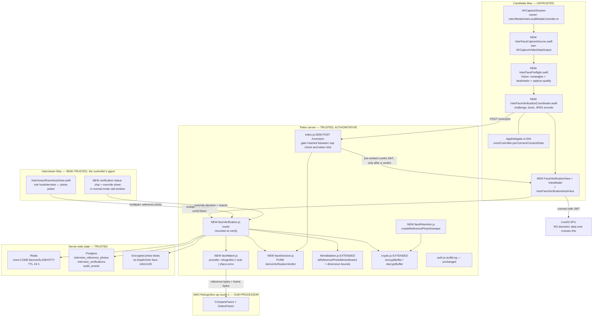
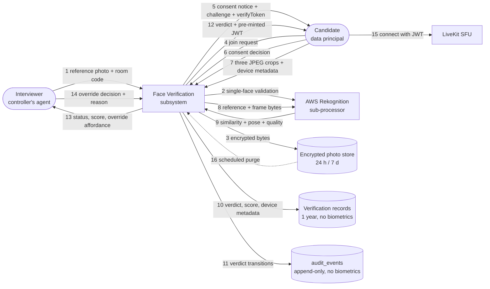
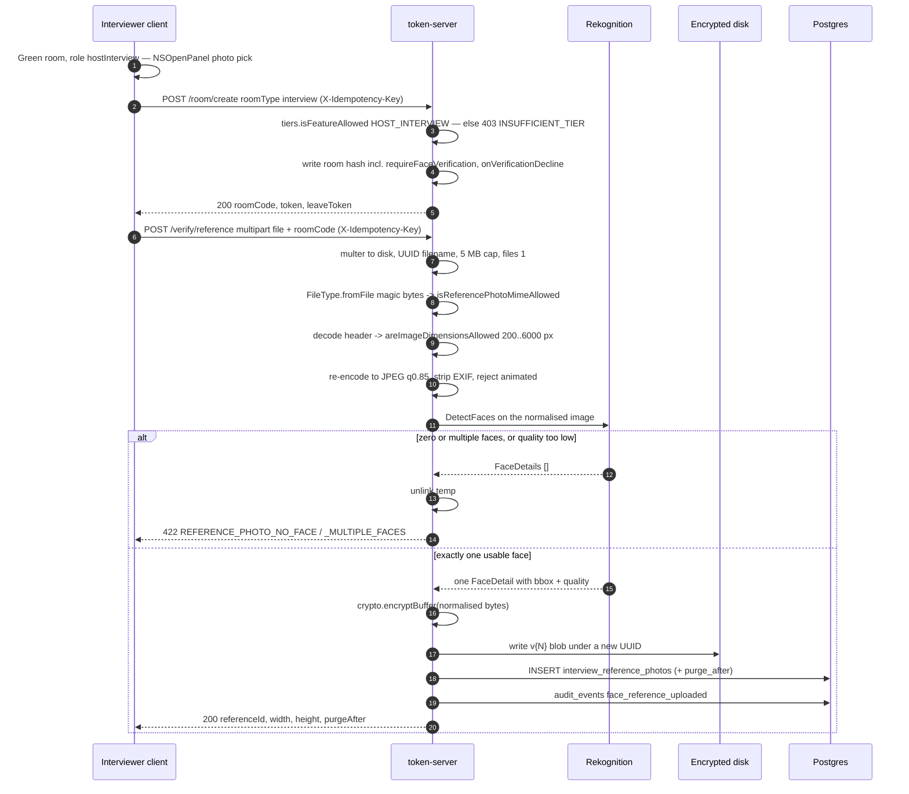

# Candidate Identity Verification for Secure Interview Mode — Design Spec

**Date:** 2026-10-27
**Project:** inter (macOS, Obj-C + Swift, LiveKit; Node/Express token server, Postgres + Redis)
**Feature:** The interviewer supplies a reference photo of the expected candidate; when the
interview session starts, the candidate's live camera is matched against it server-side before a
LiveKit grant is issued.
**Status:** Draft — awaiting review before implementation planning
**Builds on:** `2026-06-10-consent-first-moderation-design.md` (consent-first principle, the
interview-mode exception, the "never silent" indicator rule, the pure-derivation-function
anti-drift device) and `2026-06-19-interviewer-collaborative-tools-design.md` (format, depth,
server-`tools`-flag entitlement model).
**Grounded in:** `.agents/tasks/face-verification-design/codebase-recon.md` (verified paths,
columns, middleware, line numbers) and `.agents/tasks/face-verification-design/external-research.md`
(verified external facts; every external claim below carries its citation).

> **Format note.** This document uses Mermaid for the architecture diagram, the context DFD and
> the sequence flows. That is a deliberate departure: no existing doc in
> `docs/superpowers/specs/` contains a Mermaid block, and the house convention is tables plus
> fenced pseudo-code. Mermaid is used here because the feature's value is mostly in *where data
> crosses which trust boundary*, which a table cannot show. Tables and pseudo-code carry
> everything else, per house style.

---

## 1. Summary

An interviewer on the `hiring` tier uploads one reference photo of the candidate they expect.
When that candidate joins the interview room, `/room/join` **does not issue a LiveKit token**.
Instead it returns a `verificationRequired` rejection carrying a per-join `verifyToken` and a
server-drawn liveness challenge. The candidate reads a standalone biometric-consent screen,
performs a short randomised head-pose challenge in front of their camera, and the client uploads
three cropped JPEG frames. **The server** — never the client — compares each frame against the
reference photo, verifies the challenge poses from the pixels it received, and writes a verdict to
Redis. Only on a verdict does the server hand over a pre-minted LiveKit JWT, exactly as the
existing lobby admit path does.

Four decisions carry the design:

1. **The comparison runs server-side on server-received pixels.** An on-device decision is a
   client assertion and is therefore forgeable by a modified client, which contradicts this
   codebase's established "server is authoritative, never trust client input" posture (§5.1 of the
   recon: tier is read from the DB, never from the client). A hybrid that lets the client compute
   the *embedding* is worse than it looks: a modified client would simply embed the reference photo
   and submit that. Apple Vision runs on-device for framing, pose and quality only — it has no
   recognition API at all (§3.1).
2. **Nothing about this feature automatically rejects a candidate.** The decision is three-valued
   (`passed` / `inconclusive` / `failed`), a `failed` verdict flags the session and notifies the
   interviewer rather than ending it, and the interviewer always holds a logged manual override.
   This is forced by three independent constraints: NIST's measured demographic error differentials
   (§13.1), AWS's own written recommendation to route rights-affecting comparisons to a human
   ([AWS CompareFaces](https://docs.aws.amazon.com/rekognition/latest/APIReference/API_CompareFaces.html)),
   and GDPR Art. 22(3)'s human-intervention requirement (§7.2).
3. **Consent is standalone, precedes any capture, and refusal does not fail the interview.** The
   candidate who declines joins with `status = 'declined'` and the interviewer sees
   "Identity not verified — candidate declined" plus the documented fallback (a human photo-ID
   check on camera). A blocking alternative exists as an explicit room setting, defaulted off, and
   is raised in Open Decisions (§16).
4. **This feature raises the cost of candidate substitution. It does not prove identity.** A
   real-time face-swap injected through a macOS virtual camera defeats it, and that cannot be
   reliably detected (§2.2, §2.3). The honest claim is: it defeats the unprepared proxy and the
   held-up photo, and it produces a durable evidence trail for the interviewer's own judgement.

Phase 1 delivers exactly what the user asked for — a one-time gate at session start. Periodic
re-verification is Phase 3 and is argued for in §6.

---

## 2. Threat model

### 2.1 What this defends against

| Threat | Defence | Residual risk |
|---|---|---|
| **Proxy candidate** — a different, better-qualified person sits the interview | Server-side match of three live frames against the interviewer's reference photo before any LiveKit grant exists | A proxy who physically resembles the candidate within the threshold band; identical twins and close siblings are a known hard case |
| **Printed photo / phone screen held to the camera** | The server-drawn two-pose challenge, verified from `Pose.Yaw` measured by the server on the submitted pixels, inside a hard 20 s window | A tilted flat photo produces a *real* yaw change in the estimator. The challenge raises the attack from trivial to "coordinated physical manipulation under an unpredictable 20 s sequence". It does **not** defeat a screen replaying a video of the real candidate turning their head |
| **Pre-recorded response replay** | Challenge drawn server-side per session from a 12-element ordered space, bound to a nonce, with a hard expiry; frames must all match the reference *and* satisfy the drawn poses | An attacker with a library covering all 12 orderings; mitigated only by the time bound and by the pose tolerance being checked server-side |
| **Mid-burst person swap** (one person for the match frame, another for the pose frames) | All three frames are matched against the reference, not just the first | — |
| **Replayed or forged "I am verified" claim** | The verdict is server-side Redis state keyed on `room:{CODE}:faceverify:{identity}`; the LiveKit JWT is minted *by the server after* the verdict and handed over once. The client never holds a verification assertion (§11.5) | — |
| **Post-interview dispute** ("that wasn't me" / "you let an impostor through") | Append-only `audit_events` trail of every verdict, attempt, override and purge, with the score and the capture-device metadata | — |

### 2.2 What this explicitly does NOT defend against

**Stated plainly, because overclaiming here is the main way a feature like this causes harm.**

- **Virtual-camera injection with a real-time face swap.** An attacker installs a Core Media I/O
  camera extension, selects it as the capture device, and feeds a live deepfake of the real
  candidate. The frames the server receives are genuine pixels from a genuine `AVCaptureDevice`;
  they are simply not from a camera pointed at a person. This is the decisive residual risk, it is
  documented and commoditised (MITRE ATLAS AML.CS0033 records an iProov red-team demonstration
  that evaded *both* passive and active liveness; an [MIT Technology Review
  investigation](https://www.technologyreview.com/2026/04/15/1135898/cyberscammers-bypassing-bank-telegram/)
  describes a Telegram marketplace for exactly these tools, noting they typically deploy a virtual
  camera rather than the real feed), and it cannot be reliably detected on macOS (§2.3). ISO/IEC
  30107-3:2023 does not even reach it: the standard's scope is attacks *at the capture device
  during presentation*, so an iBeta PAD Level 1/2 certification says nothing about injection
  ([ISO/IEC 30107-3:2023](https://www.iso.org/standard/79520.html)).
- **A second person off-camera feeding answers.** Out of scope for face matching, by construction —
  face matching answers "is this the right face", not "is this person unaided". Say so to the user;
  do not let the feature be sold as proctoring. The existing capture-protection and one-shared-window
  properties of secure interview mode are the controls that touch this, and they are weak against a
  second physical device.
- **Reference-photo poisoning.** A colluding or careless interviewer uploads the *proxy's* photo,
  and the system happily verifies the proxy. This is unfixable inside the product: the interviewer
  is the trusted party that supplies ground truth. Mitigations are organisational and evidential —
  the uploader's `user_id`, the upload timestamp and the photo's SHA-256 are recorded, and the
  scheduled-meeting path (§9.3) binds the photo to a `meeting_invitees` row, so the photo is tied to
  an invited email address rather than to whoever happens to be in the room.
- **Mid-interview person swap after a one-time check passes.** The Phase-1 gate is defeated by
  swapping seats once the candidate is in. Phase 3's periodic re-verification is the answer, and
  this gap is the reason §6 recommends adopting it rather than treating the one-time gate as
  sufficient.
- **A candidate joining from an identity the interviewer never named.** The gate verifies against
  the *one* reference photo attached to the room. In a multi-candidate room, or if the interviewer
  uploads the wrong person's photo, the feature produces a false `failed`.
- **Compromise of the reference photo at rest.** Mitigated (encrypted at rest with versioned keys,
  short retention, never returned to any client) but not eliminated. DPDP's penalty structure puts
  the two largest heads on exactly this — up to ₹250 crore for failure to take reasonable security
  safeguards and up to ₹200 crore for failure to notify a breach (DPDP Act 2023, The Schedule).

### 2.3 Capture-device signals are evidence, not a gate

An app **cannot** reliably determine that the selected `AVCaptureDevice` is software rather than
hardware. This is architectural, not a gap careful engineering can close: Apple's camera-extension
model makes virtual cameras fully compatible with AVFoundation and appear as `.external` devices
([Apple — Creating a camera extension with Core Media I/O](https://developer.apple.com/documentation/coremediaio/creating-a-camera-extension-with-core-media-i-o)),
and the two properties one would use as heuristics are *writable by the extension author*:
`CMIOExtensionDeviceProperties.transportType` and `.model` are both declared `get set`
([Apple docs](https://developer.apple.com/documentation/coremediaio/cmioextensiondeviceproperties)).
A virtual camera can declare itself a built-in FaceTime HD Camera over USB, and any attacker with
intent will. `AVCaptureDevice.isVirtualDevice` is a trap — it is unavailable on macOS *and* means
"composed of two or more **physical** devices"
([Apple docs](https://developer.apple.com/documentation/avfoundation/avcapturedevice/isvirtualdevice)).

Therefore:

```
Capture-device policy
  record    localizedName, uniqueID, modelID, transportType, deviceType, isContinuityCamera
            into interview_verifications + the audit metadata, as evidence for a human
  pin       uniqueID for the whole session
  flag      a mid-session device change  -> forces `inconclusive` (human review), never a hard fail
  prefer    built-in or Continuity cameras, but NEVER require one
  never     gate pass/fail on any device property
```

"Never require one" is load-bearing: a Mac mini, Mac Studio or Mac Pro has no built-in camera, so
requiring built-in/Continuity would falsely reject a large population of legitimate desktop users.

App Attest (`DCAppAttestService`, macOS 11.0+) is worth adopting eventually to prove *our
unmodified app on genuine Apple hardware sent this request*
([Apple docs](https://developer.apple.com/documentation/devicecheck/dcappattestservice)), and it is
listed as deferred in §15. It must not be oversold: an unmodified, correctly attested app reading a
virtual camera produces a perfectly valid attestation over fraudulent pixels.

---

## 3. Where inference runs — the central decision

### 3.1 Apple Vision cannot do the match

**The premise that `VNGenerateFaceprintRequest` / `VNFaceprint` exists is false.** The Vision
framework's complete symbol inventory contains exactly four face/feature-print symbols:
`DetectFaceRectanglesRequest`, `DetectFaceLandmarksRequest`, `DetectFaceCaptureQualityRequest`, and
`GenerateImageFeaturePrintRequest` — the last being a **generic whole-image** feature print, not a
face template ([Apple — Vision](https://developer.apple.com/documentation/vision);
[Original Objective-C and Swift API](https://developer.apple.com/documentation/vision/original-objective-c-and-swift-api)).
`VNFaceObservation` carries `landmarks`, `roll`, `yaw`, `pitch`, `faceCaptureQuality` and nothing
identity-bearing ([Apple docs](https://developer.apple.com/documentation/vision/vnfaceobservation)).

Using `GenerateImageFeaturePrintRequest` on two face crops is an off-label use of a
visual-similarity API with no accuracy claim behind it, no documented distance scale, no example
threshold, and no cross-revision stability guarantee — Apple's own forums confirm observations from
different request revisions are not comparable, and developers report distances shifting materially
across OS versions ([Apple Developer Forums 732876](https://developer.apple.com/forums/thread/732876);
[Stack Overflow 77185128](https://stackoverflow.com/questions/77185128/is-vnfeatureprintobservation-and-vision-distance-computation-different-for-two)).
Apple states only that shorter distances mean greater similarity
([distance(to:)](https://developer.apple.com/documentation/vision/featureprintobservation/distance(to:))).
It is not a candidate for an identity decision.

**Vision is still the right tool for the pre-flight gate** — single-face detection, capture quality
and head pose — because it is first-party, on-device, free, and available at the macOS 15.6
deployment floor. It is currently used nowhere in the client (zero hits for `import Vision`), so
this is greenfield but dependency-free.

### 3.2 The options, compared

| Criterion | A. On-device decision (Vision / bundled ONNX) | B. Server-side, managed (Rekognition `CompareFaces`) | C. Server-side, self-hosted (SFace ONNX) | D. Hybrid: client embedding, server compare |
|---|---|---|---|---|
| **Trustworthiness** | **Fatal.** The verdict is a client assertion; a patched client returns `passed`. Contradicts the codebase's server-authority rule | **Strong.** Server sees pixels, computes the verdict, mints the token | **Strong.** Same property | **Fatal.** A patched client embeds the *reference photo* and submits that, guaranteeing a match. Worse than A because it looks sound |
| **Biometric exposure** | Best — nothing leaves the device | Candidate frames + reference photo reach AWS as a sub-processor. `ap-south-1` keeps it in India; training use is excludable via an AWS Organizations AI-services opt-out policy | Best of the trustworthy options — nothing leaves our infrastructure; permits **template-only** retention (discard the reference photo after enrolment) | Frames stay local, but see Trustworthiness |
| **Retention consequence** | n/a | **Forces retaining the reference *photo* bytes** for the room's life — the API is image-to-image, there is no template | Permits storing a 512-float template and deleting the photo | n/a |
| **Accuracy evidence** | None published by Apple for any face request, in either direction | Documented, maintained, vendor publishes threshold guidance and a human-review recommendation | Only the OpenCV Zoo repo's own eval harness (0.9940, benchmark unnamed) — not an audited number | n/a |
| **Licence** | Clean (first-party) | Clean (paid service) | **Clean: Apache 2.0**, ONNX shipped in-repo ([OpenCV Zoo SFace LICENSE](https://github.com/opencv/opencv_zoo/blob/main/models/face_recognition_sface/LICENSE)) | — |
| **Latency** | Lowest (no network) | 3 parallel calls, est. ~0.9 s (§12) | In-process, likely faster; unmeasured on our hardware | — |
| **Cost** | $0 | **$0.00125 / image call** in `ap-south-1`; $0.005 per verified candidate (§14.4) | $0 marginal; real engineering cost | — |
| **Dev / offline viability** | Works offline | Needs a `stub` provider for local dev and CI | Works offline | — |
| **Ease of audit** | Poor — no server record of what was compared | Good — server holds score, threshold, provider, timestamps | Good, plus full control of the model version | — |
| **Build effort for a 3-person team** | Low | **Low** — an SDK call plus IAM | **High** — bundle model, ONNX Runtime, a server-side detector, 5-landmark alignment, threshold calibration from zero, per-op Core ML/CPU support checks | — |

**InsightFace / ArcFace `buffalo_l` and DeepFace's default stack are excluded on licence.**
InsightFace's code is MIT but its **models are non-commercial research use only**, stated for both
manual and library-auto downloads, with commercial licensing sold separately
([InsightFace README](https://github.com/deepinsight/insightface/blob/master/README.md);
[model_zoo.md](https://github.com/deepinsight/insightface/blob/master/python-package/docs/model_zoo.md)).
DeepFace is MIT but is a *wrapper* whose licences are inherited per backend, and its defaults
include `Buffalo_L` (non-commercial) and Ultralytics YOLO (AGPL-3.0 absent a commercial licence)
([DeepFace README](https://github.com/serengil/deepface/blob/master/README.md)). If this project
ever ships commercially these are hard blockers, so they are not adopted even for the prototype.

**Azure AI Face verification is unavailable and is recorded only as a rejected alternative.** Face
identification and verification are Limited Access, require registration, are not on the Free tier,
are granted at Microsoft's sole discretion, and are available **only to "customers managed by
Microsoft" — those working directly with Microsoft account teams**
([Microsoft — Limited Access features of Face](https://learn.microsoft.com/en-us/legal/cognitive-services/computer-vision/limited-access-identity)).
A university project has no path through that gate. The ISV limited-access-token back door requires
being an approved ISV, i.e. the same gate one level up.

**AWS Rekognition Face Liveness is unavailable to this client.** It cannot be used without the
Amplify SDK, and the documented client components are React (web), Swift (**iOS**) and Android;
there is no native macOS component
([AWS — Detecting face liveness](https://docs.aws.amazon.com/rekognition/latest/dg/face-liveness.html);
[Face Liveness FAQ](https://docs.aws.amazon.com/rekognition/latest/dg/face-liveness-faq.html)).
Embedding the React component in a `WKWebView` is the only route, and it inherits the web SDK's
documented inability to adjust screen brightness. That is rejected: it imports a web runtime into a
capture-protected native secure window for the weakest variant of the control. Consequence: **the
liveness layer is in-house** (§4).

### 3.3 Decision

> **[DECISION] Hybrid, with the decision server-side on server-received pixels. Apple Vision runs
> on-device for the pre-flight gate only — single-face detection, capture quality, head pose and
> framing guidance. The identity comparison runs on the token server against the reference photo,
> via a `faceMatcher` provider interface. Phase 1's production provider is AWS Rekognition
> `CompareFaces` in `ap-south-1`. A `stub` provider serves local dev and CI. A self-hosted
> `sface-onnx` provider is designed for but deferred to Phase 4.**

Reasoning, in the order that decided it:

1. **Trust forces the server to see pixels.** Options A and D are client-asserted and therefore
   forgeable. D's failure mode deserves emphasis because it is the intuitive "privacy-preserving
   hybrid" and it is strictly broken: whoever computes the embedding chooses its input, so a
   modified client embeds the reference photo. There is no cryptographic fix available on an
   attacker-controlled device — App Attest proves the app binary, not the camera or the buffer.
2. **Between B and C, evidence and effort decide Phase 1.** This decision affects someone's access
   to employment. Rekognition is documented, maintained, available in Mumbai since 2018, and ships
   with the vendor's own written instruction to route rights-affecting results to a human — which is
   the exact design we need anyway. SFace's only published figure comes from the repo's own eval
   harness with the benchmark unnamed. Building C properly also means building server-side detection
   and 5-landmark alignment and calibrating a threshold from zero, which is the whole feature again.
3. **B's real cost is retention shape, and it is bounded.** `CompareFaces` is image-to-image, so B
   forces retaining the reference *photo* rather than a non-reversible template — the opposite of
   the data-minimisation instinct. Three things bound it: the photo is one the hiring company
   already holds and supplied; the novel biometric artefact is the candidate's *live frames*, and
   those are never persisted (§7.5); and retention is 24 h past session end (§7.6). Template-only
   retention is named in §16 as the specific benefit that should trigger the Phase-4 migration.
4. **The provider interface is not indecision.** `faceMatch.js` exposes one function so the
   migration in 3 is a swap rather than a rewrite, and so `npm test` can run the full decision path
   with no network and no AWS account. The Phase-1 default is `rekognition`; the trigger to move is
   written down.

**Unverified, and not asserted:** that `CompareFaces` bills under the "Rekognition Image API
Requests" price group (the $0.00125 `ap-south-1` figure is from the authoritative Price List offer
file; the mapping of this specific operation to that group is inference from the group name and the
public pricing page); that AWS has stated macOS is unsupported for Face Liveness (the absence of
macOS from the supported list is the evidence); measured inference latency for any face model on
Apple Silicon; which ops of a chosen ONNX model the Core ML execution provider supports.

---

## 4. Liveness and anti-spoofing

### 4.1 Vocabulary

Use ISO/IEC 30107-3's terms, at a stated operating point, never "accuracy":

- **APCER** — attack presentations wrongly classified as bona fide. NIST's gloss: *the rate at which
  fraud succeeds*; it states a system's **security**.
- **BPCER** — bona fide presentations wrongly classified as attacks. *The inconvenience rate for
  legitimate users*; it states a system's **convenience**.
- Report as **APCER @ BPCER = 0.01** (convenience-focused) or **BPCER @ APCER = 0.01**
  (security-focused) ([NIST IR 8491 — FATE Part 10](https://doi.org/10.6028/NIST.IR.8491);
  [Busch, ISO/IEC 30107-3 editor, via NIST](https://www.nist.gov/system/files/documents/2020/09/15/12_buschthieme-ibpc-pad-160504.pdf)).

A liveness threshold and a matching threshold are two separate policy choices with two separate
error surfaces. Keep them separate in code and in logs.

### 4.2 What passive single-frame PAD would and would not buy

NIST IR 8491 evaluated **82 algorithms from 45 developers** against ~20,000 attack and ~21,000
bona fide presentations across 9 PA categories. Findings that matter here:

- Photo print/replay attacks are **well detected** — top performers reach **APCER 0.0 @ BPCER 0.01**
  (Table 1, PA Type 8).
- **Only a small percentage of evaluated algorithms showed notable detection capability**, and other
  PA types produced high error with every implementation — best-in-class APCER 0.13 for one
  impersonation type, and **0.62** for one evasion type at BPCER 0.01 (Table 2).
- Algorithms generally do better on a **video sequence than a single still**, so single-frame
  passive PAD is the weakest configuration available.
- The report is **silent on injection attacks**.

So a passive PAD model would mainly buy print/replay detection, which the pose challenge below also
attacks, and it would add a model dependency with its own licence chain (the Silent-Face-Anti-Spoofing
model DeepFace can use has an unverified licence). **Passive PAD is deferred (§15, Phase 4)**, and
the gap is stated rather than papered over.

### 4.3 Decision — the Phase-1 baseline

> **[DECISION] In-house active challenge-response: a server-drawn, time-bounded two-pose challenge
> over a three-frame burst, with the poses verified server-side from the `Pose.Yaw` the matcher
> already returns for every submitted frame. On-device Vision runs the pre-flight quality gate. No
> passive PAD model, no virtual-camera gating, in Phase 1.**

The two properties that make a challenge worth anything are server-side randomisation and a hard
time bound — AWS fixes its own oval geometry, light sequence and countdown precisely because those
deliver the accuracy, and reports 5 s best / ~7 s average / 11 s worst end-to-end
([AWS — Detecting face liveness](https://docs.aws.amazon.com/rekognition/latest/dg/face-liveness.html)).
Concretely:

```
Challenge protocol
  draw      server-side at gate time, per session:
              poses  = 2 distinct draws from { left, right, up }            -> 6 ordered pairs
              order  = which of the two is frame B vs frame C               -> included above
              plus a 16-byte nonce and expiresAt = now + 20 s
  space     6 ordered pose pairs x (future: 2 blink slots) — small, so the TIME BOUND carries
            most of the anti-replay weight, not the entropy. Stated honestly.
  client    frame A: face centred, |yaw| <= 8 deg      (the match frame)
            frame B: yaw satisfying challenge.poses[0]
            frame C: yaw satisfying challenge.poses[1]
  server    for EACH of A,B,C:  Similarity vs reference, and Pose.Yaw measured on OUR pixels
            verify  all three Similarity >= pass/review band (§13.2)
                    B,C yaw within +/- 12 deg of target magnitude 25 deg, correct sign
                    arrival before expiresAt, nonce matches, attempt not already consumed
  verdict   challengeSatisfied = pose checks pass; it is an INPUT to the decision, not the decision
```

Server-side pose verification is what makes this non-trivial: the client never asserts "I turned my
head". `CompareFaces` returns pose (pitch/roll/yaw), landmarks and quality for each face it
examines ([AWS CompareFaces](https://docs.aws.amazon.com/rekognition/latest/APIReference/API_CompareFaces.html)),
so the challenge check rides on the match call that is already being made — no extra API call, no
extra cost.

**Be honest about what this achieves.** It defeats a static printed photo held still, and it defeats
a stale pre-recorded clip whose poses do not match the draw. It does **not** defeat a screen
replaying a video of the real candidate turning their head, and it does **not** defeat a real-time
face swap — the published red-team work evaded *both* passive and active liveness (§2.2). A tilted
printed photo also produces a genuine yaw change in the estimator, so the pose check degrades
against a determined physical attacker rather than failing closed against one.

**Deferred, with the reason:** blink detection via a `DetectFaces` call reading `EyesOpen` (one
extra $0.00125 call and a second round trip — Phase 3); a passive PAD model (licence chain and
marginal value over the pose challenge — Phase 4); any virtual-camera *gate* (cannot be made
reliable, and the available heuristics falsely reject desktop-Mac users — never).

---

## 5. Decision model — the one pure function

Following the consent doc's anti-drift device (`deriveRemoteTileState`) and the server's
`joinGuards.js` / `recordingQuota.js` dependency-injected-predicate pattern, all policy lives in one
pure, I/O-free, exhaustively unit-tested function in a new `token-server/faceDecision.js`.

### 5.1 Inputs

| Input | Source |
|---|---|
| `scores` | `[number, number, number]` — Similarity per frame from the matcher |
| `challengeSatisfied` | boolean — server-measured pose check (§4.3) |
| `referenceFaceOk` | boolean — exactly one face found in the reference at upload time |
| `providerOk` | boolean — matcher reachable and returned a result |
| `attempt` / `maxAttempts` | server-side counters from the Redis verification hash |
| `deviceChanged` | boolean — `uniqueID` differs from the pinned session value |
| `passThreshold` / `reviewThreshold` | policy values, env-overridable (§13.2) |

### 5.2 Derivation

```
deriveVerificationVerdict(inputs) ->
  !providerOk                            -> ('unavailable',  notify: interviewer, join: allowed-flagged)
  !referenceFaceOk                       -> ('unavailable',  notify: interviewer, join: allowed-flagged)
  deviceChanged                          -> ('inconclusive', notify: interviewer, join: held-for-review)
  min(scores) >= pass && challengeSatisfied
                                         -> ('passed',       notify: interviewer, join: allowed)
  min(scores) >= pass && !challengeSatisfied
                                         -> ('inconclusive', notify: interviewer, join: held-for-review)
  min(scores) >= review                  -> ('inconclusive', notify: interviewer, join: held-for-review)
  attempt < maxAttempts                  -> ('retry',         notify: none,        join: blocked-pending)
  else                                   -> ('failed',       notify: interviewer, join: allowed-flagged)
```

Key properties, by construction:

- **`failed` does not mean "blocked".** Its join disposition is `allowed-flagged`: the candidate
  enters, the interviewer is told, the interviewer decides. The only state that blocks is `retry`,
  which is transient and bounded by `maxAttempts`.
- **A high score with an unsatisfied challenge is never `passed`.** That ordering is fixed by the
  test suite, not by reading order — it is the "someone held up a very good photo" case.
- **`min(scores)`, not `mean`** — a mid-burst swap cannot be averaged away.
- **`unavailable` precedes everything.** A provider outage or a bad reference photo must never read
  as a candidate failure.
- `deviceChanged` yields `inconclusive`, never `failed`, per §2.3.

Testable with no DB, no Redis, no network, no AWS — the `tiers.test.js` / `fileValidation.test.js`
pure-unit style (§17).

---

## 6. One-time gate vs continuous verification

The user's words — "once the interview is started the candidate will go through a face-matching
stage" — describe a one-time gate. A one-time gate is defeated by swapping people after it passes.

| Option | Cost | Privacy | UX | Verdict |
|---|---|---|---|---|
| **A. One-time gate at join** | $0.005 / candidate | Minimal: one burst, frames discarded | One 8 s stage before entry | **Phase 1.** Exactly what was asked for; delivers real value against the unprepared proxy |
| **B. Periodic re-verification, randomly sampled** | +$0.00125 per check; at one check per 10 min window, **$0.0075 / hour** | One frame per check, discarded after the call; no challenge, so no interruption | Silent capture — but **never silent disclosure**: a persistent "Identity checks active" indicator for the whole session, disclosed at consent | **Phase 3, recommended.** Closes the swap gap at trivial cost |
| **C. Continuous low-frequency presence monitoring** | 1 frame / 10 s ≈ $0.45 / hour, 360× option B | Continuous biometric processing of a live feed; materially harder to justify under DPDP §6 necessity and GDPR Art. 9 | Same indicator | **Rejected.** The cost/benefit over B is poor and the proportionality argument gets much worse |

> **[DECISION] One-time gate at join in Phase 1 (§13). Periodic re-verification in Phase 3: one
> passive frame at a random point inside each 10-minute window, no challenge, skipped entirely when
> the candidate's camera is muted. Continuous monitoring rejected.**

**What the interviewer sees when a later check fails.** Never an interruption of the interview, and
never an automated end. A non-blocking banner in the interviewer's normal-mode call window:
*"Identity re-check did not match (score 62). Review before relying on this session."* plus an entry
in the verification panel with the time and score, and an `audit_events` row
(`face_verify_recheck_failed`). The candidate is **not** told a specific check failed — they are
told at consent time that periodic checks happen, and the persistent indicator stays visible
throughout. Telling them a check failed mid-answer is both prejudicial and useless, since the
interviewer, not the system, adjudicates.

**Consent-prior-art reconciliation.** The consent doc's rule is that interview mode may
force-activate a device *but every such activation MUST show a persistent indicator — never
silent*. Re-verification does not force the camera on (it skips when muted) and it is disclosed up
front and indicated persistently, so it satisfies both the letter and the intent. A transient toast
would not: that doc explicitly rejects toasts because "the toast conflated 'declined' with 'never
saw it'".

---

## 7. Biometric data privacy and legal compliance

A first-class design constraint. Face templates and face images processed to identify a person are
legally special almost everywhere, and the two decisions this section forces — a real non-biometric
fallback, and a human in the loop — are not optional features that can be cut.

### 7.1 India — DPDP Act 2023 and DPDP Rules 2025 (primary jurisdiction)

The likely primary jurisdiction: a Shri Mata Vaishno Devi University project with INR pricing in
`token-server/public/billing-page.js`.

**There is no sensitive or biometric category in the DPDP Act.** A full-text search of the Act for
"biometric" and for "sensitive" returns **zero occurrences of either word**. Personal data is
defined uniformly in §2(t) as any data about an identifiable individual. A face template is personal
data governed by the same consent and notice rules as an email address
([DPDP Act 2023 gazette](https://www.meity.gov.in/static/uploads/2024/06/2bf1f0e9f04e6fb4f8fef35e82c42aa5.pdf)).
This cuts both ways: no biometric uplift, but also **no Article-22 equivalent** — "profiling" does
not appear in the Act or the Rules, and there is no right to human intervention in an automated
decision. The human-review design in §13 is therefore driven by GDPR, BIPA and engineering ethics,
not by DPDP.

Commencement is phased. The Rules were notified **13 November 2025 (G.S.R. 846(E))**; Rules 1, 2 and
17–21 are already in force, Rule 4 lands 13 November 2026, and **Rules 3, 5–16, 22 and 23 commence
13 May 2027** — which is every operating obligation that matters here: notice (Rule 3), security
safeguards (Rule 6), breach intimation (Rule 7), erasure (Rule 8), rights mechanisms (Rule 14),
cross-border transfer (Rule 15)
([DPDP Rules 2025 gazette](https://du991dnb5pm56.cloudfront.net/documents/dpdpa/DPDP_Rules_2025_English_only.pdf)).

| Obligation | Source | What this design does |
|---|---|---|
| Consent free, specific, informed, unconditional, unambiguous, by clear affirmative action, **limited to data necessary for the specified purpose** | Act §6(1) | Standalone consent screen (§12.1); three frames and one reference photo only; no other use |
| Notice presented and understandable **independently of any other information**, with an **itemised description of the data** and the specified purpose | Rule 3 | The consent screen is its own screen, not a clause inside the existing secure-interview alert. Itemised copy in §12.1 |
| Withdrawal with **ease comparable to giving consent** | Act §6(4)–(6) | A "Withdraw consent and delete my data" control in the candidate's post-verification state and an email route; withdrawal triggers immediate purge of photo + evidence (decision record survives per Rule 8(3)) |
| Security: **encryption / tokenisation**, access control, **logs and monitoring of access**, backups, **1-year log retention** | Rule 6(a)–(g) | AES-256-GCM versioned-key encryption at rest (§10.3); every read of a reference photo written to `audit_events`; decision records retained 1 year (§7.6) |
| Breach intimation to each affected principal **without delay**; to the Board without delay and **in detail within 72 hours**. **No risk threshold** — any breach | Rule 7 | Operational, not architectural, but the `interview_verifications` table is designed so an affected-principal list is one query (room code + identity + invitee email) |
| Minimum retention of personal data, traffic data and processing logs for **one year** | Rule 8(3) | Decision records (no biometrics) retained 1 year; the photo itself purged in 24 h on the reading that Rule 8(3) reaches processing *logs*. **Flagged for counsel** (§7.7) |
| A **"child" is under 18**; verifiable parental consent required | Act §2(f), §9; Rules 10–12 | Campus recruitment makes a 17-year-old candidate plausible. **Verifiable parental consent for a face scan is operationally infeasible in this flow**, so the design's answer is: do not run biometric verification for a candidate who declares they are under 18 — route them to the non-biometric fallback. §9 breaches carry up to ₹200 crore |
| Penalties concentrated on security (up to **₹250 crore**) and breach notification (up to **₹200 crore**) | Act, The Schedule, read with §33(1) | Reinforces: the regulatory risk is in *how* the photo is protected and whether its loss is reported, not in collecting it |

**Legitimate use does not cover candidates.** §7(i) permits consent-free processing "for the
purposes of employment or those related to safeguarding the employer from loss or liability". An
interview candidate is not an employee and the clause's examples are oriented to the employment
relationship. **Reading, not verified case law:** relying on §7(i) here is a stretch, so candidate
verification needs consent under §6. Put to counsel; do not resolve in architecture.

**Cross-border transfer.** Sending frames to Rekognition is a transfer outside India unless the
region is `ap-south-1`. Choosing Mumbai removes the Rule 15 question. Rekognition Image has been in
`ap-south-1` since August 2018. `AWS_REGION` for this feature is therefore **pinned to `ap-south-1`
and validated at server start**; a non-Indian region is a startup refusal, not a warning.

### 7.2 GDPR — if any EU candidate is ever interviewed

Article 9(1) prohibits processing **"biometric data for the purpose of uniquely identifying a
natural person"** by default. The purpose qualifier is what bites: face *detection* is not Art. 9
data; matching a face against a reference photo to confirm who someone is unambiguously is
([Art. 9 GDPR](https://gdpr-info.eu/art-9-gdpr/)). Of the ten Art. 9(2) grounds, only **9(2)(a)
explicit consent** is realistically available to a private recruitment product — 9(2)(b) and
9(2)(g) both require enabling Member State law that does not exist for interview identity checks,
and 9(2)(f) is for litigation.

**And explicit consent has now failed in court on these facts.** In **November 2025 the Thuringian
Higher Regional Court** held that processing biometric data during proctoring violated Article 9,
reasoning that because the students **had no real alternative** to proctored online exams they had
not effectively consented, and declining to accept a substantial-public-interest basis
([GFF — Monitoring of online examinations](https://freiheitsrechte.org/en/themen/freiheit-im-digitalen-zeitalter/proctoring)).
Four years earlier the Italian Garante **fined Università Bocconi €200,000** over Respondus
proctoring, finding biometric data processed without an Art. 9 lawful basis plus insufficient
information to students
([EDPB summary](https://www.edpb.europa.eu/news/national-news/2021/italian-sa-finds-monitoring-system-online-university-exams-be-breach_en);
[EDRi](https://edri.org/our-work/no-biometric-surveillance-for-italian-students-during-exams/)).
**Two Member States, four years apart, same outcome.** The "no real alternative" reasoning transfers
directly: a candidate who must pass the face check to be interviewed is in the same structural
position as a student who must pass it to sit the exam.

**Article 22(4) is the clause that constrains the architecture most tightly.** A decision based
solely on automated processing that produces legal effects or similarly significantly affects the
person — losing a job opportunity to an automated identity rejection is a textbook instance — may
not be based on Art. 9(1) data unless 9(2)(a) or 9(2)(g) applies *and* suitable safeguards are in
place, which under Art. 22(3) include **at minimum the right to obtain human intervention, to
express a point of view, and to contest the decision**
([Art. 22 GDPR](https://gdpr-info.eu/art-22-gdpr/)). A DPIA is mandatory for large-scale Art. 9(1)
processing (Art. 35(3)(b)).

> **[DECISION] Three mandatory architectural consequences, implemented in Phase 1 and 2, not
> deferred: (1) a genuine non-biometric alternative path that does not cost the candidate the
> interview (§7.4); (2) a human decision-maker — the interviewer — with authority to override, and
> no automated rejection anywhere in the flow (§13); (3) a documented contest route surfaced to the
> candidate (§12.1 copy). Additionally: the design's recommendation is NOT to enable this feature
> for EU-resident candidates on an automated basis, because the one lawful basis Art. 22(4) leaves
> open is the basis a German appellate court just found ineffective in a no-real-alternative
> setting. Surface that as a per-room setting and a documented deployment warning, not as silent
> behaviour.**

**Unverified:** the Thuringian judgment text, case number and a neutral report could not be located
(the account is from the litigating NGO, a party to the case); whether the Bocconi fine was reduced
to €150,000 on appeal; the primary EUR-Lex text of Arts. 9, 22 and 35. Verify before relying on exact
wording.

### 7.3 US state biometric privacy — Illinois BIPA is the one that matters

| Duty | Requirement | Engineering consequence |
|---|---|---|
| **§15(b)** informed written consent | Before collection, inform **in writing** that a biometric identifier is being collected, **the specific purpose, AND the specific length of term** of collection/storage/use, and **receive a written release** — electronic signature explicitly acceptable since the 2024 amendment | The consent screen must state the retention period **as a concrete duration**, not "as long as necessary". Copy in §12.1 does. Consent is recorded with a `consent_version` so the exact text shown is reconstructible |
| **§15(a)** retention policy | Develop a written policy, **made available to the public**, with a retention schedule and destruction guidelines; destroy at purpose satisfaction **or within 3 years of last interaction, whichever is first** | A **public** page — not an internal doc, not just the in-app notice. Phase 2 ships `/legal/biometric-retention` served from `token-server/public/`. A 2020 bill that would have softened "to the public" to "to the person" did not pass ([HB 5374](https://my.ilga.gov/ftp/legislation/101/BillStatus/HTML/10100HB5374.html)) |
| **§15(c)** no profit | May not sell, lease, trade or **otherwise profit from** a biometric identifier | **Rules out using any candidate frame or reference photo for model training or service improvement.** Hence the AWS Organizations AI-services opt-out policy is a *required* deployment step (§15, Phase 0), not a nicety |
| **§15(d)** disclosure limits | No dissemination without consent, bar enumerated exceptions | The reference photo is never returned to any client, never sent over LiveKit, and is disclosed only to the matcher sub-processor named in the consent copy |
| **§15(e)** standard of care | Store and transmit using the reasonable industry standard of care and **at least as protectively as other confidential data** | Reuses the strongest existing pattern in the codebase (AES-256-GCM versioned keys, §8.3), which is what protects OAuth refresh tokens |
| **§20** remedy | **Private right of action**, liquidated **$1,000 negligent / $5,000 intentional-or-reckless** per violation, **plus attorneys' fees** | The reason Illinois drives US risk at all. SB 2979 / P.A. 103-769 (effective 2 August 2024) capped repeat collection by the same method from the same person at **one recovery**, and redefined "written release" to include electronic signature — **it reduced the multiplier, not the duty** |

Sources: [Justia — 740 ILCS 14](https://law.justia.com/codes/illinois/chapter-740/act-740-ilcs-14/);
[Quarles & Brady quoting §15(a)](https://www.quarles.com/newsroom/publications/biometric-information-privacy-update-new-illinois-appellate-ruling-expands-temporal-recovery-period-and-suggests-enhanced-damage-remedy-available);
[Holland & Knight](https://www.hklaw.com/en/insights/publications/2020/09/illinois-appellate-court-rules-that-workers-compensation-act);
[Cothron v. White Castle, 2023 IL 128004 — per-scan accrual](https://www.jenner.com/en/news-insights/publications/client-alert-illinois-supreme-court-rules-that-bipa-claims-accrue-with-scan-or-transmission-of-private-information);
[Seyfarth on SB 2979](https://www.seyfarth.com/news-insights/bipa-legislative-update-governor-pritzker-signs-amendment-limiting-damages-to-a-single-recovery-1.html).
**Weakest sourcing in this document on the point with the highest litigation exposure** — the
Illinois General Assembly site returned 403/timeouts, so the statutory text is reconstructed from
indexed content plus independent legal sources that quote it. **Counsel must read 740 ILCS 14/10,
/15 and /20 directly before any US deployment.**

**Texas CUBI** (§503.001, amended effective 1 January 2026) requires informing and consent before
capturing a face-geometry record for a commercial purpose, reasonable care in storage, and
**destruction within a reasonable time and no later than the first anniversary of the purpose's
expiry**; enforcement is **AG-only, up to $25,000 per violation, with no private right of action**
([Tex. Bus. & Com. Code ch. 503](https://tcss.legis.texas.gov/resources/BC/htm/BC.503.htm)). The new
§503.001(e)(3) fraud-detection AI exemption and the §503.001(e)(2) carve-back for systems deployed
"for the purpose of uniquely identifying a specific individual" pull in opposite directions on
exactly these facts; **not guessed here** — Texas counsel.

**Washington RCW 19.375** is low-risk: "biometric identifier" **expressly excludes a photograph,
video, and data generated therefrom**, and "commercial purpose" **excludes a security purpose**,
which identity verification against substitution fraud is
([Chapter 19.375 RCW](https://app.leg.wa.gov/RCW/default.aspx?cite=19.375&full=true)). Both are
readings of the statutory text, not verified against Washington guidance.

### 7.4 Consent and the mandatory non-biometric fallback

> **[DECISION] Consent is a standalone screen shown before any frame is captured. A candidate who
> declines joins the interview with `status = 'declined'`; the interviewer sees "Identity not
> verified — candidate declined" together with the fallback instruction. Refusal NEVER silently
> fails the interview and NEVER blocks the join under the default policy.**

The fallback is a documented human procedure, not a second automated system: **the interviewer asks
the candidate to hold a government or institutional photo ID to the camera and visually confirms
it, recording the outcome in the verification panel.** It is logged as
`face_verify_consent_declined` plus an interviewer-entered override decision, so the file shows a
deliberate human check rather than an unexplained gap. Nothing about the ID is captured, uploaded or
stored — the interviewer records only a boolean and a free-text note.

This is the posture GDPR forces (§7.2: no real alternative means no valid consent), and it is also
the only posture that survives the demographic-error data in §13.1. A blocking policy
(`onVerificationDecline: 'block'`) is implemented as a room setting so an organisation that has
taken its own legal advice can choose it, but the default is `allow-flagged` and the setting carries
an in-app warning naming the Art. 9 / Erfurt risk. **This is a user-visible policy choice and is
raised in §14.**

Candidates who declare they are under 18 are routed to the fallback without being offered the
biometric path at all (DPDP §9 / Rules 10–12 verifiable parental consent).

### 7.5 Data minimisation — what is kept and what is destroyed

| Artefact | Persisted? | Where | Why |
|---|---|---|---|
| Reference photo bytes | **Yes, encrypted, short-lived** | Disk under a UUID filename, AES-256-GCM `v{N}:` blob; path in Postgres, bytes never in Postgres | Forced by the image-to-image matcher (§3.2). The chat-file precedent (bytes on disk, metadata out of the DB) is the in-repo pattern |
| Candidate live frames | **No** | Held in memory for the duration of the match call, then dropped. Written to disk **never** in the `passed` / `failed` / `declined` paths | The novel biometric artefact. Not retaining it is the single biggest privacy win available |
| Candidate evidence crop | **Only on `inconclusive`**, encrypted, purged with the photo | Same disk + encryption scheme | A human reviewer cannot adjudicate an `inconclusive` verdict without seeing something. One frame, one crop, same retention clock |
| Face template / embedding | **No, in Phase 1** | — | `CompareFaces` produces none. Phase 4's self-hosted provider would add `template` + `template_key_version` + `template_model` columns and allow deleting the photo instead |
| Verification decision record | **Yes, 1 year** | `interview_verifications` — score, verdict, thresholds, provider, device metadata, timestamps. **No biometric content** | DPDP Rule 6(c)/(e) access logs and Rule 8(3) minimum retention; the interviewer's and the candidate's evidence in any dispute |
| `audit_events` rows | **Yes, permanently** (append-only DB triggers) | `audit_events` | Existing mechanism. **Therefore these rows must contain no biometric data, no photo reference beyond an opaque UUID, and no raw email** — use the existing `pseudonymizeEmail` (`index.js:480`) |
| Raw video of the interview | Unchanged by this feature | Existing recording subsystem | This feature adds no recording and publishes nothing over LiveKit |

### 7.6 Retention schedule — concrete, automatic

> **[DECISION] Reference photo and any evidence crop are purged at `min(session end + 24 h, upload
> + 7 days)`. Verification decision records are purged at `created_at + 1 year`. Both by a scheduled
> sweeper, never by a manual step.**

```
purge_after  = LEAST(session_ended_at + interval '24 hours', created_at + interval '7 days')
               -- 7 days covers the photo uploaded for an interview that never happened
decision row = created_at + interval '1 year'   -- DPDP Rule 6(e) / Rule 8(3)
```

Implemented as `token-server/faceRetention.js` exporting
`createReferencePhotoSweeper({ db, fs, logger })` → `sweepOnce()`, on the exact
`recordingQuota.js` `createOverdueRecordingSweeper` pattern — dependency-injected so it unit-tests
without a DB, driven by an hourly `setInterval(...).unref()` like the existing chat-upload TTL
sweep so the test suite does not hang. `sweepOnce()` unlinks the file, nulls `storage_path`, sets
`purged_at`, and writes `face_reference_purged` to `audit_events`. Idempotent: a missing file is a
success.

Why these numbers: 24 h past session end satisfies BIPA §15(a)'s "when the initial purpose has been
satisfied" far inside its 3-year outer bound and Texas's one-year bound, while leaving a window for
a same-day dispute or a re-run after a crash. The published public policy (§7.3) must state exactly
these durations, and the consent copy must state them too (BIPA §15(b) requires the length of term).

### 7.7 Controller / processor, and the questions for counsel

**The hiring company — the `hiring`-tier account holder — is the data controller (DPDP: data
fiduciary). This product is the processor. AWS is a sub-processor.** The company decides to run the
check, supplies the reference photo, and adjudicates the result; the product processes on its
instructions. Consequences that must be built, not just asserted:

- A data-processing term in the `hiring`-tier agreement covering purpose limitation, the
  sub-processor list, Rule 6(f)'s contractual-safeguards requirement, and breach assistance.
- The consent screen must name both parties — the candidate is consenting to the *company's*
  processing, performed by this product. Copy in §10.1 does.
- Candidate access/erasure requests arrive at either party. Since most candidates are guests with no
  account, the lookup key is `(room_code, participant_identity)` plus, on the scheduled path, the
  invitee email. A published DPO contact (Rule 9) and a documented runbook are Phase 2.

**Open legal questions. Recorded, not resolved here:**

1. Whether DPDP **Rule 8(3)**'s minimum-one-year retention of "personal data, associated traffic
   data and other logs" reaches a **biometric artefact** or only the processing logs. The design
   assumes logs-only (photo purged in 24 h, decision record kept a year) and notes §12(3)'s carve-out
   for retention required by law as the likely reconciliation. **Sharpest open question; needs Indian
   counsel.**
2. Whether §7(i)'s employment legitimate use covers candidates (§7.1 — reading says no).
3. Whether Texas CUBI §503.001(e)(2) or (e)(3) controls (§7.3).
4. Whether a DPIA is required and who signs it, if any EU candidate is in scope (§7.2).
5. Whether this product is a Significant Data Fiduciary under Act §10 / Rule 13.

---

## 8. System architecture

### 8.1 Layers and trust boundaries



**Trust boundaries, named:**

| Boundary | Crossed by | Protection |
|---|---|---|
| Candidate Mac → token server | 3 JPEG crops, consent decision, device metadata | TLS; `verifyToken` compared with `constantTimeEqual` (`index.js:423`); `rateLimitRoomAction`. The client's *claims* about pose, quality and identity are re-derived server-side from the pixels and are never trusted |
| Interviewer Mac → token server | Reference photo, override decisions | `auth.requireAuth` + inline `tiers.isFeatureAllowed(..., FEATURES.HOST_INTERVIEW)` + `requireIdempotencyKey` + `validateModerator`-style userId↔host binding (`index.js:2223`) |
| Token server → AWS | Reference photo bytes, candidate frame bytes | TLS; region pinned `ap-south-1`; AWS Organizations AI-services opt-out policy so inputs are excluded from service-improvement use; stateless operation — AWS states `CompareFaces` data does not persist |
| Token server → disk | Encrypted reference photo | AES-256-GCM `v{N}:{iv}:{tag}:{ct}`, UUID filename, path never returned to a client, traversal-guarded reads mirroring `index.js:5304` |
| Token server → LiveKit | **Nothing from this feature** | The JWT metadata gains one boolean `faceVerified`; no image, template or score crosses LiveKit |

**TLS pinning reality, stated so it is not over-assumed.** `InterPinnedSessionDelegate`
(`InterTokenService.swift:3741`) exists but `pinnedSPKIHashes` is an **empty set with a TODO**, so
the client does default system trust today. The verification endpoints inherit whatever pinning
state exists — nothing extra to wire, and nothing protecting them beyond system trust until the set
is populated. Separately, **pinning does not cover LiveKit**: the LiveKit Swift SDK makes its own
connections and never sees the pinned delegate. Neither fact blocks this feature; both belong in the
deployment checklist.

### 8.2 New components and the files they touch

| Component | Path | Responsibility |
|---|---|---|
| Verification router | `token-server/faceVerification.js` **(new)** | `/verify/*` endpoints; owns all I/O. Mounted in `index.js` beside the existing routers (lines 139–152), i.e. after `auth.authenticateToken` so `req.user` is populated |
| Matcher provider | `token-server/faceMatch.js` **(new)** | `compare({ referenceBuffer, frameBuffer })` → `{ similarity, pose, quality }`; `detectSingleFace(buffer)`. Providers: `rekognition`, `stub`, `sface-onnx` (Phase 4). Selected by `FACE_MATCH_PROVIDER` |
| Decision predicate | `token-server/faceDecision.js` **(new)** | Pure `deriveVerificationVerdict` (§5). No `require` of db/redis/aws |
| Retention sweeper | `token-server/faceRetention.js` **(new)** | DI'd `createReferencePhotoSweeper({ db, fs, logger })` → `sweepOnce()` |
| Join gate | `token-server/index.js` `app.post('/room/join', …)` **(modified, ~12 lines)** | Inserted **between the participant-cap check (line ~2715) and `createToken` (line ~2731)** |
| Room setting snapshot | `token-server/index.js` `app.post('/room/create', …)` **(modified)** | `requireFaceVerification` and `onVerificationDecline` written into the `room:{CODE}` hash beside `lobbyEnabled` / `passwordHash` so they are server-authoritative for the room's life |
| Upload validation | `token-server/fileValidation.js` **(extended)** | `ALLOWED_IMAGE_MIMES`, `isReferencePhotoMimeAllowed`, `areImageDimensionsAllowed` |
| Binary encryption | `token-server/crypto.js` **(extended)** | `encryptBuffer` / `decryptBuffer` reusing the same framing and key store |
| Scheduling pre-stage | `token-server/scheduling.js` **(modified, Phase 2)** | `requireFaceVerification` into the validated `settings` whitelist (line ~176); `registerScheduledRoom` carries it into the room hash |
| Migration | `token-server/migrations/023_interview_face_verification.sql` **(new)** | §10 |
| Client capture | `inter/Media/InterFaceCaptureSource.swift` **(new)** | Adds **its own** `AVCaptureVideoDataOutput` to the existing session, per `InterLiveKitCameraSource.swift`'s stated isolation invariant |
| Client pre-flight | `inter/Media/InterFacePreflight.swift` **(new)** | Vision requests; pure scoring helpers unit-testable without a camera |
| Client coordinator | `inter/Networking/InterFaceVerificationCoordinator.swift` **(new)** | Challenge state machine, burst capture, JPEG encode, upload via `InterTokenService` |
| Client UI triad | `inter/UI/SwiftUI/Screens/FaceVerificationView.swift`, `FaceVerificationViewModel.swift`, `InterFaceVerificationHostView.swift` **(new)** | §12 |
| Client gate wiring | `inter/App/AppDelegate.m` **(modified)** | `preConnectConsentGate` chains the verification stage behind the existing `-showIntervieweeConfirmationWithCompletion:` |
| Client error codes | `inter/Networking/InterNetworkTypes.swift` **(modified)** | `verificationRequired = 1021`, `verificationFailed = 1022`; **both added to `isExpectedJoinRejection`** |
| Client error copy | `inter/App/AppDelegate.m` `-userFacingMessageForError:` **(modified)** | Map 1021/1022 |
| Client tier mirror | `inter/Networking/InterFeatureGate.m` | **Unchanged** — this rides on the existing `InterFeatureHostInterview` entitlement |

### 8.3 Why the client capture uses a new output, not the existing observer

`InterLocalMediaController` owns the single `AVCaptureSession` and its header is explicit: callers
must use `sessionQueue` and must not call `startRunning`/`stopRunning`. Two seams exist:

- **`recordingFrameObserver`** — already exactly a "give me local camera `CVPixelBuffer`s" hook, but
  it is a **single-slot property already owned by `InterRecordingCoordinator`**. Taking it would
  break local recording's camera PiP.
- **A second `AVCaptureVideoDataOutput`** — the sanctioned pattern. `InterLiveKitCameraSource.swift`
  already does this and documents the invariant: *"This class never modifies the capture session's
  input configuration. It only adds/removes its own output."* The session already carries two or
  more outputs in practice, and `videoSettings` is pinned to `kCVPixelFormatType_32BGRA` precisely
  so a new consumer cannot trigger format renegotiation.

> **[DECISION] `InterFaceCaptureSource.swift` adds its own `AVCaptureVideoDataOutput`, attaches only
> for the duration of a verification burst, and detaches immediately after. It never calls
> `track.mute()`/`unmute()` and never fires while `cameraState` is `.muted` or `.muting`.**

There is no `AVCapturePhotoOutput` anywhere in the client and no `CVPixelBuffer` → JPEG path; the
closest prior art (`InterViewSnapshotVideoSource.m`) does the inverse. The encode is new but short:
`CIImage(cvPixelBuffer:)` → crop to the Vision bounding box expanded 1.6× → `CIContext.jpegRepresentation`.

`SecureWindowController`'s header notes interview rooms have **no** pre-meeting, so the candidate's
green-room choice is the only thing shaping initial device state. A verification stage needs the
camera, so the coordinator must reconcile with `startWithCameraOff`: if the candidate chose
camera-off, the verification screen asks them to enable it **through their own camera button** (the
consent-first rule) and offers "Skip — I can't use my camera", which routes to `unavailable`.

---

## 9. Data flow

### 9.1 Context-level DFD



**What is discarded and when:** the three candidate frames exist only in the server process's memory
between steps 7 and 9 and are dropped when the match call returns (step 10) — except on an
`inconclusive` verdict, where exactly one crop is encrypted into the photo store on the same purge
clock. The reference photo is destroyed at step 16. Nothing in steps 1–16 puts a biometric artefact
into `audit_events` or over LiveKit.

### 9.2 Reference photo upload — interviewer, ad-hoc path (recommended primary)



**Ordering matters and the failure is handled:** the room must exist before the photo can be
room-scoped, so `/room/create` runs first. If the upload then fails, the room exists **without** a
reference photo. The interviewer's call window therefore shows a persistent
*"Identity verification not armed — add the candidate's photo"* chip with a retry that opens the
same upload sheet, and `/room/join` treats a `requireFaceVerification` room with no reference as
`unavailable` (candidate joins flagged) rather than blocking anyone. Both halves of the create are
idempotent (`X-Idempotency-Key`, `idempotency.js`), so a flaky network retry cannot create two
rooms or two photos.

### 9.3 Scheduled pre-stage (Phase 2) — and why both paths exist

An interview created via `/room/create` has **no `scheduled_meetings` row at all** — the host just
gets a room code. So a scheduling-time-only upload cannot cover the ad-hoc path, which is the path
the user's words describe ("at the starting of the interview"). Conversely, the scheduled path has
the better binding available: `meeting_invitees` is already uniquely keyed `(meeting_id, email)`, so
a photo attached there is tied to *the person who was invited*, which is a materially stronger
answer to reference-photo poisoning than "whatever the host uploaded just now".

> **[DECISION] Room-scoped upload is the primary mechanism and ships in Phase 1. The scheduled
> pre-stage is Phase 2 and is additive: `POST /meetings/:id/invitees/:inviteeId/reference` stores a
> photo against the invitee row, and `registerScheduledRoom` copies the reference into the room's
> verification state when the room is started. `requireFaceVerification` lives in the existing
> `settings` JSONB (no migration needed for the flag); the photo never goes in `settings`, which is
> a validated flat boolean/enum whitelist.**

`scheduled_meetings.password` is stored in plaintext today (`scheduling.js:198`). That is a
pre-existing wart and is **not** a precedent — nothing in this feature stores anything sensitive in
plaintext.

### 9.4 The join gate — happy path

```mermaid
sequenceDiagram
  autonumber
  participant C as Candidate client
  participant TS as token-server
  participant RD as Redis
  participant RK as Rekognition
  participant PG as Postgres
  participant LK as LiveKit

  C->>TS: POST /room/join roomCode, identity, displayName
  Note over TS: gates 0..10 unchanged: rate limit, ban, lock,<br/>password, lobby, join-before-host, participant cap
  TS->>RD: HGETALL room:CODE:faceverify:IDENTITY
  alt already passed and TTL alive
    TS->>TS: proceed to the normal token mint
    TS-->>C: 200 roomName, token, serverURL, settings...
  else no verification state
    TS->>TS: draw poses + nonce, mint verifyToken (32 bytes)
    TS->>RD: HSET faceverify hash status pending, attempts 0,<br/>challenge, verifyTokenHash, expiresAt — EXPIRE 24 h
    TS->>PG: INSERT interview_verifications status pending
    TS-->>C: 403 verificationRequired, verifyToken, challenge, consentNotice
    Note over TS: NO LiveKit JWT minted. NO participant-set membership.<br/>This is the only genuinely fail-closed position.
    C->>C: show standalone consent screen
    C->>TS: POST /verify/consent granted true (x-verify-token)
    TS->>PG: UPDATE consent_granted_at, consent_version
    TS->>PG: audit_events face_verify_consent_granted
    TS-->>C: 200 proceed
    C->>C: Vision pre-flight — one face, quality, framing
    C->>C: run challenge, capture frames A B C, JPEG crop
    C->>TS: POST /verify/frames multipart A,B,C + device metadata (x-verify-token)
    par three comparisons in parallel
      TS->>RK: CompareFaces reference, A
      TS->>RK: CompareFaces reference, B
      TS->>RK: CompareFaces reference, C
    end
    RK-->>TS: similarity + Pose.Yaw per frame
    TS->>TS: verify poses vs challenge, expiry, nonce
    TS->>TS: faceDecision.deriveVerificationVerdict -> passed
    TS->>TS: mint LiveKit JWT metadata role interviewee,<br/>tools, faceVerified true
    TS->>RD: HSET status passed, score; SET faceverify:IDENTITY:token
    TS->>PG: UPDATE interview_verifications; audit_events face_verify_passed
    TS-->>C: 200 status passed, token, serverURL, settings...
    C->>LK: connect
  end
```

Note the **reconnect property** this gives for free: a candidate who drops and rejoins with the same
`identity` finds `status = passed` in Redis and is admitted without re-verifying, bounded by the
24 h room TTL. A **new** identity is a new verification. That is deliberate — re-running a biometric
check on every network blip would be both hostile and, under DPDP §6's necessity test, hard to
justify.

### 9.5 Failure paths

```mermaid
sequenceDiagram
  autonumber
  participant C as Candidate client
  participant TS as token-server
  participant I as Interviewer client

  rect rgba(239,68,68,0.08)
  Note over C,TS: Consent declined
  C->>TS: POST /verify/consent granted false
  TS->>TS: audit face_verify_consent_declined; status declined
  alt onVerificationDecline = allow-flagged (DEFAULT)
    TS->>TS: mint JWT with faceVerified false
    TS-->>C: 200 status declined, token, serverURL, settings...
    TS-->>I: verification panel — Not verified, candidate declined + fallback steps
  else onVerificationDecline = block (opt-in, warned)
    TS-->>C: 403 verificationDeclined, no token
  end
  end

  rect rgba(245,158,11,0.10)
  Note over C,TS: Score in the review band, or challenge unsatisfied
  C->>TS: POST /verify/frames
  TS->>TS: verdict inconclusive; encrypt ONE evidence crop
  TS-->>C: 200 status inconclusive — Waiting for the interviewer to review
  TS-->>I: review request: score, evidence crop, Allow / Reject + required reason
  I->>TS: POST /room/:code/verify/:identity/override allow, reason
  TS->>TS: audit face_verify_override; status overridden
  TS-->>C: on next GET /verify/status — 200 token, serverURL, settings...
  end

  rect rgba(239,68,68,0.08)
  Note over C,TS: Below the review band
  C->>TS: POST /verify/frames
  TS->>TS: attempt < 3 -> retry, 60 s cooldown
  TS-->>C: 200 status retry, attemptsRemaining, guidance
  C->>TS: POST /verify/frames (attempt 3)
  TS->>TS: verdict failed — NOT a rejection
  TS->>TS: mint JWT with faceVerified false
  TS-->>C: 200 status failed, token, serverURL, settings...
  TS-->>I: Identity did NOT match (score 41). Verify by photo ID before proceeding.
  end

  rect rgba(148,163,184,0.12)
  Note over C,TS: Provider down, no reference photo, or no camera
  C->>TS: POST /verify/frames
  TS->>TS: providerOk false -> verdict unavailable
  TS-->>C: 200 status unavailable — Verification is unavailable; you can continue
  TS-->>I: Verification unavailable — check identity manually
  end
```

**The single most important property in this diagram:** in every path except the opt-in `block`
policy, the candidate ends up holding a LiveKit token. What changes is the `faceVerified` flag, the
verification record, and what the interviewer is told. **The system never ends anyone's interview.**

---

## 10. Database design

Highest applied migration is **`022_rename_pro_plus_to_hiring.sql`**, so the next file is
**`token-server/migrations/023_interview_face_verification.sql`**. Forward-only, one transaction per
file, tracked in `schema_migrations(filename)`; there is no down-migration mechanism, so the DDL
below is additive and re-runnable (`IF NOT EXISTS` throughout, per the 016/020 precedent).

### 10.1 Proposed DDL

```sql
-- ============================================================================
-- 023_interview_face_verification.sql
-- Candidate identity verification for secure interview mode.
--
-- Design notes:
--   * Photo BYTES never live in Postgres. Encrypted blobs sit on disk under a
--     UUID filename (the chat-upload precedent); only the path lives here, and
--     the path is never returned to any client.
--   * Encrypted-at-rest columns follow the migration-016 convention:
--     TEXT path/blob + a companion *_key_version SMALLINT.
--   * interview_verifications is MUTABLE (pending -> passed/failed/...), so it
--     cannot be an audit_events row: audit_events is append-only by DB trigger.
--     audit_events records the immutable TRANSITIONS; this table holds state.
--   * No biometric template column in Phase 1: CompareFaces is image-to-image.
--     A later self-hosted provider adds template / template_key_version /
--     template_model and lets the photo be destroyed at enrolment instead.
--
-- ASSERT: users, scheduled_meetings, meeting_invitees and the
--         trigger_set_updated_at() function (001_initial_schema.sql) exist.
-- ============================================================================

CREATE TABLE IF NOT EXISTS interview_reference_photos (
    id                   UUID PRIMARY KEY DEFAULT gen_random_uuid(),

    -- Ownership. The uploader is the controller's agent; if their account goes,
    -- so does the photo (it is their data-processing instruction).
    uploader_user_id     UUID NOT NULL REFERENCES users(id) ON DELETE CASCADE,

    -- Scope. Exactly one of (room_code) or (meeting_id, invitee_id) is the live
    -- binding; the scheduled pre-stage (Phase 2) populates the latter and the
    -- room_code is stamped when the room is started.
    room_code            VARCHAR(6),
    meeting_id           UUID REFERENCES scheduled_meetings(id) ON DELETE CASCADE,
    invitee_id           UUID REFERENCES meeting_invitees(id)   ON DELETE CASCADE,

    -- Encrypted-at-rest artefact. storage_path is server-side only.
    storage_path         TEXT,
    storage_key_version  SMALLINT,
    content_sha256       CHAR(64) NOT NULL,          -- integrity + dedupe evidence
    mime_type            VARCHAR(40) NOT NULL
                           CHECK (mime_type IN ('image/jpeg','image/png','image/heic')),
    width_px             INT NOT NULL CHECK (width_px  BETWEEN 200 AND 6000),
    height_px            INT NOT NULL CHECK (height_px BETWEEN 200 AND 6000),
    size_bytes           INT NOT NULL CHECK (size_bytes > 0 AND size_bytes <= 5242880),

    -- Cached single-face validation from upload time, so it is never recomputed.
    face_detected        BOOLEAN NOT NULL DEFAULT FALSE,
    face_quality         NUMERIC(5,2),

    -- Retention. purge_after is computed at write time and enforced by a sweeper.
    purge_after          TIMESTAMPTZ NOT NULL,
    purged_at            TIMESTAMPTZ,

    created_at           TIMESTAMPTZ NOT NULL DEFAULT NOW(),
    updated_at           TIMESTAMPTZ NOT NULL DEFAULT NOW(),

    CONSTRAINT irp_scope_present
      CHECK (room_code IS NOT NULL OR (meeting_id IS NOT NULL AND invitee_id IS NOT NULL))
);

CREATE INDEX IF NOT EXISTS idx_irp_room
  ON interview_reference_photos (room_code)
  WHERE room_code IS NOT NULL AND purged_at IS NULL;

CREATE INDEX IF NOT EXISTS idx_irp_invitee
  ON interview_reference_photos (meeting_id, invitee_id)
  WHERE purged_at IS NULL;

-- The sweeper's only query. Partial so it stays small as purged rows accumulate.
CREATE INDEX IF NOT EXISTS idx_irp_purge_due
  ON interview_reference_photos (purge_after)
  WHERE purged_at IS NULL;

CREATE TRIGGER set_interview_reference_photos_updated_at
  BEFORE UPDATE ON interview_reference_photos
  FOR EACH ROW EXECUTE FUNCTION trigger_set_updated_at();


CREATE TABLE IF NOT EXISTS interview_verifications (
    id                   UUID PRIMARY KEY DEFAULT gen_random_uuid(),

    room_code            VARCHAR(6) NOT NULL,
    participant_identity VARCHAR(128) NOT NULL,

    -- SET NULL, not CASCADE: the verdict must outlive the photo it was made
    -- against, because the photo is purged within 24 h and the record lives a year.
    reference_photo_id   UUID REFERENCES interview_reference_photos(id) ON DELETE SET NULL,

    -- A candidate is usually a guest with no account, so this is nullable, and
    -- SET NULL mirrors audit_events.user_id so the record survives account deletion.
    user_id              UUID REFERENCES users(id) ON DELETE SET NULL,
    invitee_email        VARCHAR(255),   -- scheduled path only; the rights-request lookup key

    status               VARCHAR(20) NOT NULL DEFAULT 'pending'
                           CHECK (status IN ('pending','passed','failed','inconclusive',
                                             'declined','unavailable','overridden')),

    -- Consent provenance. consent_version pins WHICH notice text was shown.
    consent_granted_at   TIMESTAMPTZ,
    consent_declined_at  TIMESTAMPTZ,
    consent_version      VARCHAR(20),

    -- Outcome. Thresholds are stored WITH the decision so a later policy change
    -- never silently reinterprets an old verdict (the recordingQuota.js lesson:
    -- persist the limit at the moment of the decision).
    match_score          NUMERIC(5,2),
    score_min            NUMERIC(5,2),   -- min across the burst; what the verdict used
    pass_threshold       NUMERIC(5,2),
    review_threshold     NUMERIC(5,2),
    challenge_satisfied  BOOLEAN,
    provider             VARCHAR(20),    -- 'rekognition' | 'stub' | 'sface-onnx'
    attempts             SMALLINT NOT NULL DEFAULT 0,

    -- Capture-device evidence for a HUMAN reviewer. Never a gate (see section 2.3).
    device_name          TEXT,
    device_unique_id     TEXT,
    device_model_id      TEXT,
    device_transport     VARCHAR(20),
    device_is_continuity BOOLEAN,
    device_changed       BOOLEAN NOT NULL DEFAULT FALSE,

    -- Human override. reason is mandatory at the API layer, not NOT NULL here,
    -- because the column is null for every non-overridden row.
    override_by_user_id  UUID REFERENCES users(id) ON DELETE SET NULL,
    override_decision    VARCHAR(10) CHECK (override_decision IN ('allow','reject')),
    override_reason      TEXT,
    override_at          TIMESTAMPTZ,

    -- Evidence crop: written ONLY on an inconclusive verdict, same purge clock.
    evidence_path        TEXT,
    evidence_key_version SMALLINT,

    session_ended_at     TIMESTAMPTZ,
    purge_after          TIMESTAMPTZ NOT NULL,
    purged_at            TIMESTAMPTZ,

    created_at           TIMESTAMPTZ NOT NULL DEFAULT NOW(),
    updated_at           TIMESTAMPTZ NOT NULL DEFAULT NOW()
);

-- One live verification per identity per room.
CREATE UNIQUE INDEX IF NOT EXISTS idx_ifv_room_identity
  ON interview_verifications (room_code, participant_identity);

CREATE INDEX IF NOT EXISTS idx_ifv_room_created
  ON interview_verifications (room_code, created_at DESC);

CREATE INDEX IF NOT EXISTS idx_ifv_purge_due
  ON interview_verifications (purge_after)
  WHERE purged_at IS NULL;

-- Rights-request lookup (DPDP sections 11-12 access/erasure) without a full scan.
CREATE INDEX IF NOT EXISTS idx_ifv_invitee_email
  ON interview_verifications (invitee_email)
  WHERE invitee_email IS NOT NULL;

CREATE TRIGGER set_interview_verifications_updated_at
  BEFORE UPDATE ON interview_verifications
  FOR EACH ROW EXECUTE FUNCTION trigger_set_updated_at();
```

Every FK names its policy deliberately, per the house convention: `ON DELETE CASCADE` for ownership
(`uploader_user_id`, `meeting_id`, `invitee_id`), `ON DELETE SET NULL` where the row must outlive the
referent (`reference_photo_id`, `user_id`, `override_by_user_id`). Enumerations are
`VARCHAR(n) … CHECK (… IN (…))` — no Postgres `ENUM` types exist anywhere in this schema. The
`README.md` migration table (stale at 6 of 22 rows) gains a `023` entry.

### 10.2 Audit trail — the existing `audit_events` table, used as-is

`audit_events` is **append-only enforced by DB triggers** (`audit_events_no_update`,
`audit_events_no_delete` → `prevent_audit_modification()`), there is no `room_code` or `meeting_id`
column, `event_type` is capped at **50 characters**, and `user_id` is nullable with
`ON DELETE SET NULL`. All four facts shape the usage:

| `event_type` (chars) | When | `metadata` JSONB |
|---|---|---|
| `face_reference_uploaded` (23) | Reference accepted | `{ roomCode, referenceId, width, height, sizeBytes, sha256Prefix, purgeAfter }` |
| `face_reference_rejected` (23) | Validation refused it | `{ roomCode, reason }` |
| `face_verify_consent_granted` (27) | Candidate accepted | `{ roomCode, identity, verificationId, consentVersion }` |
| `face_verify_consent_declined` (28) | Candidate refused | `{ roomCode, identity, verificationId, consentVersion, policy }` |
| `face_verify_passed` (18) | Verdict | `{ roomCode, identity, verificationId, scoreMin, passThreshold, provider, attempt, deviceTransport }` |
| `face_verify_failed` (18) | Verdict | same shape |
| `face_verify_inconclusive` (24) | Verdict | same shape + `{ reason: 'review_band' \| 'challenge_unsatisfied' \| 'device_changed' }` |
| `face_verify_unavailable` (23) | Degraded | `{ roomCode, identity, verificationId, reason }` |
| `face_verify_recheck_failed` (26) | Phase 3 re-check | `{ roomCode, identity, verificationId, scoreMin, checkIndex }` |
| `face_verify_override` (20) | Interviewer decided | `{ roomCode, identity, verificationId, decision, reason, byUserId, priorStatus }` |
| `face_reference_purged` (21) | Sweeper | `{ referenceId, roomCode, purgeAfter, foundOnDisk }` |

Written via `auth.auditLog(userId, eventType, req.ip, metadata)` — the only writer, never awaited so
it can never break a flow, and never hand-rolled as an `INSERT`. For a guest candidate `userId` is
`null` and the identity lives in `metadata`, exactly as the table's design anticipates.

**Hard rule, stated as a rule because the triggers make it irreversible:** these rows must never
carry a frame, a crop, a template, a disk path, or a raw email address. Emails go through
`pseudonymizeEmail` (`index.js:480`). Scores are rounded to two decimals. A biometric artefact
written here could not be deleted by any code path, which would itself breach BIPA §15(a) and
DPDP Rule 8.

**One pre-existing gap worth naming:** `audit_events` has **no retention mechanism** — no purge job,
no partitioning. These rows accumulate forever. They are deliberately biometric-free, so this is not
a breach, but a partitioning or archival story for `audit_events` belongs on the backlog and is
outside this feature's scope.

### 10.3 Encryption at rest — extending `crypto.js`

`crypto.js` is AES-256-GCM, key-versioned, format `v{N}:{iv_hex}:{authTag_hex}:{ciphertext_hex}`,
96-bit IV, 128-bit tag, keys from `ENCRYPTION_ACTIVE_VERSION` + `ENCRYPTION_SECRET_V{N}`. It is
reusable as-is **only for UTF-8 strings**: `encryptToken` reads `plaintext` as `'utf8'` and
`decryptToken` returns `'utf8'`, so raw JPEG bytes would be corrupted.

Three options existed: base64 the bytes first (≈33% inflation, whole blob in memory, whole blob in
one Postgres `TEXT`); add a buffer pair to `crypto.js`; or keep bytes out of the DB and encrypt only
a reference.

> **[DECISION] Add `encryptBuffer(buf)` / `decryptBuffer(blob)` to `token-server/crypto.js`, reusing
> the identical `v{N}:{iv}:{tag}:{ct}` framing and the same `keyStore`, and write the resulting blob
> to disk under a UUID filename. This is the smallest change that preserves the key-versioning
> single source of truth, avoids base64 inflation, and keeps binary out of Postgres.**

```js
// token-server/crypto.js — proposed addition. Same key store, same framing,
// same null-on-unavailable degradation as encryptToken/decryptToken.
function encryptBuffer(buf) {
  if (activeVersion === null || !keyStore[activeVersion]) return null;
  const iv = crypto.randomBytes(IV_LENGTH);
  const cipher = crypto.createCipheriv(ALGORITHM, keyStore[activeVersion], iv,
                                       { authTagLength: AUTH_TAG_LENGTH });
  const ct = Buffer.concat([cipher.update(buf), cipher.final()]);
  return Buffer.concat([
    Buffer.from(`v${activeVersion}:${iv.toString('hex')}:` +
                `${cipher.getAuthTag().toString('hex')}:`, 'utf8'),
    ct,                      // binary tail — NOT hex, so there is no size inflation
  ]);
}
```

Note the deliberate asymmetry: the header stays ASCII (so the version is parseable without
decrypting) while the ciphertext tail stays binary. `decryptBuffer` reads up to the third `:` for
the header, then treats the remainder as ciphertext. **This is a new format variant, so it gets its
own round-trip unit test and a documented comment that it is not interchangeable with
`encryptToken`'s all-hex form.**

Writes fail closed, copying `calendar.js:170`: if `encryptBuffer` returns `null` the upload returns
`500 { error, code: 'ENCRYPTION_UNAVAILABLE' }` and the temp file is unlinked. A reference photo is
never written unencrypted.

**Deployment gap that must be fixed first.** `ENCRYPTION_ACTIVE_VERSION` and
`ENCRYPTION_SECRET_V1` exist in `token-server/.env` (lines 59–60) but are **absent from
`.env.example`**. A fresh clone on a second device — which the user is explicitly planning — starts
with encryption unavailable, which with this feature means reference-photo uploads fail closed on a
new machine. Adding both to `.env.example` with a generation command is Phase 0.

### 10.4 Live decision state — Redis, not Postgres

Postgres holds the durable record; the *live* decision is Redis, mirroring the lobby quartet
(`room:{code}:lobby:{identity}:{pollToken,status,token,serverURL}`) because that pattern is proven,
TTL'd and already understood in this codebase.

```
room:{CODE}:faceverify:{identity}          HASH   status, attempts, scoreMin, challenge (JSON),
                                                  verifyTokenHash, nonce, expiresAt, referenceId,
                                                  deviceUniqueId, verificationId
room:{CODE}:faceverify:{identity}:token    STRING pre-minted LiveKit JWT, handed over exactly once
room:{CODE}:faceverify:{identity}:surl     STRING serverURL captured at mint time
```

All four keys `EXPIRE ROOM_CODE_EXPIRY_SECONDS` (86400) explicitly on first write — Redis hashes and
sets do not inherit a TTL, and every existing write path in `index.js` sets it right after the first
write. The `:token` and `:surl` keys are `redis.del`'d the moment they are handed over, exactly as
the lobby admitted branch does. `verifyTokenHash` is stored rather than the token itself, and
compared with `constantTimeEqual` (`index.js:423`, SHA-256 then `timingSafeEqual`).

Redis-down behaviour deserves an explicit choice, because the existing rate limiters deliberately
fail **open** ("duplicates are better than a total outage") while this is an authorization gate:

> **[DECISION] If Redis is unavailable when `/room/join` tries to read or create verification state,
> the verdict is `unavailable` and the candidate joins flagged — it does NOT fail closed into a
> block, and it does NOT fail open into a silent `passed`. A Redis outage must not strand a
> legitimate candidate out of an interview, and must not be reportable as a verified session.**

---

## 11. API design

House conventions this follows, as actually practised rather than as assumed:

- Hand-written route responses emit `{ error, code, … }`. **`requestId` is generated only in the
  global error handler** (`index.js:5402`), so a new endpoint gets it for free on thrown 500s and
  does not fabricate it on 4xx.
- The tier code is **`INSUFFICIENT_TIER`** (`TIER_INSUFFICIENT` does not exist).
- There is **no `RATE_LIMITED` code** anywhere in the server; 429s are `{ error: '<prose>' }`. New
  limiters here use `rateLimitRoomAction(action, max, windowSec)`, which does **not** set
  `Retry-After` today. **This feature adds `Retry-After` to its own 429s** (matching
  `makeAuthRateLimiter`, which does set it) and introduces `code: 'RATE_LIMITED'` as a *new* code —
  flagged as new, not claimed as existing.
- `/room/join` rejections use **boolean discriminator fields**, not codes (`{ banned: true }`,
  `{ passwordRequired: true }`, `{ hostNotYetJoined: true }`, `{ lobbyFull: true }`). The
  verification gate follows that shape.
- Interview tier gating is the **inline `tiers.isFeatureAllowed`** form used by `/room/create` and
  `/meetings/schedule`, not `auth.requireTier`.

### 11.1 Endpoints

| Method / path | Auth | Tier | Rate limit | Idempotent |
|---|---|---|---|---|
| `POST /verify/reference` | `auth.requireAuth` | inline `HOST_INTERVIEW` → `hiring` | `rateLimitRoomAction('verify-reference', 10, 600)` | `requireIdempotencyKey` |
| `DELETE /verify/reference/:referenceId` | `auth.requireAuth` + uploader match | `hiring` | `rateLimitRoomAction('verify-reference-del', 20, 600)` | — |
| `POST /verify/consent` | `x-verify-token` | — (room's host tier decides) | `rateLimitRoomAction('verify-consent', 10, 600)` | — |
| `POST /verify/frames` | `x-verify-token` | — | `rateLimitRoomAction('verify-frames', 6, 600)` + 60 s per-attempt cooldown | — |
| `GET /verify/status/:code/:identity` | `x-verify-token` | — | `rateLimitLobbyPoll`-equivalent, 240/60 s per IP | — |
| `POST /room/:code/verify/:identity/override` | `auth.requireAuth` + `validateModerator` | `hiring` | `rateLimitRoomAction('verify-override', 30, 600)` | — |
| `GET /room/:code/verify` | `auth.requireAuth` + `validateModerator` | `hiring` | `rateLimitRoomAction('verify-list', 60, 60)` | — |
| `POST /meetings/:id/invitees/:inviteeId/reference` (Phase 2) | `auth.requireAuth` + host match | `hiring` | `rateLimitRoomAction('verify-reference', 10, 600)` | `requireIdempotencyKey` |

Mounted as a router, like the four existing ones: `const faceVerifyRouter = require('./faceVerification');`
then `app.use('/verify', faceVerifyRouter);` placed with lines 139–152 so `req.user` is populated by
the global optional `auth.authenticateToken`.

### 11.2 Transport — why multipart, not JSON

`app.use(express.json())` is registered with **no `limit` option**, so Express's **100 KB default
body cap** applies. A base64 JPEG in a JSON body would be rejected. The established escape hatch is
`multer` + `multipart/form-data`, which bypasses `express.json()` entirely and is exactly what the
chat upload does. Note `idempotency.js` caches `res.json` only — so the multipart handlers must
respond via `res.json` for the cache to engage.

```
POST /verify/reference                       multipart/form-data
  file              the photo                 <= 5 MB, 1 file
  roomCode          string                    6 chars
  X-Idempotency-Key header                    strict UUID v4

POST /verify/frames                          multipart/form-data
  frameA, frameB, frameC                      <= 256 KB each, 3 files
  x-verify-token    header
  device            JSON string                { name, uniqueId, modelId, transport,
                                                 deviceType, isContinuity }
  elapsedMs         integer                    client-reported, used only as a log hint
```

### 11.3 Request / response shapes

```js
// 403 from POST /room/join when the room requires verification and none exists yet.
// Boolean discriminator, matching the house shape for join rejections.
{
  error: 'Identity verification is required before you can join this interview.',
  verificationRequired: true,
  verifyToken: '<64 hex chars>',
  verificationId: '<uuid>',
  challenge: { poses: ['left', 'up'], nonce: '<32 hex>', expiresAt: 1793577600000 },
  consent: { version: 'bio-2026-10-27', retentionHours: 24 },
  attemptsAllowed: 3
}

// 200 from POST /verify/frames — the only place a candidate ever receives a token.
// Carries the FULL settings payload so there is no extra /room/join round trip,
// exactly like the lobby admitted branch at index.js:3715.
{
  status: 'passed',                  // passed | failed | inconclusive | declined |
                                     // unavailable | retry
  score: 94.2,                       // omitted entirely for declined / unavailable
  token: '<LiveKit JWT>',            // absent for retry, and for declined under 'block'
  serverURL: 'wss://...',
  roomName: '...', roomType: 'interview', meetingDisplayName: '...',
  muteOnJoin: false, cameraOffOnJoin: false, allowUnmuting: true,
  chatPermissions: 'everyone', sharingPermissions: 'hostOnly',
  autoRecord: false, autoTranscript: false, lobbyEnabled: false, hasPassword: false,
  faceVerified: true,
  leaveToken: '<32 bytes hex>'
}

// 200 from POST /verify/frames — retry
{ status: 'retry', attemptsRemaining: 2, retryAfterSeconds: 60,
  guidance: 'face_too_small' }       // face_too_small | low_light | multiple_faces |
                                     // pose_not_held | no_face

// 200 from GET /verify/status/:code/:identity — the inconclusive review poll
{ status: 'inconclusive' }           // then, once the interviewer allows:
{ status: 'overridden', token: '...', serverURL: '...', faceVerified: false, ... }

// POST /room/:code/verify/:identity/override — request
{ decision: 'allow', reason: 'Checked passport on camera, name and face match.' }
```

### 11.4 Error codes

New, stable, machine-readable, following `{ error, code, … }`:

| Code | HTTP | Meaning |
|---|---|---|
| `INSUFFICIENT_TIER` | 403 | **Existing code, reused.** Interviewer is not `hiring` |
| `REFERENCE_PHOTO_REQUIRED` | 400 | No file part |
| `REFERENCE_PHOTO_TYPE` | 415 | Magic-byte MIME outside `{jpeg, png, heic}` |
| `REFERENCE_PHOTO_TOO_LARGE` | 413 | > 5 MB, or multer's `LIMIT_FILE_SIZE` |
| `REFERENCE_PHOTO_DIMENSIONS` | 422 | Outside 200–6000 px either axis |
| `REFERENCE_PHOTO_ANIMATED` | 422 | Animated PNG/WebP |
| `REFERENCE_PHOTO_NO_FACE` | 422 | Detector found zero usable faces |
| `REFERENCE_PHOTO_MULTIPLE_FACES` | 422 | More than one face — ambiguous reference |
| `REFERENCE_PHOTO_QUOTA` | 429 | Per-user upload budget exhausted |
| `ENCRYPTION_UNAVAILABLE` | 500 | `encryptBuffer` returned `null`; fail closed |
| `VERIFY_TOKEN_REQUIRED` | 401 | Missing `x-verify-token` |
| `VERIFY_TOKEN_INVALID` | 403 | `constantTimeEqual` mismatch, or state gone |
| `VERIFY_SESSION_EXPIRED` | 410 | Past `challenge.expiresAt` |
| `VERIFY_CHALLENGE_MISMATCH` | 422 | Frames do not satisfy the drawn poses (surfaced as `retry`, not a hard error, unless attempts are exhausted) |
| `VERIFY_FRAMES_REQUIRED` | 400 | Fewer than three frames |
| `VERIFY_ATTEMPTS_EXHAUSTED` | 429 | Attempt budget gone; verdict is now `failed` |
| `VERIFY_ALREADY_RESOLVED` | 409 | A terminal verdict already exists for this identity |
| `VERIFY_NOT_PENDING_REVIEW` | 409 | Override attempted on a non-`inconclusive` record |
| `OVERRIDE_REASON_REQUIRED` | 400 | Reason missing or under 10 characters |
| `RATE_LIMITED` | 429 | **New code**, with `Retry-After` |

Client mapping: `InterNetworkErrorCode` currently runs 1000–1020, so the next free raw values are
**1021 `verificationRequired`** and **1022 `verificationFailed`**. Both **must** be added to
`isExpectedJoinRejection` in `inter/Networking/InterNetworkTypes.swift`, or the candidate sees a
bogus mid-call "Connection Lost" alert instead of the inline verification stage — the same trap the
`consentDeclined` (1020) path already documents. `AppDelegate.m -userFacingMessageForError:` gains
both strings, keeping its `T3` rule of never leaking a raw `localizedDescription`.

### 11.5 The gate's hook point, and why the verdict cannot be forged or replayed

**Exact position.** In `token-server/index.js`, inside `app.post('/room/join', rateLimitJoin, …)`
(line 2558), the verification check goes **after the participant-cap check (`isJoinWithinCap`, line
~2715) and before `createToken` / `addParticipant` (line ~2731)**.

That is the only genuinely fail-closed position, because it is the last point at which **no LiveKit
JWT has been minted and no participant-set membership exists**. Placing it after token issuance
would mean the candidate already holds a room-join grant, and the client-side
`preConnectConsentGate` (`AppDelegate.m:334`) demonstrates exactly that weakness: it runs *after*
the server has already minted a token, which is why `handleConsentDeclined` has to call
`tokenService.leaveRoom(...)` to release the reserved slot. The client gate is a UX surface; the
server gate is the control.

**`joinGuards.js` is not the hook point.** It contains only `createJoinCapGuard` — the
participant-cap cross-check against LiveKit occupancy. It is not a guard chain and has no extension
point. The real admission chain is written inline in the `/room/join` handler.

Four properties make the verdict unforgeable:

1. **The decision is server-side state, not a client-held artefact.** `room:{CODE}:faceverify:{identity}`
   is written only by the server. There is no signed "verified" token the client could fabricate,
   replay, or lift from another session.
2. **The LiveKit JWT is minted after the verdict, by the server, and bound to the identity.** The
   token carries `metadata = { role: 'interviewee', tools: toolsEntitlement(hostTier), faceVerified }`.
   Because the JWT is minted server-side with the identity baked in, a candidate cannot carry a
   verdict from identity X to identity Y: the Redis key is per-identity and a new identity has no
   state.
3. **The handover is single-use.** `:token` and `:surl` are `del`'d on handover, copying the lobby
   admitted branch. A replayed `/verify/frames` with a consumed token gets
   `VERIFY_ALREADY_RESOLVED`.
4. **`verifyToken` is a per-join secret, never a credential with scope.** 32 random bytes, stored
   hashed, compared with `constantTimeEqual`, scoped to one `(roomCode, identity)` pair, expiring
   with the room. It authorises *submitting frames for this one verification*, nothing else — it
   cannot read room state, cannot join, cannot be used on another room.

**Entitlement model.** Face verification follows the existing `toolsEntitlement(hostTier)` shape —
the **room creator's** tier decides, stamped server-side into the room hash at `/room/create` and
into the JWT metadata, never read from joiner input. A candidate on the free tier is verified in a
`hiring` host's room, exactly as they already get the collaborative tools. The flag is read from the
`room:{CODE}` hash on every join, so a host tier downgrade mid-room cannot retroactively disarm a
room, and a client claiming `requireFaceVerification: false` is ignored.

---

## 12. Client UX

Both new candidate surfaces live inside the secure window, so they are **stage surfaces and stay
dark in both app appearances** — `DESIGN-SPEC.md` §2.2 is explicit that call surfaces are never made
appearance-aware. The interviewer's surfaces are normal app chrome and therefore use the
appearance-aware `InterColor.*` tokens.

Token names below are the **compiled** ones the app actually uses
(`inter/UI/DesignSystem/DesignTokens.swift`), not the handoff reference values, because the two
differ on radii (compiled: `sm` 4, `md` 6, `lg` 6, `bubble` 8, `xl` 10, `xxl` 10).

### 12.1 Candidate — consent screen (archetype §7.6 modal, rendered on a stage surface)

Reached from `preConnectConsentGate` immediately after the existing secure-mode confirmation. A new
SwiftUI triad, `FaceVerificationView` / `FaceVerificationViewModel` / `InterFaceVerificationHostView`,
hosted in the secure window via `InterHostingController`, with
`[window setSharingType:InterWindowSharingType()]` like every other protected window.

Layout: a centred card, `max 560 pt`, `InterColor.stageElevated` fill, `InterRadius.xxl` (10),
`.interShadow(.twoXl)`, 1 pt `InterColor.stageBorder` (white @ 10%), `InterSpacing.x6` (24) padding,
on a `InterColor.stage` scrim. Title `InterFont.Size.title` (20, semibold) in `InterColor.stageText`.
Body `InterFont.Size.secondary` (14) in `InterColor.stageTextSecondary` with
`InterFont.lineSpacing(cssLineHeight: 1.6, size: 14)`. Itemised list rows at
`InterSpacing.x2` (8) gaps, each with a `lock.shield` glyph in `InterStatus.brand`. Action row:
`InterButton` secondary ("Continue without verification", `InterControl.secondaryHeight` 36) on the
left, `InterButton` primary ("I agree — verify my identity", `InterControl.primaryHeight` 40,
`.interPrimary` fill, `.interShadow(.cta(.interPrimary))`) on the right. ⏎ confirms, Esc routes to
decline. Neither button is a default-destructive styling — declining is a legitimate choice, not a
danger.

**Consent copy (`consent_version: "bio-2026-10-27"`).** Written to satisfy BIPA §15(b)'s three
written disclosures *and* DPDP Rule 3's standalone-itemised-notice requirement in one screen. The
retention duration is stated as a concrete number because §15(b) requires the length of term:

> ### Verify your identity
>
> **{CompanyName}** has asked us to check that you are the person they invited to this interview.
> This check uses your face, which is biometric information. You do not have to agree.
>
> **What we collect**
> - Three still images of your face, captured from your camera during a short head-turn check.
> - The make and model of the camera you are using.
>
> **Why**
> Only to compare your face with the reference photo **{CompanyName}** provided, so they can confirm
> you are the invited candidate. Nothing else. We will never use your images to train software, and
> we will never sell, share or publish them.
>
> **How long we keep it**
> Your three images are **deleted as soon as the comparison finishes** — they are never saved to
> disk. The reference photo **{CompanyName}** uploaded is deleted **within 24 hours** of this
> interview ending. We keep the result of the check — pass, needs review, or no match, with the
> score — for **1 year**, without any image.
>
> **Who sees it**
> Your interviewer sees the result and the score. The comparison itself is performed for us by
> Amazon Web Services in India, which does not keep your images. **{CompanyName}** decides how the
> result is used; we only process it for them.
>
> **If you say no**
> You can still do this interview. We will tell your interviewer that the check was not completed,
> and they will confirm your identity by looking at your photo ID on camera instead. Declining is
> not recorded as a failure.
>
> **Your rights**
> You can withdraw your agreement at any time, and ask us for a copy of what we hold or for it to be
> deleted, at **{DPOContact}**. If you disagree with the result of a check, you can ask for a person
> to review it — **no decision here is made automatically by software alone**; your interviewer
> always decides.
>
> `[ Continue without verification ]`  `[ I agree — verify my identity ]`

Three deliberate properties: the word "biometric" appears in the first paragraph rather than buried;
the retention periods are durations, not "as necessary"; and the decline path is described as a real
option with its consequence spelled out, because a decline route the candidate cannot find is not a
decline route.

### 12.2 Candidate — the verification stage

One screen, five states driven by `@Published` view-model state, following the triad pattern and
unit-testable without a camera (the `*ViewModelTests.swift` family is the precedent).

| State | Canvas | Copy | Tokens |
|---|---|---|---|
| `permission` | Camera glyph, muted | "Turn on your camera to continue" + the candidate's **own** camera button pulses | `InterStatus.warning` ring; never force-activates — consent-first rule |
| `framing` | Live preview, oval guide, live quality meter | "Move a little closer" / "A bit more light, please" / "Only one person in frame" — driven by `VNDetectFaceCaptureQualityRequest` + bounding-box area | Guide stroke `InterStatus.warning` → `InterStatus.success` when all gates pass |
| `challenge` | Live preview + a single large directional arrow, one target at a time, with a countdown ring | "Turn your head **left**" → "Now look **up**" | Arrow `InterStatus.brand`; ring drains over the 20 s budget |
| `verifying` | Preview frozen on frame A, indeterminate progress | "Checking…" | `InterLobbyToast` is the closest prior art for a "you are waiting" state and should be reused rather than rebuilt |
| `result` | Badge + label | `passed` "Verified — joining now" / `inconclusive` "Waiting for your interviewer to review" / `failed` "We couldn't match your photo. Your interviewer will check your ID." / `unavailable` "Verification unavailable — you can continue" | `success` / `warning` / `danger` / `stageTextMuted`, **each paired with an icon and a word**, never colour alone (DESIGN-SPEC §8) |

A persistent `InterBanner` in the secure window's top bar for the whole session once Phase 3 lands:
*"Identity checks active"* with a `lock.shield` glyph — the consent doc's "never silent" obligation
discharged as a persistent indicator rather than a toast, which that doc explicitly rejects.

Retry copy is specific, not generic: `guidance: 'low_light'` → "Try facing a window or turning on a
light", `'face_too_small'` → "Move a little closer to the camera", `'pose_not_held'` → "Hold the turn
for a moment longer". A candidate being told "verification failed" three times with no actionable
guidance is the single most common way this kind of flow fails a legitimate person.

### 12.3 Interviewer — upload and status

**Upload** extends the green room rather than adding a screen.
`InterGreenRoomRole.hostInterview` (`InterGreenRoomHostView.swift:34`) is the one screen between
pressing "Host Interview" and the room existing, and it already collects meeting name, password and
device choices — so a "Candidate's photo" field belongs there (archetype §7.1, centred focused
entry). An `NSOpenPanel` pick is already entitled (`files.user-selected.read-write` in
`inter/inter.entitlements`). The field shows a 72 pt thumbnail at `InterRadius.xl`, the filename at
`InterFont.Size.caption` (12) in `InterColor.mutedForeground`, a "Remove" text button, and inline
validation errors in `InterStatus.danger`. An amber `InterBanner` appears if the field is left empty:
*"Without a photo, identity verification will be unavailable for this interview."* — informative, not
blocking.

**In-call status** lives in the interviewer's normal-mode call window. Matching the chip row in
`ref_secure_dark.png` (room code, "E2E Encrypted", "LOCKED"), a fourth chip joins it:

| Verdict | Chip | Tint recipe |
|---|---|---|
| `passed` | `lock.shield` + "VERIFIED 94%" | `InterStatus.success` text on emerald @ 20% |
| `inconclusive` | `lock.shield` + "REVIEW 78%" — tappable | `InterStatus.warning` text on amber @ 20% |
| `failed` | `exclamationmark.shield` + "NO MATCH 41%" | `InterStatus.danger` text on red @ 20% |
| `declined` | `lock.shield` + "NOT VERIFIED" | `InterColor.stageTextMuted` on white @ 8% |
| `unavailable` | `lock.shield` + "UNAVAILABLE" | `InterColor.stageTextMuted` on white @ 8% |
| `overridden` | `checkmark.shield` + "MANUAL" | `InterStatus.brand` text on violet @ 20% |

Icons are lucide templates or the nearest SF Symbol, never both for the same glyph in the same view.
Chip text at `InterFont.Size.dense10` (10) semibold with the established
`text-[10px] font-semibold px-1.5 py-0.5 rounded-full` badge geometry.

**Override sheet** (archetype §7.6, appearance-aware `InterColor.card`, `InterRadius.xxl`,
`.interShadow(.twoXl)`): the score, the thresholds that produced the verdict, the capture-device name
and transport, the single evidence crop on an `inconclusive` verdict, and a two-action row — "Reject
identity" (danger recipe, `InterStatus.danger`) and "Confirm identity" (primary). **A reason field of
at least 10 characters is required for either action**, enforced client-side and re-enforced server-side
(`OVERRIDE_REASON_REQUIRED`). Above the actions, a fixed caption in `InterColor.mutedForeground`:
*"This score is a probability, not proof. Confirm by photo ID before relying on it."* That sentence is
not decoration — it is the design's main defence against an interviewer treating a number as a fact.

### 12.4 Reference-photo upload hardening

`fileValidation.js` gives three things free: `image/jpeg`, `image/png` and `image/heic` pass
`isMimeAllowed`; **`image/svg+xml` is already blocked** by `BLOCKED_MIME_EXACT` (checked before the
prefix allowlist), which is the main stored-XSS risk for an image upload; and `sanitizeFilename`.
Its module header states the contract that matters: **the MIME passed in must be the
magic-byte-detected type, never the client `Content-Type`.**

Six things it does **not** do, all of which this feature needs, added to the same module so the two
upload paths keep sharing one hardened file (the file's stated reason for existing):

```js
// token-server/fileValidation.js — proposed additions
const ALLOWED_IMAGE_MIMES = new Set(['image/jpeg', 'image/png', 'image/heic']);

function isReferencePhotoMimeAllowed(mime) {        // 1. narrow allowlist: isMimeAllowed admits
  if (!mime) return false;                          //    ANY image/* not on the blocklist —
  const lower = mime.toLowerCase();                 //    gif, tiff, webp, vnd.* all slip through
  if (BLOCKED_MIME_EXACT.has(lower)) return false;  //    the broad 'image/' prefix today
  return ALLOWED_IMAGE_MIMES.has(lower);
}

function areImageDimensionsAllowed(w, h) {          // 2. decompression-bomb + thumbnail guard:
  return Number.isInteger(w) && Number.isInteger(h) //    nothing today stops a 50 KB PNG that
      && w >= 200 && h >= 200                       //    expands to 30000 x 30000, and nothing
      && w <= 6000 && h <= 6000;                    //    rejects a 40 x 40 avatar
}
```

Plus, in the handler: **3.** a 5 MB cap via `multer({ limits: { fileSize: 5*1024*1024, files: 1 } })`
rather than the chat path's 10 MB; **4.** mandatory re-encode to JPEG q0.85 which strips EXIF
(GPS, device, timestamp would otherwise be stored verbatim — a privacy obligation for biometric data,
not a nicety) and normalises away polyglot files; **5.** animated PNG/WebP rejection and a
`file-type`-vs-decoder agreement check; **6.** a per-user upload budget (`REFERENCE_PHOTO_QUOTA`,
default 50/day) since `recordingQuota.js` is the only existing quota accounting and it is
recording-specific.

The whole handler copies the chat upload's proven shape: `multer` to disk under a
`crypto.randomUUID()` filename (the original name never touches the filesystem), a `cleanup()`
closure that `fs.unlink`s on **every** early return, `FileType.fromFile` for magic bytes, and a
traversal guard on read (`path.resolve(meta.path).startsWith(path.resolve(DIR) + path.sep)`).
Reference blobs go in `path.join(os.tmpdir(), 'inter-face-refs')`, created with
`fs.mkdirSync(..., { recursive: true })`, kept separate from `inter-chat-uploads` so the retention
sweepers cannot cross-delete.

---

## 13. Failure modes and human override

### 13.1 Why a hard automated block is not an option

Face recognition has measured demographic accuracy disparities. A hard block will eventually lock out
a legitimate candidate, and it will do so unevenly across groups.

**NISTIR 8280** processed **18.27 million images of 8.49 million people through 189 algorithms from
99 developers**. Its central findings:

- **False-positive differentials are much larger than false-negative ones and exist broadly. Across
  demographics, false-positive rates often vary by factors of 10 to beyond 100.** False negatives
  are more algorithm-specific and vary by factors usually below 3.
- With higher-quality application photos, false positives are highest for West African, East African
  and East Asian people and lowest for Eastern Europeans — **except with a number of
  China-developed algorithms, where the effect reverses**, which is the clearest evidence the
  differential is a property of training data rather than of faces.
- **False positives are consistently higher in women than men** (smaller than the race effect), and
  elevated in the elderly and in children.
- With **lower-quality border-crossing images**, false negatives are generally higher for people
  born in Africa and the Caribbean, and NIST attributes the difference from the mugshot result to
  **image quality**. A candidate's home webcam is exactly the low-quality regime.
- NIST's instructions to system owners, which this design adopts verbatim: **know your algorithm**;
  measure accuracy on *your* operational algorithm and *your* operational data; and because most
  systems run a fixed threshold, **report BOTH false-negative and false-positive rates for each
  demographic group at that threshold** — NIST notes this is rarely done and that most reports cover
  only false negatives.

([NISTIR 8280 — FRVT Part 3: Demographic Effects](https://doi.org/10.6028/NIST.IR.8280),
December 2019, still the authoritative headline study; the current FRTE 1:1 report dated 2026-10-06
still cross-references it for the methodology behind its per-algorithm demographic report cards
([NIST FRTE 1:1](https://pages.nist.gov/frvt/html/frvt11.html)).)

**Be precise about the state of the art rather than scoring a point in either direction.** NIST's
position is that overall error has fallen dramatically and differentials are smaller in the most
accurate algorithms — but differentials remain algorithm-specific, remain measurable, and remain the
system owner's responsibility to measure. NISTIR 8280 has not been retracted and no successor
headline report exists. "Modern algorithms fixed bias" overstates; so does quoting the 100× figure
as the 2026 state of the art without noting it was a 2019 measurement spanning 189 algorithms
including poor ones.

**For the class of model this project might self-host, the vendor's own numbers are stark.**
InsightFace publishes per-demographic TAR at FAR ≤ 1e-6 on its MFR all-to-all 1:1 protocol; read as
error rates, `buffalo_l` gives roughly **5.3% FNMR on Caucasian faces, 6.8% on South Asian / Indian,
9.7% on African and 25.0% on East Asian** — a **~20-point spread in the vendor's own publication**,
and roughly **1 in 15 genuine Indian candidates falsely rejected** at that strict operating point.
That is the primary jurisdiction's majority population
([InsightFace model_zoo](https://github.com/deepinsight/insightface/blob/master/python-package/docs/model_zoo.md);
metric definitions in the [MFR challenge README](https://github.com/deepinsight/insightface/blob/master/challenges/mfr/README.md)).
Note how far these sit from the same model's 99.83% LFW figure — LFW is saturated and operationally
meaningless.

**Gender Shades** (Buolamwini & Gebru, PMLR v81, 2018) found **darker-skinned females the most
misclassified group at error rates up to 34.7%, against a maximum of 0.8% for lighter-skinned
males**, with 37–83% of all errors coming from darker females
([MIT Media Lab](https://www.media.mit.edu/publications/gender-shades-intersectional-accuracy-disparities-in-commercial-gender-classification);
[paper PDF](http://proceedings.mlr.press/v81/buolamwini18a/buolamwini18a.pdf)). **Scope caveat that
must travel with those numbers:** it measured *gender classification*, not 1:1 verification.
Conflating the two is the most common misuse of the paper. Its enduring contribution here is the
**intersectional** method — a system can look acceptable on race-marginal and sex-marginal
breakdowns and fail badly at an intersection.

The EDPB reached the same concern from the regulatory side, noting facial recognition can lead to
**false negatives, bias and discrimination** and urging operators to choose less intrusive means
where possible ([EDPB, 24 May 2024](https://www.edpb.europa.eu/news/news/2024/facial-recognition-airports-individuals-should-have-maximum-control-over-biometric_en)).

### 13.2 Thresholds

Express the operating point as **FNMR at a stated FMR**, never "accuracy". FMR/FNMR are
algorithm-level rates at a threshold; FAR/FRR are system-level and include failure-to-acquire;
APCER/BPCER are the PAD equivalents. Three incomparable scales are in play and must not be mixed:
AWS `Similarity`, Apple feature-print distance, and cosine similarity over any ONNX model.

**Critically: `Similarity` is an AWS-internal percentage, not an FMR.** AWS publishes no mapping
from a `Similarity` value to a measured FMR/FNMR on any benchmark. "99% similarity" is not
"FMR = 1%". Treat it as an ordinal dial whose error rates we must measure ourselves.

The verifiable anchors:

| Anchor | Value |
|---|---|
| AWS `CompareFaces` default — only faces at ≥ this are returned | `Similarity` **80** |
| AWS recommendation for misidentification-sensitive use (many law-enforcement cases) | `Similarity` **99 or above** |
| AWS `UserMatchThreshold` default for collections | **75** |
| NIST FRTE 1:1 primary reporting point | **FNMR @ FMR = 10⁻⁶** |
| NIST PAD points | APCER @ **BPCER = 0.01**; BPCER @ **APCER = 0.01** |

([AWS — Using similarity thresholds](https://docs.aws.amazon.com/rekognition/latest/dg/thresholds-collections.html);
[AWS CompareFaces](https://docs.aws.amazon.com/rekognition/latest/APIReference/API_CompareFaces.html);
AWS's own framing: *all machine learning systems are probabilistic; use your judgment in setting the
right similarity threshold depending on your use case*.)

> **[DECISION] `Similarity` ≥ **90** → `passed`. **70 ≤ Similarity < 90** → `inconclusive`
> (human review). **< 70** → `retry`, then `failed` after 3 attempts. The API is called with
> `SimilarityThreshold: 70` so the review band is visible rather than silently dropped.
> `QualityFilter: 'AUTO'`. All four values are env-overridable
> (`FACE_MATCH_PASS_THRESHOLD`, `FACE_MATCH_REVIEW_THRESHOLD`, `FACE_MATCH_MAX_ATTEMPTS`,
> `FACE_MATCH_QUALITY_FILTER`) and are persisted on every verification row.**

Reasoning in FMR/FNMR terms:

- **99 is wrong here.** AWS recommends it where a false accept is catastrophic and a false reject is
  cheap. Our error costs are closer to inverted: a false accept means a proxy gets interviewed and
  the interviewer — who is watching the candidate for an hour — may still catch it; a false reject
  means a legitimate candidate is accused of impersonation. Combined with NIST's finding that FNMR
  worsens sharply with poor image quality, and with the ~6.8% implied FNMR for South Asian faces at
  a strict operating point, a 99 bar against a webcam-versus-HR-photo quality gap would produce a
  steady stream of flagged legitimate candidates, unevenly distributed.
- **80 is also wrong** — it is AWS's *recall* default for "find similar-looking people", too loose
  for a `passed` verdict that will be read as "this is the right person".
- **90 with a review band down to 70** is the convenience-leaning choice, and it is defensible
  *precisely because nothing auto-rejects*: the cost of a false reject is bounded at "a human looks
  at it", and the cost of a borderline true accept is bounded by the interviewer still having the
  evidence. The security side of the dial is carried by the human, not by the number.
- **These are policy values, not technical constants.** They need a named owner and a written
  rationale, and they **must be recalibrated after measuring on real candidate data** — which is
  NISTIR 8280's own instruction to system owners. §15 Phase 2 budgets that measurement. A threshold
  chosen without it is a guess wearing a number.

**Logging obligation, straight from NISTIR 8280's reporting finding:** every verification row stores
the score, both thresholds, the verdict and the provider, so the operating curve can be reconstructed
after the fact — and the measurement study must report **both** FMR-side and FNMR-side outcomes at
the chosen threshold, broken down per group where consented demographic data exists. Reporting only
false negatives is the documented failure mode.

### 13.3 Graceful degradation

| Condition | Verdict | Candidate sees | Interviewer sees | Never |
|---|---|---|---|---|
| Matcher unreachable / 5xx / timeout > 6 s | `unavailable` | "Verification unavailable — you can continue" | "Verification unavailable — check identity manually" | Blocked |
| No reference photo on the room | `unavailable` | same | "Identity verification not armed — add the candidate's photo" | Blocked |
| Reference photo has no detectable face | `unavailable` at gate time (should have been caught at upload) | same | "Reference photo unusable — replace it" | A candidate `failed` for the interviewer's bad photo |
| Redis unavailable | `unavailable` | same | same | Fail-closed block; silent `passed` |
| Encryption unconfigured | Upload refused `ENCRYPTION_UNAVAILABLE`; rooms stay unarmed | nothing | "not armed" chip | A photo written unencrypted |
| Candidate has no camera / declines camera | `unavailable` via an explicit "Skip — I can't use my camera" | "You can continue" | "No camera — check identity manually" | A forced camera activation |
| Pre-flight cannot get a usable frame after 3 tries | `unavailable` | actionable guidance, then "You can continue" | same | An infinite framing loop |
| 3 frame attempts below the review band | `failed` | "We couldn't match your photo. Your interviewer will check your ID." | "Identity did NOT match (score 41). Verify by photo ID before proceeding." | Auto-ending the interview |
| Capture device changed mid-session | `inconclusive` | nothing new | "Camera changed mid-session — review" | A hard fail on a device heuristic |

**Retry and lockout policy.** 3 attempts per `(roomCode, identity)`, 60 s cooldown between them,
`rateLimitRoomAction('verify-frames', 6, 600)` as the outer envelope. **After 3 attempts the verdict
is `failed` and the candidate joins** — there is deliberately *no lockout*, because a lockout is a
block by another name. The rate limiter exists to stop frame-flooding, not to stop the candidate.

Every one of these rows exists because the alternative — a legitimate candidate unable to attend
their own interview because a service was down or a room was misconfigured — is a worse outcome than
an unverified session that the interviewer knows is unverified.

### 13.4 Override

The interviewer always holds a documented manual override, in every state including `passed` (they
may reject a session the machine accepted). Properties:

- **Server-enforced authority:** `auth.requireAuth` plus the `validateModerator(code, identity, userId)`
  cross-check (`index.js:2223`) against the `roomUserBindingKey` mapping — an override cannot be
  issued by a participant claiming to be the host.
- **A reason is mandatory** (≥ 10 characters), stored in `override_reason`, and written into
  `audit_events` as `face_verify_override` with `{ decision, reason, byUserId, priorStatus }`. An
  override with no reason is not accepted.
- **It is additive, not destructive.** The original verdict, score and thresholds stay on the row;
  `status` moves to `overridden` and the original is recoverable from the append-only audit trail.
  Nobody can rewrite history: `audit_events` forbids `UPDATE` and `DELETE` at the database.
- **`reject` does not disconnect anyone.** It records the interviewer's conclusion and surfaces it
  in the post-interview record. Ending the interview remains the interviewer's existing explicit
  "End Interview" action — one capability, one place, as it is today.

---

## 14. Efficiency

### 14.1 Latency budget

> **Target: ≤ 8 s p50, ≤ 15 s p95, measured from the candidate tapping "I agree" to the verdict
> arriving.** Consent reading time is excluded (it is user-paced and must not be rushed).

| Stage | Budget p50 | Budget p95 | Notes |
|---|---|---|---|
| Camera already running? | 0 ms | 1,000 ms | The secure window's session is normally live; a cold start costs up to ~1 s |
| Vision pre-flight until all gates pass | 400 ms | 2,500 ms | 3 requests on one frame at 50–150 ms; p95 is dominated by the *human* re-framing, not compute |
| Challenge performance, 2 poses | 4,000 ms | 7,000 ms | User-paced; hard ceiling 20 s from `challenge.expiresAt` |
| Crop + JPEG encode, 3 frames | 90 ms | 200 ms | `CIContext.jpegRepresentation`, ~30 ms each |
| Upload, 3 × ~60 KB multipart | 400 ms | 1,500 ms | ~180 KB total; one request, not three |
| 3 × `CompareFaces` **in parallel** | 900 ms | 2,500 ms | Parallel, so the slowest call sets the cost, not the sum |
| Pose + nonce + expiry verification | < 5 ms | < 5 ms | Pure arithmetic on data already returned |
| `deriveVerificationVerdict` + DB write + audit | 20 ms | 80 ms | Audit is fire-and-forget and never awaited |
| LiveKit JWT mint + Redis writes | 15 ms | 60 ms | Already on the join path today |
| **Total (excl. consent reading)** | **~5.8 s** | **~14.9 s** | |

The target is calibrated against the only comparable published figure: AWS states Face Liveness runs
**5 s best case, ~7 s average, 11 s worst**
([AWS Face Liveness FAQ](https://docs.aws.amazon.com/rekognition/latest/dg/face-liveness-faq.html)).
Landing in the same band with an in-house challenge is the right expectation. **Unverified and not
asserted:** per-call `CompareFaces` latency from `ap-south-1` and Vision request latency on the
target hardware — both must be measured in Phase 1 and the budget revised from measurements rather
than from these estimates.

Two design choices buy most of the margin: the three comparisons are issued **concurrently**
(`Promise.all`), and the challenge runs *while* nothing is uploading, so network and user time
overlap rather than stack.

### 14.2 Frame and image preprocessing

```
Candidate frame spec
  source      CVPixelBuffer, kCVPixelFormatType_32BGRA (already pinned by the session)
  crop        Vision face bounding box expanded 1.6x, clamped to frame bounds
              -> AWS recommends full head and shoulders, not a tight face crop
  resize      longest edge 640 px (shorter edge >= 200 px)
  encode      JPEG quality 0.80  ->  ~40-80 KB per frame
  reject      locally, before upload, if  faceCount != 1
                                       or faceCaptureQuality < 0.45
                                       or faceBoxArea < 4% of the frame
```

This comfortably satisfies Rekognition's documented input limits — max 5 MB as raw bytes, PNG and
JPEG only, minimum 80 px on both axes, and a face no smaller than 40×40 within a 1920×1080 image
([AWS — Guidelines and quotas](https://docs.aws.amazon.com/rekognition/latest/dg/limits.html)). It
also follows AWS's input recommendations: pitch under 30° down / 45° up, **yaw under 45° either
direction** — which is why the challenge targets 25° with ±12° tolerance rather than a larger,
more dramatic turn that would push frames outside the recommended envelope
([AWS — Recommendations for facial comparison input images](https://docs.aws.amazon.com/rekognition/latest/dg/recommendations-facial-input-images.html)).

The **local pre-flight rejection is the main efficiency lever**: a frame that cannot possibly match
never costs an upload or an API call. Vision is free and on-device, so every rejection it makes
before upload saves ~60 KB of bandwidth and $0.00125.

The reference photo is normalised **once at upload**: re-encoded to JPEG q0.85 with EXIF stripped,
longest edge capped at 1600 px. Every subsequent comparison uses that normalised artefact, so the
interviewer's 8 MB phone photo is paid for once, not per check.

### 14.3 Caching — compute the reference once

| Artefact | Computed | Cached where | Recomputed |
|---|---|---|---|
| Reference normalisation + EXIF strip | Once, at upload | The encrypted blob on disk *is* the cache | Never |
| Reference single-face validation + bbox + quality | Once, at upload (`DetectFaces`) | `interview_reference_photos.face_detected`, `.face_quality` | Never — the candidate never waits for it, and the interviewer learns about a bad photo immediately rather than the candidate discovering it at the gate |
| Decrypted reference bytes | Once per verification session | In-process memory for the life of the request | Per verification session, not per frame — three comparisons share one decrypt |
| Verdict | Once | Redis hash, 24 h TTL | Never within the room's life; a reconnect reuses it (§9.4) |
| Reference **embedding** | n/a in Phase 1 | — | **This is the efficiency prize of the Phase-4 self-hosted provider:** a 512-float template computed once at upload turns every later comparison into a dot product with no network call at all, and lets the photo be deleted at enrolment |

### 14.4 Cost

Per verified candidate, `ap-south-1`, from the authoritative AWS Price List offer file (queried
2026-10-30, `$0.00125` per Rekognition Image API request in the first 1 M/month tier):

| Item | Calls | Cost |
|---|---|---|
| `DetectFaces` on the reference, at upload | 1 | $0.00125 |
| `CompareFaces` on frames A, B, C | 3 | $0.00375 |
| **Phase 1 total per candidate** | **4** | **≈ $0.005** |
| Phase 3 re-verification, 1 frame per 10-min window | 6/hour | **$0.0075 / hour** |

At 1,000 interviews a month averaging one hour each: **$5 for gating + $7.50 for re-verification ≈
$12.50/month**, roughly ₹1,050 at an indicative ₹84/USD (rate not verified; treat as illustrative).
A retry costs one extra burst ($0.00375), so even a 30% retry rate adds about $1/month at that
volume.

**For contrast, Face Liveness would have cost $0.018 per check in Mumbai** — about 3.6× the entire
rest of the flow, and the single largest line item had it been available
([AWS Rekognition pricing](https://aws.amazon.com/rekognition/pricing/)). Its macOS unavailability
(§3.2) is therefore less costly than it first appears.

**Unverified:** that `CompareFaces` and `DetectFaces` both bill under the "Rekognition Image API
Requests" price group. The per-request figure is authoritative; the operation-to-group mapping is
inference. Confirm against a real bill in the first billing cycle before quoting the per-candidate
number externally.

### 14.5 Keeping re-verification cheap

One frame, no challenge, no extra round trip (the frame rides an existing authenticated request),
sampled at a random offset inside each 10-minute window so it is unpredictable, and **skipped
entirely** when `cameraState` is `.muted`/`.muting` or the candidate's camera is off — no forced
activation, so no cost and no consent problem. A failed re-check does not trigger retries; it
records one event and notifies the interviewer. Cost scales linearly with interview length at
$0.0075/hour and is bounded by the session, not by the number of participants.

---

## 15. Phased implementation plan

Dependency-ordered. Phase 0 is a hard prerequisite for everything; Phase 1 is the minimum that
delivers real security value; Phases 2 and 3 are independent of each other and both depend on 1;
Phase 4 is optional and independent after 1.

### Phase 0 — Prerequisites (no user-visible change)

| Item | Path | Why it gates everything |
|---|---|---|
| `encryptBuffer` / `decryptBuffer` + round-trip tests | `token-server/crypto.js` | No photo can be stored before this exists; writes fail closed without it |
| `ENCRYPTION_ACTIVE_VERSION`, `ENCRYPTION_SECRET_V1` + a generation command | `token-server/.env.example` | A fresh clone on the second device otherwise starts with encryption unavailable |
| `isReferencePhotoMimeAllowed`, `areImageDimensionsAllowed` + tests | `token-server/fileValidation.js` | §12.4 |
| Migration `023_interview_face_verification.sql` | `token-server/migrations/` | §10.1 |
| `faceDecision.js` + the full unit matrix | `token-server/faceDecision.js` | The policy must be pinned by tests before any I/O is written around it |
| `faceMatch.js` with the `stub` provider only | `token-server/faceMatch.js` | Lets Phase 1 be developed and CI-tested with no AWS account |
| AWS: IAM role scoped to `rekognition:CompareFaces` + `rekognition:DetectFaces` in `ap-south-1`; **AI-services opt-out policy applied** | deployment | The opt-out is a BIPA §15(c) requirement (§7.3), not an optimisation |

### Phase 1 — MVP: the one-time gate (delivers the user's request in full)

Interviewer photo upload in the green room with full validation and encryption; `POST /verify/reference`;
the `/room/join` gate between the cap check and the token mint; `verificationRequired` rejection with
`verifyToken` + challenge; client error codes 1021/1022 added to `isExpectedJoinRejection`; the
standalone consent screen with the §12.1 copy; `InterFaceCaptureSource` + `InterFacePreflight` +
`InterFaceVerificationCoordinator`; the three-frame burst; the `rekognition` provider;
server-side pose verification; `deriveVerificationVerdict`; pre-minted token handover copying the
lobby admit branch; the interviewer status chip; all `audit_events` writes; `faceRetention.js` with
the hourly sweeper. **Policy defaults: `onVerificationDecline: 'allow-flagged'`, nothing blocks.**

Exit criteria: a two-client manual run covering `passed`, `declined`, `failed` after 3 attempts, and
`unavailable` with the provider stubbed down; `npm test` and `xcodebuild test` green; measured
latency replacing the §14.1 estimates.

### Phase 2 — Review, override and the legal surface

The `inconclusive` verdict's full loop: evidence crop, `GET /verify/status` polling, the override
sheet with a mandatory reason, `POST /room/:code/verify/:identity/override`. The public retention
policy page at `/legal/biometric-retention` (BIPA §15(a) requires it to be **public**). The
scheduled pre-stage bound to `meeting_invitees`. The candidate rights runbook and published DPO
contact. **The threshold measurement study** — collect scores on a representative candidate
population, report FMR-side and FNMR-side outcomes at the chosen threshold per group, and revise
the 90/70 defaults from data (NISTIR 8280's own instruction).

Prerequisite for: treating any verdict as evidence in a hiring decision. Phase 1 alone should be
run as advisory.

### Phase 3 — Closing the mid-interview swap gap

Periodic passive re-verification (one frame, random offset per 10-minute window, skipped when the
camera is muted); the persistent "Identity checks active" indicator; the non-blocking interviewer
re-check banner; `face_verify_recheck_failed`; blink via `DetectFaces` `EyesOpen` as a second
challenge dimension; capture-device-change risk signals feeding `inconclusive`.

### Phase 4 — Optional hardening, independent

The `sface-onnx` self-hosted provider (SFace, Apache 2.0, 38.7 MB fp32 / 9.9 MB int8, ONNX Runtime
with the Core ML execution provider) enabling **template-only retention** — the reference photo is
destroyed at enrolment and only a non-reversible embedding survives. Requires: a server-side
detector with a verified licence, 5-landmark alignment, a per-op Core ML support check, and a fresh
threshold calibration because the scale is **not** comparable to AWS `Similarity`. Also here: App
Attest for app-integrity assurance (stating plainly that it says nothing about camera provenance),
and a passive PAD model if a licence-clean one is identified.

**Trigger to start Phase 4:** a decision that the third-party transfer of candidate frames is
unacceptable, or a requirement for template-only retention, or a measured accuracy problem with
`CompareFaces` on the real candidate population. Not before one of those.

### Explicitly deferred, with the reason

| Deferred | Reason |
|---|---|
| Virtual-camera **gating** | Cannot be made reliable; the available heuristics falsely reject desktop-Mac users (§2.3). Never |
| AWS Face Liveness | No native macOS client; `WKWebView` embedding rejected (§3.2) |
| Azure Face verification | Gated to Microsoft-managed customers; unobtainable (§3.2) |
| InsightFace / ArcFace / DeepFace defaults | Non-commercial model licences (§3.2) |
| Continuous presence monitoring | Cost and proportionality (§6) |
| 1:N identification against a candidate database | Not the problem; multiplies both the legal exposure and the false-positive surface |
| `audit_events` partitioning / archival | Pre-existing gap, out of this feature's scope (§10.2) |

---

## 16. Open decisions for the user

Every item here genuinely needs a decision from the user, with a recommendation and the trade-off.

| # | Decision | Recommendation | Trade-off |
|---|---|---|---|
| 1 | **Where inference runs** | **Hybrid: Vision on-device for pre-flight only; the match server-side on server-received pixels** | On-device-only is forgeable by a patched client and contradicts the codebase's server-authority rule. The cost is that candidate frames must cross the network to our server |
| 2 | **Managed service or self-hosted** | **Managed: Rekognition `CompareFaces` in `ap-south-1` for Phase 1**, behind a provider interface, with self-hosted SFace designed for Phase 4 | Managed: documented accuracy, trivial effort, $0.005/candidate, **but** biometric data reaches a sub-processor and the image-to-image API **forces retaining the reference photo** rather than a non-reversible template. Self-hosted: no third-party transfer, template-only retention, no marginal cost — **but** substantial engineering and a threshold calibrated from zero against a model whose only published accuracy figure comes from its own eval harness |
| 3 | **One-time or continuous** | **One-time gate in Phase 1** (exactly what was asked for); **add random passive re-verification in Phase 3** | A one-time gate is defeated by swapping people after it passes. Re-verification closes that for $0.0075/hour but means processing the candidate's face throughout the session, which needs the persistent indicator and a larger consent scope |
| 4 | **What happens when a candidate refuses consent** | **`allow-flagged`: the candidate joins, the interviewer is told, a human photo-ID check is the documented fallback.** A `block` policy exists as an opt-in room setting with an in-app legal warning | **This is the one recommendation that adjusts user-visible behaviour relative to a literal reading of the request.** A mandatory check reads as stronger security, but GDPR Art. 9 has now failed twice in the EU precisely on "no real alternative" (§7.2), and a blocking gate turns every false reject into a lost interview. If the user wants mandatory, it is one room-setting default away — but it should be a deliberate, recorded choice |
| 5 | **Whether a `failed` verdict may block** | **Never, by default.** `failed` flags and notifies; the interviewer decides | Forced by NIST's demographic data (§13.1), AWS's own human-review recommendation, and GDPR Art. 22(3). Blocking would make the system the decision-maker, which is the posture both regulators and the vendor advise against |
| 6 | **Thresholds** | **`passed` ≥ 90, `inconclusive` 70–90, below 70 retry then `failed` after 3 attempts.** Env-overridable, persisted per decision, recalibrated in Phase 2 from measured data | 99 (AWS's misidentification-sensitive figure) would flag legitimate candidates at a webcam-vs-HR-photo quality gap, unevenly across demographic groups. 80 (AWS's default) is a recall setting, too loose to call "verified". The number is a policy choice needing a named owner, not a constant |
| 7 | **Retention** | **Reference photo + evidence crop: `min(session end + 24 h, upload + 7 days)`. Decision records (no biometrics): 1 year. Both swept automatically** | Shorter is better for privacy and BIPA/CUBI; longer helps a late dispute. 24 h is the shortest window that still allows a same-day re-run or dispute. The 1-year decision-record figure answers DPDP Rule 6(e) and the Rule 8(3) reading in §7.7 — **which needs Indian counsel to confirm** |
| 8 | **EU candidates** | **Do not enable automated verification for EU-resident candidates.** Make it a per-room setting with a documented warning | The only Art. 9(2) basis available to a private product is explicit consent, and that is the basis a German appellate court held ineffective in November 2025 in a no-real-alternative setting, with Art. 22(4) layering human-intervention requirements on top. Enabling it anyway is a legal risk the product cannot carry on the user's behalf |
| 9 | **Candidates under 18** | **Route to the non-biometric fallback without offering the biometric path** | DPDP's child threshold is 18 and requires verifiable parental consent; §9 breaches carry up to ₹200 crore. Campus recruitment makes 17-year-old candidates plausible. The cost is that some legitimate candidates get the weaker check |
| 10 | **Legal review before any production use** | **Required.** The five questions in §7.7, plus counsel reading 740 ILCS 14 directly | The BIPA sourcing in this document is the weakest on the point with the highest litigation exposure (the Illinois statute site returned 403/timeouts), and the DPDP Rule 8(3) retention-versus-erasure interaction is unresolved |

---

## 17. Testing

### 17.1 Server — `cd token-server && npm test` (`node --test --test-concurrency=1 test/*.test.js`)

**Pure unit** (the `tiers.test.js` / `fileValidation.test.js` style — no DB, no Redis, no network):

- `test/faceDecision.test.js` — the enumerable matrix over
  `(scores × challengeSatisfied × referenceFaceOk × providerOk × attempt × deviceChanged)`.
  Required rows, stated explicitly so the ordering is pinned by the suite rather than by reading
  order:
  - **`unavailable` precedes everything:** `providerOk = false` with a perfect score → `unavailable`,
    never `passed`.
  - **High score, unsatisfied challenge → `inconclusive`, never `passed`.** Assert `passed` is
    unreachable whenever `challengeSatisfied` is false.
  - **`min`, not `mean`:** `scores = [98, 97, 40]` → not `passed` (the mid-burst swap case).
  - **`deviceChanged` → `inconclusive`, never `failed`.**
  - **`failed` only after the attempt budget:** `attempt < maxAttempts` with a low score → `retry`;
    `attempt === maxAttempts` → `failed`.
  - **`failed` never implies blocked:** assert the returned join disposition is `allowed-flagged`.
  - Boundary rows at exactly `passThreshold` and exactly `reviewThreshold` (inclusive lower bounds).
- `test/fileValidation.test.js` **(extended)** — `isReferencePhotoMimeAllowed` accepts jpeg/png/heic
  and **rejects `image/gif`, `image/webp`, `image/tiff`** (which today's `isMimeAllowed` admits via
  the broad `image/` prefix) and `image/svg+xml`; `areImageDimensionsAllowed` boundary rows at 199 /
  200 / 6000 / 6001.
- `test/crypto.test.js` **(new)** — `encryptBuffer`/`decryptBuffer` round-trip on binary that is not
  valid UTF-8; version-prefix parse; wrong-key rejection; `null` when unconfigured; **an explicit
  assertion that `decryptToken` cannot read an `encryptBuffer` blob and vice versa**, so the two
  formats can never be confused.
- `test/faceRetention.test.js` **(new)** — `sweepOnce()` with injected fakes: due rows purged,
  not-yet-due rows untouched, a missing file treated as success, idempotent on a second run.

**Integration against the dev DB + Redis** (the `interviewTierGate.test.js` template — `require('dotenv')`,
import the real `{ app }`, `app.listen(0, '127.0.0.1')`, `h.api` / `h.createUser({tier})` /
`h.cleanupUsers(track)` in `after()`):

- `test/faceVerificationGate.test.js` **(new)** — with `FACE_MATCH_PROVIDER=stub`:
  - `/room/join` on an armed room returns `403 { verificationRequired: true, verifyToken, challenge }`
    and **no `token` field**;
  - **the gate fires before any LiveKit side effect**, so the case is deterministic without LiveKit —
    the property `interviewTierGate.test.js` already proves for the tier gate;
  - a stub `passed` verdict returns a token plus the full settings payload, and the `:token` Redis key
    is gone afterwards;
  - replaying `/verify/frames` with a consumed `verifyToken` → `VERIFY_ALREADY_RESOLVED`;
  - a wrong `verifyToken` → `VERIFY_TOKEN_INVALID`, and a forged one of the right length still fails
    (`constantTimeEqual`);
  - a `passed` verdict for identity X does **not** admit identity Y;
  - `/verify/reference` as a `pro`-tier host → `403 INSUFFICIENT_TIER` (not `TIER_INSUFFICIENT`);
  - an override without a reason → `400 OVERRIDE_REASON_REQUIRED`; an override by a non-host
    participant → rejected by `validateModerator`;
  - a room with `requireFaceVerification` but no reference photo → candidate joins with
    `faceVerified: false` and verdict `unavailable`, **not** blocked.

### 17.2 Client — `xcodebuild test -scheme inter -destination 'platform=macOS'`

- `interTests/FaceVerificationViewModelTests.swift` — the five-state machine, challenge timeout,
  retry guidance mapping, and that the `permission` state **never** calls a camera-enable path
  itself (consent-first).
- `interTests/InterFacePreflightTests.swift` — pure scoring helpers against synthetic
  `VNFaceObservation` fixtures: single-face gate, quality floor, bounding-box-area floor, pose
  tolerance. **`VNFaceObservation.pitch` availability must be confirmed empirically on each target OS
  before any gate depends on it** (§19).
- `interTests/InterFaceCaptureSourceTests.swift` — modelled on `InterLiveKitCameraSourceTests`:
  asserts the source adds and removes **only its own** output, never touches session inputs, never
  calls `startRunning`/`stopRunning`, and drops frames while `cameraState` is `.muted`/`.muting`.
- `interTests/InterNetworkTypesTests.swift` **(extended)** — 1021 and 1022 are in
  `isExpectedJoinRejection`. This single assertion prevents the bogus "Connection Lost" alert that
  the 1020 path already documents as the trap.
- `interTests/InterDesignTokensTests.swift` **(extended)** — the new chip and card recipes use only
  existing tokens; no off-grid spacing, no invented radii.

### 17.3 The verification lever that substitutes for what cannot be automated

Following both reference docs' practice of naming this explicitly: **a live two-client run is the
residual risk the phasing contains.** `FACE_MATCH_PROVIDER=stub` with scriptable verdicts makes every
*decision* path deterministic in CI, but four things need a human:

1. The real end-to-end latency against `ap-south-1` (§14.1 is estimates, flagged as such).
2. Whether the challenge is actually performable by a person reading the on-screen prompt in 20 s.
3. Whether a real HR-supplied reference photo against a real webcam clears 90 — the single biggest
   unknown in the threshold choice, and the reason Phase 2's measurement study exists.
4. The interviewer-side chip and override sheet under rapid verdict transitions.

A deliberate red-team run also belongs in Phase 1's exit: a printed photo, a phone screen replaying a
video, and — to confirm the residual risk is real rather than theoretical — an OBS virtual camera.
**The virtual-camera attempt is expected to succeed.** Documenting that it does is more useful than
pretending otherwise, and it is what makes §2.2's honesty load-bearing rather than decorative.

---

## 18. What stays untouched

Guarantees, in the spirit of both reference docs:

- **The existing `/room/join` gate chain** — rate limiting, ban check, meeting lock, password and
  its per-principal lockout, lobby, join-before-host, participant cap — is unchanged, in the same
  order, with the same reject shapes. The verification check is inserted as an eleventh step, not
  woven into the existing ten. The ban check stays first so nothing can bypass it.
- **The returning-host restoration path** is unchanged and exempt: an interviewer rejoining their
  own room is never asked to verify.
- **Normal (non-interview) calls** are entirely unaffected. The gate reads
  `requireFaceVerification` from the `room:{CODE}` hash, which is only ever set on an interview room.
- **Tier semantics.** No new feature key, no change to `FEATURE_MIN_TIER`, no change to
  `InterFeatureGate.m`. This rides on the existing `HOST_INTERVIEW` → `hiring` entitlement and the
  established "host tier decides, stamped server-side" shape of `toolsEntitlement(hostTier)`.
- **Consent-first for devices.** Nothing in this feature force-activates a camera or microphone. The
  verification stage asks the candidate to enable their camera through their **own** button, and the
  interview-mode force-restore path is untouched — including its existing obligation to show a
  persistent "Host turned on your camera" indicator.
- **No Socket.IO.** Verification state is server-authoritative over HTTP and surfaced to the
  interviewer through the existing room-state channels. Socket.IO stays for moderation and
  mic-state signalling, as the consent doc's "what stays untouched" requires.
- **LiveKit carries no biometric data.** The JWT metadata gains one boolean; no image, crop,
  template or score ever crosses the SFU or a DataChannel topic.
- **`audit_events`** keeps its schema, its append-only triggers and its single writer
  (`auth.auditLog`). No parallel audit mechanism is introduced.
- **Capture protection.** Every new window calls `[window setSharingType:InterWindowSharingType()]`
  rather than hardcoding a value, so the Release-only `NSWindowSharingNone` policy is preserved.
- **The recording subsystem.** No new frame observer is taken;
  `InterLocalMediaController.recordingFrameObserver` stays owned by `InterRecordingCoordinator`
  (§8.3).

---

## 19. Residual risk, and claims this design does not make

Stated last and plainly, because the main failure mode of a feature like this is being trusted
further than it earns.

1. **A real-time face swap injected through a macOS virtual camera defeats this entirely**, and
   cannot be reliably detected (§2.3). Every other control in this document assumes an attacker who
   has not done that.
2. **A `passed` verdict is a probability, not an identity proof.** It means "the face in front of
   this camera resembles the photo the interviewer supplied, above a threshold we chose". The
   interviewer's own photo-ID check remains the stronger control and the UI says so (§12.3).
3. **The reference photo is unverified ground truth.** Garbage in, confident garbage out.
4. **The threshold is uncalibrated until Phase 2 measures it.** The 90/70 values are reasoned
   defaults, not measured operating points, and AWS publishes no mapping from `Similarity` to FMR.
5. **Error rates will not be uniform across candidates.** NIST's measurements and InsightFace's own
   vendor figures both show material demographic differentials. The three-outcome design and the
   human override exist because of this, not despite it.
6. **This is not proctoring.** It says nothing about whether a candidate is being coached, reading
   from a second screen, or accompanied off-camera.
7. **Legal exposure is real and not resolved here.** EU deployment is advised against; Illinois
   requires a public retention policy and written release this design specifies but counsel has not
   reviewed; the DPDP Rule 8(3) retention question is open.

### External facts deliberately not asserted

Carried forward from the research memo so the implementer does not treat an estimate as a
measurement: `VNFaceObservation.pitch` population across request revisions on macOS 15.6 / 26 / 27;
measured inference latency for any face model on Apple Silicon; per-call `CompareFaces` latency from
`ap-south-1`; which ONNX ops the Core ML execution provider supports for a chosen model; whether
`CompareFaces` bills under the "Rekognition Image API Requests" price group; whether AWS has stated
macOS is unsupported for Face Liveness (absence from the supported list is the evidence); whether
Azure Face approval is obtainable (the stated criterion excludes unmanaged customers — the criterion
is verified, not an outcome); the primary text of 740 ILCS 14 and of GDPR Arts. 9, 22 and 35; the
Thuringian judgment text and case number; whether the Bocconi fine was reduced on appeal; whether
DPDP Rule 8(3) reaches a biometric artefact or only processing logs; whether Texas CUBI
§503.001(e)(2) or (e)(3) controls; the training-data terms of the VGGFace2 / CASIA-WebFace
checkpoints behind MIT-licensed FaceNet; which benchmark produced SFace's 0.9940 figure; the
licence of the Silent-Face-Anti-Spoofing model; the LiveKit SFU binary version running locally.


